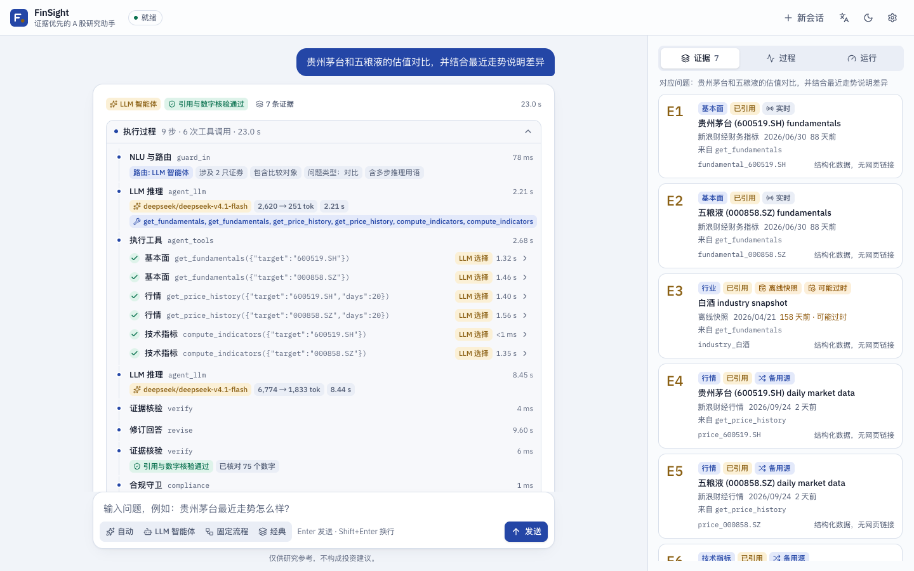
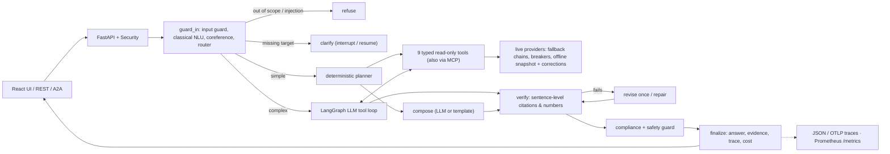
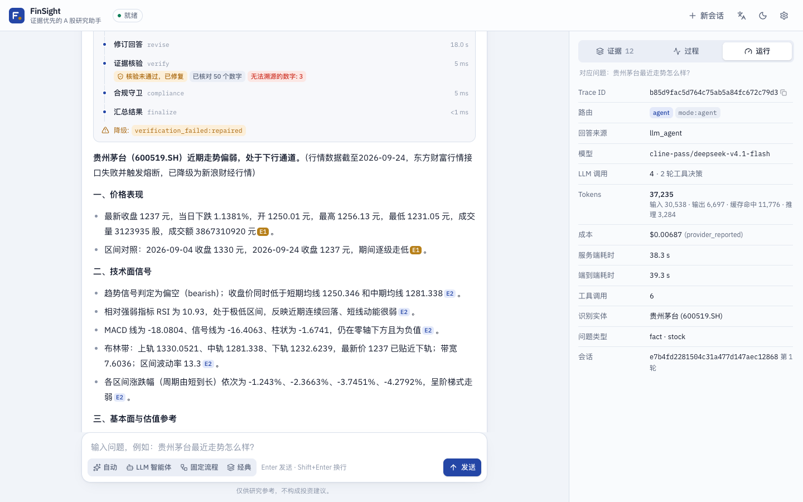
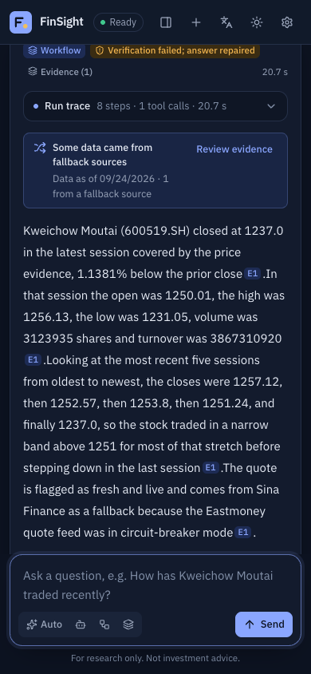

<div align="center">

# FinSight

**Evidence-first financial analysis chatbot and verified research agent with explainable Query Intelligence.**

[-b31b1b?style=flat)](https://ebooks.iospress.nl/doi/10.3233/FAIA261107)
[](https://github.com/beautifulrem/FinSight/actions/workflows/ci.yml)
[](requirements.txt)
[](docs/agent.md)
[](frontend)
[](LICENSE)

[Paper](#published-paper) ·
[Quick Start](#quick-start) ·
[Architecture](#architecture) ·
[Benchmarks](#benchmarks--verification) ·
[API](#api) ·
[Docs](#documentation) ·
[Citation](#citation) ·
[简体中文](README_CN.md)

</div>

> [!IMPORTANT]
> FinSight summarizes verifiable market, fundamental, macro, and document evidence for Chinese financial markets (A-shares, ETFs/funds, indices, sectors). It is **not** an investment adviser, issues no buy/sell or position-size instructions, and must not be used as the sole basis for trading decisions.

<p align="center">
  
</p>

## Published Paper

> **FinSight: An Evidence-First Financial Analysis Chatbot with Explainable Query Intelligence**
> Ruiqi Xie, Jiachang Zhang, Mingxi Shi, Shiyi Li, Mingyuan Gao, Zihao Yin, and Adela S.M. Lau *(The University of Hong Kong)*
> *Digitalization and Management Innovation V*, *Frontiers in Artificial Intelligence and Applications* (FAIA), Vol. 433, IOS Press, October 2026 (DMI 2026) · Open Access (`CC BY-NC 4.0`).
> [IOS Press](https://ebooks.iospress.nl/doi/10.3233/FAIA261107) · [DOI: `10.3233/FAIA261107`](https://doi.org/10.3233/FAIA261107) · [BibTeX](#citation)

This repository ships both the **published paper's classical Query Intelligence pipeline** and the **extended verified research agent** built on top of it:

| Layer | Scope & Key Modules | Contracts, Endpoints & Headline Results |
|---|---|---|
| **1. Explainable Query Intelligence** *(FAIA 2026 Paper)* | Classical NLU (`query_intelligence/nlu/`: normalization, alias/CRF/typo entity resolution, TF-IDF + linear/tree classifiers, OOS & clarification gates, source planner), hybrid retrieval & `MarketAnalyzer` (`query_intelligence/retrieval/`), FinBERT document sentiment (`sentiment/`), and constrained LLM handoff (`scripts/llm_response.py`, `query_intelligence/chat/`). | Typed `NLUResult` and `RetrievalResult` contracts (`POST /nlu/analyze`, `/retrieval/search`, `/query/intelligence`, `/chat`). **10,000** bilingual queries: **0.975** finance recall, **0.9729** OOS rejection accuracy, **0.9407** intent micro-F1, **0.9208** topic micro-F1, **0.9664** Recall@10, **32/32** fuzz contract checks ([docs/query-intelligence.md](docs/query-intelligence.md)). |
| **2. Verified Research Agent Platform** *(Post-Paper Extension)* | LangGraph tool loop + deterministic planner fallback (`query_intelligence/agent/`), 9 typed read-only evidence tools with live multi-source circuit breakers & provenance (`integrations/sources/`), sentence-level numeric claim verifier (`agent/verifier.py`), LLM-free market claim checker (`agent/claim_check.py`), MCP & A2A servers, Postgres checkpoints, observability stack, and React 19 UI (`frontend/`). | `POST /agent/chat`, `/agent/chat/stream` (SSE), `/agent/resume`, `/agent/claim-check`, `/a2a`, and MCP (`query_intelligence.agent.mcp_server`). **0.869** strict citation-gated pass rate on untouched Test v3; **0.92%** verifier false-accept rate across 5,631 corrupted answers ([docs/agent.md](docs/agent.md), [docs/agent-eval.md](docs/agent-eval.md)). |

## Why FinSight

- **Strict separation of evidence and narration**: Classical, inspectable NLU and retrieval produce typed `evidence_id` artifacts; no vector database or black-box LLM replaces routing, entity resolution, or out-of-scope guards.
- **Sentence-level numeric verification**: Every number in an answer must trace to an `evidence_id` cited in *that same sentence* (unit-, scale-, precision-, and sign-aware). Unverifiable claims trigger one targeted revision and are stripped if still unsupported.
- **Zero-key deterministic fallback**: Without an LLM API key—or on provider timeout, budget exhaustion, or outage—the same LangGraph workflow runs end-to-end on a deterministic planner and cited template composer.
- **Defense in depth against untrusted documents**: All 9 tools are read-only; retrieved text is wrapped as untrusted data and filtered for prompt injection, planted figures, foreign-listing lookalikes, future-price forecasts, and investment-advice wording.
- **Service-ready operations**: Ships with SSE streaming, Postgres-backed multi-replica sessions/rate-limits/traces, MCP & A2A 1.0 protocol support, Prometheus + Grafana + Jaeger observability, hardened Docker/Kubernetes manifests, and a bilingual React 19 UI.

## Quick Start

### Local API & Web UI (Python 3.13)

```bash
pip install -r requirements.txt
uvicorn query_intelligence.api.app:create_app --factory --port 8765
# Open http://127.0.0.1:8765
```

### Query Intelligence CLI (Paper Core)

Inspect raw `NLUResult` and `RetrievalResult` JSON artifacts directly without starting a server:

```bash
python manual_test/run_manual_query.py --query "你觉得中国平安怎么样？"
```

### Enable an LLM (Optional)

Without an API key, FinSight answers via the deterministic path. To enable the LLM agent loop, configure any OpenAI-compatible endpoint via environment variables:

```bash
export DEEPSEEK_API_KEY=...
export DEEPSEEK_BASE_URL=https://api.deepseek.com
export DEEPSEEK_MODEL=deepseek-v4-flash
```

Live market, news, announcement, and macro sources are enabled by default with automatic offline fallback. To run strictly against the shipped offline snapshot + corrections layer, set `QI_USE_LIVE_MARKET=0`, `QI_USE_LIVE_NEWS=0`, `QI_USE_LIVE_ANNOUNCEMENT=0`, and `QI_USE_LIVE_MACRO=0` (see [docs/data-sources.md](docs/data-sources.md)).

### Docker

```bash
TAG=$(git rev-parse --short=7 HEAD)
docker build -f docker/Dockerfile -t finsight:$TAG .
docker run -d --name finsight -p 8000:8000 finsight:$TAG   # add -e DEEPSEEK_API_KEY=... for LLM mode
curl http://127.0.0.1:8000/ready
```

For Kubernetes (`deploy/k8s/`), TLS, Postgres sessions, and the Prometheus/Grafana/Jaeger monitoring stack, see [docs/deployment.md](docs/deployment.md).

## Architecture



Sessions persist as LangGraph checkpoints (memory, SQLite, or Postgres), enabling interrupt/resume clarification and stateless multi-replica scaling scoped per caller API key or signed anonymous cookie.

<details>
<summary><b>Repository Layout</b></summary>

```text
FinSight/
├── query_intelligence/
│   ├── nlu/            # Classical NLU: normalization, alias/CRF/typo resolution, classifiers, source planner
│   ├── retrieval/      # Query builder, hybrid document/structured retrieval, LTR ranker, MarketAnalyzer
│   ├── agent/          # LangGraph graph, 9 typed tools, claim verifier, claim-check, MCP & A2A servers
│   ├── integrations/   # Live Tushare / AKShare / Cninfo / efinance providers, breakers & provenance
│   ├── api/            # FastAPI routes, API-key & cookie auth, body limits, rate limiting, SSE streaming
│   └── contracts.py    # Pydantic contracts for NLUResult, RetrievalResult, and Agent payloads
├── sentiment/          # Downstream per-sentence FinBERT & offline classical sentiment classifier
├── frontend/           # React 19 + TypeScript bilingual workspace (built bundle in query_intelligence/web/dist)
├── evaluation/         # Reproducible benchmarks, claim_bench, verifier stress, red-team & held-out slices
├── data/ & models/     # Shipped offline snapshot + corrections layer, runtime lexicons & verified models
├── schemas/            # Exported JSON Schemas (nlu_result, retrieval_result, agent_*)
├── deploy/ & docker/   # Multi-stage Dockerfile, Compose profiles, Kubernetes kustomize & kind smoke test
└── scripts/ & training/# Training pipeline, LLM handoff, load/chaos scripts, CI budget & prepush tools
```

</details>

## API

| Endpoint | Purpose |
|---|---|
| `POST /agent/chat`, `/agent/chat/stream` (SSE), `/agent/resume` | Verified agent answer with evidence ledger, trace ID, and cost; streaming; clarification resume |
| `POST /agent/claim-check` | LLM-free numeric fact-check for a pasted financial claim (e.g. `"茅台市盈率只有15倍"`) |
| `GET /agent/traces/{id}`, `/agent/sessions/{id}` | Caller-scoped run trace and session memory |
| `GET /.well-known/agent-card.json`, `POST /a2a` | A2A 1.0 agent discovery card and JSON-RPC endpoint |
| `GET /health`, `/ready`, `/metrics` | Liveness, readiness (checkpointer, models, offline data layers), and Prometheus metrics |
| `POST /query/intelligence`, `/nlu/analyze`, `/retrieval/search`, `/chat` | Paper-core Query Intelligence pipeline (`NLUResult` + `RetrievalResult`) and classic chatbot |

Full endpoint specs and schemas (`schemas/*.schema.json`) are documented in [docs/features.md](docs/features.md#api).

<p align="center">
  
  &nbsp;
  
</p>

## Benchmarks & Verification

All metrics come from committed, reproducible runs in [`evaluation/results/`](evaluation/results/) with commit hash, model, prompt hash, and command recorded. Agent evaluation uses strict dealbreaker scoring (correct action, every required fact stated *and* cited, required tools called, judgment hedged, zero trading instructions).

| Benchmark | Headline Result | Source |
|---|---|---|
| **Paper Query Intelligence** (10,000 bilingual queries) | Finance recall **0.975**, OOS accuracy **0.9729**, intent F1 **0.9407**, topic F1 **0.9208**, Recall@10 **0.9664** | [FAIA 2026](https://ebooks.iospress.nl/doi/10.3233/FAIA261107) · [docs/query-intelligence.md](docs/query-intelligence.md) |
| **Independent Test v3** (130 tasks, untouched first run, DeepSeek) | Agent **0.869** [0.81, 0.92], LLM composition 0.831, deterministic workflow 0.769, no-tool LLM 0/130 | [docs/agent-eval.md](docs/agent-eval.md#test-set-v3-independent-author-untouched-first-runs) |
| **Verifier Stress Test** (333 gold, 5,631 corrupted answers) | False-accept **0.92%** strict (1.05% with derived numbers), **100%** true-accept, **0.0%** cross-company swap | [docs/agent-eval.md](docs/agent-eval.md#verifier-stress-test-333-gold-answers-5631-corrupted-variants-verifier_stress-round18json) |
| **Prompt-Injection Red Team** (16 attack sets) | Template path **0 / 3,796** successes; latest targeted LLM slice (holdout13): **0/16** agent, **0/13** composition | [docs/agent-eval.md](docs/agent-eval.md#prompt-injection-red-team-offline-template-path-after-round-18-all-sixteen-sets-ci-baseline) |
| **Latency & Chaos Load** | DeepSeek P95 **15.4 s** (~3 s TTFT); **0 errors** in 400 requests (8 users) under blocked live upstreams | [docs/performance.md](docs/performance.md) |
| **Offline CI Gates** | Dev (558) **1.000**, held-out (53) **0.943**, ext (123) **1.000**, shipped default (21) **1.000** | [docs/agent-eval.md](docs/agent-eval.md#offline-gate-baselines-ci-compares-against-these) |

<details>
<summary><b>Auto-Generated Evaluation Ledger, CI Status &amp; Known Limits</b></summary>

### Highlights

<!-- generated:pitch (python -m evaluation.agent_eval.readme) -->
- **Numbers you can trace.** A claim-level verifier ties every number to the evidence cited in its sentence. On 5,631 corrupted answers it wrongly accepts **0.92%** (1.05% with derived numbers allowed, the default), and it accepts all 333 correct ones ([verifier stress test](docs/agent-eval.md#verifier-stress-test-333-gold-answers-5631-corrupted-variants-verifier_stress-round18json), round 18, `3e1008d`).
- **Measured on a set nobody tuned against.** On test v3 (130 tasks by a separate author, first LLM run), the DeepSeek agent passes **0.869** [0.81, 0.92] under strict, citation-gated scoring. The deterministic workflow passes 0.769 and an LLM without tools passes 0/130 ([test v3](docs/agent-eval.md#test-set-v3-independent-author-untouched-first-runs)).
- **Out of sample after the fixes, with the overlap counted.** Each reviewer writes a held-out slice from the bugs they found, before any fix. The latest slice (round 14) went **0.160 → 0.740** after one round of fixes (8/50 → 37/50 chat tasks; claims 0.542 → 0.917), the two before **0.413 → 0.978** and **0.320 → 0.840**. The latest still holds with the tasks that overlap our own wording removed: 35/48 by text, 28/40 by content and 17/22 by content signature ([provenance](evaluation/heldout_r14/README.md#before-the-after-fix-run)).
- **First runs are reported, not replaced.** Every independent set keeps its first-run number next to any later "after exposure" one. For example, a fresh router label set scored 0.801 on its first run, and a blind set of real claims 0.500 ([history](docs/evaluation-history.md#independent-sets-first-runs-vs-after-exposure)).
- **Runs like a service.** It works without an LLM, and every LLM call is bounded by a run deadline. It has been load- and chaos-tested and runs on k3s with Postgres-shared sessions. It speaks MCP and A2A and ships with Prometheus, Grafana and Jaeger ([performance](docs/performance.md), [deployment](docs/deployment.md)).
<!-- /generated:pitch -->

### Full Benchmark Table

<!-- generated:headline-table (python -m evaluation.agent_eval.readme) -->
| What | Result | Evidence |
|---|---|---|
| Test v3: 130 tasks by a separate author, first LLM run, DeepSeek | Agent **0.869** [0.81, 0.92], LLM composition 0.831, deterministic workflow 0.769, LLM without tools 0/130. Agent vs workflow +0.100 [+0.049, +0.156], McNemar p = 0.007. Agent vs composition is not significant on pass^3. | [`ablation-final4-deepseek-testv3-holdout.json`](docs/agent-eval.md#test-set-v3-independent-author-untouched-first-runs) |
| Verifier stress (round 18, `3e1008d`): 333 correct answers, 5,631 corrupted ones | Corrupted answers accepted: **0.92%** (1.05% with derived numbers allowed, the default). Correct answers accepted: 100%. Numbers swapped in from another company: 0.0% accepted (0.56% with derived numbers). | [`verifier_stress-round18.json`](docs/agent-eval.md#verifier-stress-test-333-gold-answers-5631-corrupted-variants-verifier_stress-round18json) |
| Latest reviewer slice (round 14): 50 chat tasks and 24 claims, run once before and once after one round of fixes | Chat **0.160 → 0.740**, claims 0.542 → 0.917. Without overlapping tasks: 7/48 → 35/48 (text), 4/40 → 28/40 (+ content), 2/22 → 17/22 (+ signature) | [`chat_heldout_r14-auto-nollm-after-fix.json`](docs/agent-eval.md#round-14-held-out-chat-slice-independent-author-before-and-after-the-round-18-fixes), [`slice_overlap-heldout_r14-at-f20c6c3.json`](evaluation/heldout_r14/README.md#before-the-after-fix-run) |
| Previous reviewer slice (round 13): 46 chat tasks and 22 claims, run once before and once after one round of fixes | Chat **0.413 → 0.978**, claims 0.636 → 1.000. Without overlapping tasks: 18/44 → 43/44 (text), 15/39 → 38/39 (+ content), 11/27 → 26/27 (+ signature) | [`chat_heldout_r13-auto-nollm-after-fix.json`](docs/agent-eval.md#round-13-held-out-chat-slice-independent-author-before-and-after-the-round-17-fixes), [`slice_overlap-heldout_r13-at-71cb928.json`](evaluation/heldout_r13/README.md#committed-to-the-repository-after-the-round-17-fixes) |
| Earlier reviewer slice (round 12): 50 chat tasks and 26 claims, run once before and once after one round of fixes | Chat **0.320 → 0.840**, claims 0.423 → 0.923. Without overlapping tasks: 16/49 → 42/49 (text), 14/43 → 37/43 (+ content), 14/35 → 31/35 (+ signature) | [`chat_heldout_r12-auto-nollm-after-fix.json`](docs/agent-eval.md#round-12-held-out-chat-slice-independent-author-before-and-after-the-round-16-fixes), [`slice_overlap-heldout_r12-at-9564263.json`](evaluation/heldout_r12/README.md#committed-to-the-repository-after-the-round-16-fixes) |
| Earlier reviewer slices (chat, first run → after one round of fixes) | Round 6: 0.579 → 0.816; round 7: 0.264 → 0.830; round 8: 0.275 → 0.686; round 9: 0.346 → 0.788; round 10: 0.250 → 0.792; round 11: 0.200 → 0.733. | [evaluation history](docs/evaluation-history.md#independent-sets-first-runs-vs-after-exposure) |
| Independent router labels (241 queries, fresh set) | 0.801 on the first run; 0.842 after exposure | [`router_eval-independent_v2-first-run.json`](docs/agent-eval.md#router-label-sets) |
| Real published claims collected blind to the checker, set v2 (50) | 0.500 [0.36, 0.64] on the first run (`117e74b`); 0.840 after exposure (round-18 checker) | [`claims_web_v2-first-run.json`](evaluation/real_claims_web_v2/README.md) |
| Real published claims collected blind to the checker, set v3 (50) | 0.540 [0.40, 0.68] on the first run (`7ea8f5d`); 0.880 after exposure (round-18 checker) | [`claims_web_v3-first-run.json`](evaluation/real_claims_web_v3/README.md) |
| Real published claims collected blind to the checker, set v4 (50) | 0.740 [0.62, 0.86] on the first run (`110e656`); 0.780 after exposure (round-18 checker) | [`claims_web_v4-first-run.json`](evaluation/real_claims_web_v4/README.md) |
| Real published claims collected blind to the checker, set v5 (50) | 0.680 [0.56, 0.80] on the first run (`c795172`); 0.680 after exposure (round-18 checker) | [`claims_web_v5-first-run.json`](evaluation/real_claims_web_v5/README.md) |
| Real published claims collected blind to the checker, set v6 (60) | 0.650 [0.52, 0.77] on the first run (`642ead2`); 0.650 after exposure (round-18 checker) | [`claims_web_v6-first-run.json`](evaluation/real_claims_web_v6/README.md) |
| Prompt injection planted in documents | Template path: 0 successes on all 16 attack sets (3,796 runs). LLM paths: 0–3.4% of payloads stated as fact per set in the last full run (`0473968`); on the latest targeted set (holdout13) agent 0/16, composition 0/13 | [`redteam-offline-r18.json`](docs/agent-eval.md#prompt-injection-red-team-offline-template-path-after-round-18-all-sixteen-sets-ci-baseline), [`redteam-r8-llm.json`](docs/agent-eval.md#prompt-injection-red-team-llm-paths-after-round-8-0473968), [`redteam-r16-holdout13-llm.json`](docs/agent-eval.md#prompt-injection-red-team-llm-paths-on-holdout13-round-12-reviewers-styles-in-round-16) |
| Latency and load | DeepSeek agent P95 15.4 s (held-out); first token after about 3 s. 0 errors in 400 requests from 8 users during a source chaos drill (no LLM) | [performance.md](docs/performance.md) |
| CI gates against committed baselines | dev 558 tasks 1.000, held-out 53 0.943, ext 123 1.000, shipped default 21 1.000 | [gate baselines](docs/agent-eval.md#offline-gate-baselines-ci-compares-against-these) |
<!-- /generated:headline-table -->

### CI & Pre-Push Status

<!-- generated:ci-status (python -m evaluation.agent_eval.readme) -->
Before a push to `master`, [`scripts/prepush.sh`](scripts/prepush.sh) runs every CI step locally ([docs/development.md](docs/development.md)). The latest committed summary is [`prepush-cf36ec5.md`](docs/results/ci/prepush-cf36ec5.md) (`cf36ec5`, 2026-10-14, every step passed): pytest 4,891 passed, 71 skipped; again on the shipped default data (extension and corrections on, seed-pinned tests deselected): 4,789 passed, 70 skipped, 103 deselected. The latest recorded CI run on `master` is [38113129617](https://github.com/beautifulrem/FinSight/actions/runs/38113129617): green, all 10 jobs, at `aa73005` (recorded 2026-10-11 in [`ci-run-aa73005.json`](docs/results/ci/ci-run-aa73005.json) by `python scripts/record_ci_run.py` from the GitHub API); the job closest to its timeout, `agent-eval-extras`, took 28.9 of its 60 min. The badge at the top shows the current state of `master`. The pre-push check fails a step whose job would exceed 60% of its timeout ([CI time budgets](docs/development.md#ci-time-budgets)). How CI runs and how the human-evaluation kit works is described in [docs/evaluation-history.md](docs/evaluation-history.md#ci-the-pre-push-check-and-the-human-evaluation-kit).
<!-- /generated:ci-status -->

### Known Limits

<!-- generated:limits (python -m evaluation.agent_eval.readme) -->
- **Few unexposed sets.** Each reviewer slice is out of sample for exactly one round of fixes. The slices are small (38–60 chat tasks), and part of each one repeats our own test wording, as the overlap counts above show. That the engineers did not open a slice before its after-fix run is their statement. The run read the slice from the reviewer's folder, and nothing records file access ([provenance](evaluation/heldout_r10/README.md#provenance-of-the-after-fix-run-what-the-record-shows-round-11-review-k16)).
- **Comparisons generalise by lexicon.** The comparison grammar decides the operation from word classes that are regular expressions. Wordings outside those classes are still missed: on the latest slice (round 14), 13 of 50 chat tasks still fail after the fixes ([per class](docs/agent-eval.md#round-14-held-out-chat-slice-independent-author-before-and-after-the-round-18-fixes)).
- **Routing misses about 20% of fresh questions** (0.801 on the first run of a fresh independent label set, 0.842 after exposure).
- **The agent loop is only slightly better than LLM composition.** With DeepSeek it is ahead per run but not on pass^3. With GLM the two are tied, and the agent costs 1.1–4x as much.
- **The verifier proves traceability, not truth.** A fake price planted inside a news excerpt passes the check, because it *is* in the evidence.
- **The LLM paths still sometimes state planted document content.** The output layer attributes or removes what it recognises; it cannot stop the model from mentioning a payload.
- **Some results need the owner.** There are no human answer labels, no head-to-head against 问财 / 豆包 / Kimi, no user study and no owner-collected claims yet. The [kit](evaluation/human/README.md) is ready.
<!-- /generated:limits -->

Full caveats and per-round evaluation history live in [docs/evaluation-history.md](docs/evaluation-history.md) and [docs/known-issues.md](docs/known-issues.md).

</details>

<details>
<summary><b>Reproducible Verification Commands</b></summary>

```bash
python -m pytest -q tests                                  # offline test suite
QI_TEST_SHIPPED_DEFAULT=1 python -m pytest -q tests        # shipped default snapshot + corrections
scripts/prepush.sh                                         # full local CI mirror + time-budget check
python -m evaluation.agent_eval.gate                       # offline gate baselines (dev/holdout/ext/shipped)
python -m evaluation.agent_eval.verifier_stress            # verifier false-accept stress test
python -m evaluation.agent_eval.redteam --llm deepseek     # prompt-injection red team
python -m evaluation.agent_eval.report --check             # verify docs/agent-eval.md & README regions
```

</details>

## Documentation

| Topic | English | 中文 |
|---|---|---|
| Documentation Index & Module Map | [index.md](docs/index.md) · [modules.md](docs/modules.md) | [index.md](docs/zh/index.md) · [modules.md](docs/zh/modules.md) |
| Query Intelligence Core (Paper) | [query-intelligence.md](docs/query-intelligence.md) | [query-intelligence.md](docs/zh/query-intelligence.md) |
| Research Agent, Tools & Guardrails | [agent.md](docs/agent.md) · [features.md](docs/features.md) | [agent.md](docs/zh/agent.md) · [features.md](docs/zh/features.md) |
| Claim Check & Data Sources | [claim-check.md](docs/claim-check.md) · [data-sources.md](docs/data-sources.md) | [claim-check.md](docs/zh/claim-check.md) · [data-sources.md](docs/zh/data-sources.md) |
| Technical Analysis, Sentiment & Handoff | [numerical-analysis.md](docs/numerical-analysis.md) · [sentiment.md](docs/sentiment.md) · [llm-response.md](docs/llm-response.md) | [numerical-analysis.md](docs/zh/numerical-analysis.md) · [sentiment.md](docs/zh/sentiment.md) · [llm-response.md](docs/zh/llm-response.md) |
| Web UI, MCP, A2A & Observability | [frontend-chatbot.md](docs/frontend-chatbot.md) · [mcp.md](docs/mcp.md) · [a2a-and-observability.md](docs/a2a-and-observability.md) | [frontend-chatbot.md](docs/zh/frontend-chatbot.md) · [mcp.md](docs/zh/mcp.md) · [a2a-and-observability.md](docs/zh/a2a-and-observability.md) |
| Deployment, Performance & Development | [deployment.md](docs/deployment.md) · [performance.md](docs/performance.md) · [development.md](docs/development.md) | [deployment.md](docs/zh/deployment.md) · [performance.md](docs/zh/performance.md) · [development.md](docs/zh/development.md) |
| Training & Evaluation | [training.md](docs/training.md) · [agent-eval.md](docs/agent-eval.md) · [evaluation-history.md](docs/evaluation-history.md) | [training.md](docs/zh/training.md) · [evaluation.md](docs/zh/evaluation.md) · [evaluation-history.md](docs/zh/evaluation-history.md) |
| Known Issues & Product Comparison | [known-issues.md](docs/known-issues.md) · [comparison.md](docs/comparison.md) | [known-issues.md](docs/zh/known-issues.md) · [comparison.md](docs/zh/comparison.md) |
| Independent Reviews & Human Kit | [docs/reviews/](docs/reviews/README.md) · [evaluation/human/](evaluation/human/README.md) | [docs/presentation/](docs/presentation/README.md) |

## Citation

Machine-readable metadata is also shipped in [`CITATION.cff`](CITATION.cff) (GitHub **Cite this repository**):

```bibtex
@incollection{xie2026finsight,
  title     = {FinSight: An Evidence-First Financial Analysis Chatbot with Explainable Query Intelligence},
  author    = {Xie, Ruiqi and Zhang, Jiachang and Shi, Mingxi and Li, Shiyi and Gao, Mingyuan and Yin, Zihao and Lau, Adela S.M.},
  booktitle = {Digitalization and Management Innovation V},
  series    = {Frontiers in Artificial Intelligence and Applications},
  volume    = {433},
  publisher = {IOS Press},
  year      = {2026},
  month     = oct,
  isbn      = {978-1-64368-695-0},
  issn      = {0922-6389},
  doi       = {10.3233/FAIA261107},
  url       = {https://ebooks.iospress.nl/doi/10.3233/FAIA261107}
}
```

## Contributing, Security & License

- **Contributing**: See [CONTRIBUTING.md](CONTRIBUTING.md) and [docs/development.md](docs/development.md).
- **Security**: Report vulnerabilities privately per [SECURITY.md](SECURITY.md).
- **License**: [MIT](LICENSE)
