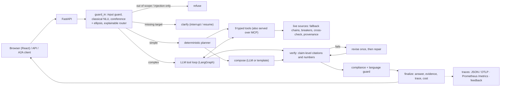

<div align="center">

<h1>FinSight</h1>

<h3>Evidence-first research agent for China A-shares.</h3>

<p>
  <a href="README.md"></a>
  <a href="README_CN.md"></a>
  <a href="LICENSE"></a>
  <a href="https://github.com/beautifulrem/FinSight/actions/workflows/ci.yml"></a>
  
  
  
  
</p>

</div>

---

FinSight answers questions about Chinese listed companies, funds, indices and macro data. A classical, explainable NLU front end routes and guards every question. An LLM orchestrates typed evidence tools in a LangGraph loop. **Every number in the answer is checked by code against the evidence cited in the same sentence**, and a compliance guard then removes anything that reads like investment advice. Without an LLM key, the same graph runs on a deterministic planner.

## In 30 seconds

<!-- generated:pitch (python -m evaluation.agent_eval.readme) -->
- **Numbers you can trace.** A claim-level verifier ties every number to the evidence cited in its sentence. On 5,597 corrupted answers it wrongly accepts **0.93%** (1.05% with derived numbers allowed, the default), and it accepts all 329 correct ones ([verifier stress test](docs/agent-eval.md#verifier-stress-test-329-gold-answers-5597-corrupted-variants-verifier_stress-round16json), round 16, `d3b5cc2`).
- **Measured on a set nobody tuned against.** On test v3 (130 tasks by a separate author, first LLM run), the DeepSeek agent passes **0.869** [0.81, 0.92] under strict, citation-gated scoring. The deterministic workflow passes 0.769 and an LLM without tools passes 0/130 ([test v3](docs/agent-eval.md#test-set-v3-independent-author-untouched-first-runs)).
- **Out of sample after the fixes, with the overlap counted.** Each reviewer writes a held-out slice from the bugs they found, before any fix. The latest slice (round 12) went **0.320 → 0.840** after one round of fixes (16/50 → 42/50 chat tasks; claims 0.423 → 0.923), the two before **0.200 → 0.733** and **0.250 → 0.792**. The latest still holds with the tasks that overlap our own wording removed: 42/49 by text, 37/43 by content and 31/35 by content signature ([provenance](evaluation/heldout_r12/README.md#committed-to-the-repository-after-the-round-16-fixes)).
- **First runs are reported, not replaced.** Every independent set keeps its first-run number next to any later "after exposure" one. For example, a fresh router label set scored 0.801 on its first run, and a blind set of real claims 0.500 ([history](docs/evaluation-history.md#independent-sets-first-runs-vs-after-exposure)).
- **Runs like a service.** It works without an LLM, and every LLM call is bounded by a run deadline. It has been load- and chaos-tested and runs on k3s with Postgres-shared sessions. It speaks MCP and A2A and ships with Prometheus, Grafana and Jaeger ([performance](docs/performance.md), [deployment](docs/deployment.md)).
<!-- /generated:pitch -->

<p align="center"></p>

## Why it is built this way

| Decision | Reason | Where |
|---|---|---|
| Classical NLU routes; an LLM orchestrates | Routing and guarding must be explainable and cheap, so the LLM is used only where it adds value: choosing tools and writing. A fixed workflow handles simple questions; the LLM loop handles comparisons, "why" questions and multi-hop ones. Every routing decision is logged as a reason. | `agent/router.py`, `agent/graph.py` |
| Claim-level number verification | A number must appear in the evidence cited in *its own sentence*, matched with awareness of units, precision and sign. An unverifiable sentence goes back to the LLM for one revision; if it still fails, it is deleted. | `agent/verifier.py` |
| Deterministic fallback everywhere | No key, a provider outage, an exhausted budget or a passed deadline all fall back to the planner + template answer, which is still cited and verified. | `agent/planner.py`, `agent/llm.py` |
| Evidence as untrusted data | Tool output is wrapped, normalised and filtered for injected instructions; the user's own message goes through an input guard; all tools are read-only. | `agent/injection.py` |

## Architecture



Sessions are LangGraph checkpoints (memory, SQLite or Postgres). This lets a clarification pause a run, and lets any replica continue a conversation. Each session is scoped to the API key that created it. See [docs/agent.md](docs/agent.md).

The main pieces:

- **Tools.** Nine typed evidence tools cover entity resolution, prices, technical indicators, fundamentals, macro data, news, announcements, knowledge search and sentiment. Each has a Pydantic schema, a timeout and retries.
- **Claim check.** `POST /agent/claim-check` checks the numbers in a pasted claim, such as "茅台市盈率只有15倍", against the data, with no LLM involved.
- **Data.** Live sources sit behind fallback chains and circuit breakers. An offline snapshot with a corrections layer carries primary-source values.
- **Operations.** Every run leaves a trace, and the service exports Prometheus metrics.
- **Web UI.** React 19 with a live progress panel, an evidence ledger, KPI tiles, zh/en and dark mode.

The full list is in [docs/features.md](docs/features.md).

## Quick start

**Local** (Python 3.13):

```bash
pip install -r requirements.txt
uvicorn query_intelligence.api.app:create_app --factory --port 8765   # open http://127.0.0.1:8765
```

Without a key, answers come from the deterministic path. To enable the LLM agent, point it at any OpenAI-compatible endpoint:

```bash
export DEEPSEEK_API_KEY=...                      # read from the environment, never from the config file
export DEEPSEEK_BASE_URL=https://api.deepseek.com # or a gateway, e.g. https://api.cline.bot/api/v1
export DEEPSEEK_MODEL=deepseek-v4-flash
```

Live market, news, announcement and macro sources are on by default. To use only the shipped offline snapshot (as of 2026-04-22 and 2026-09-30, with the corrections layer), set `QI_USE_LIVE_MARKET=0`, and do the same for `_NEWS`, `_ANNOUNCEMENT` and `_MACRO` ([data-sources.md](docs/data-sources.md#what-is-live-what-is-snapshot-and-the-fallback-order)).

**Docker:**

```bash
TAG=$(git rev-parse --short=7 HEAD)
docker build -f docker/Dockerfile -t finsight:$TAG .
docker run -d --name finsight -p 8000:8000 finsight:$TAG    # add -e DEEPSEEK_API_KEY=... for the LLM path
curl http://127.0.0.1:8000/ready                            # lists the offline data layers it loaded
```

Kubernetes and the monitoring stack: [docs/deployment.md](docs/deployment.md).

**Web UI:** open the server's root URL (run details, mobile, dark mode, English shown below).

<p align="center">
  
  
</p>

## What is measured and how

Scoring is strict ("dealbreaker"). A task succeeds only if all of these hold:

- the behaviour is right (answer, clarify or refuse);
- every required fact is stated **and** cited;
- the required tools were used;
- judgment questions are hedged;
- no trading instruction appears.

Online runs repeat every task 3 times. Every rate has a 95% bootstrap CI, and paths are compared with a paired bootstrap and an exact McNemar test. Each number below comes from a committed file in [`evaluation/results/`](evaluation/results/), which records the commit, prompt hashes, model and command of its run.

<!-- generated:headline-table (python -m evaluation.agent_eval.readme) -->
| What | Result | Evidence |
|---|---|---|
| Test v3: 130 tasks by a separate author, first LLM run, DeepSeek | Agent **0.869** [0.81, 0.92], LLM composition 0.831, deterministic workflow 0.769, LLM without tools 0/130. Agent vs workflow +0.100 [+0.049, +0.156], McNemar p = 0.007. Agent vs composition is not significant on pass^3. | [`ablation-final4-deepseek-testv3-holdout.json`](docs/agent-eval.md#test-set-v3-independent-author-untouched-first-runs) |
| Verifier stress (round 16, `d3b5cc2`): 329 correct answers, 5,597 corrupted ones | Corrupted answers accepted: **0.93%** (1.05% with derived numbers allowed, the default). Correct answers accepted: 100%. Numbers swapped in from another company: 0.0% accepted (0.57% with derived numbers). | [`verifier_stress-round16.json`](docs/agent-eval.md#verifier-stress-test-329-gold-answers-5597-corrupted-variants-verifier_stress-round16json) |
| Latest reviewer slice (round 12): 50 chat tasks and 26 claims, run once before and once after one round of fixes | Chat **0.320 → 0.840**, claims 0.423 → 0.923. Without overlapping tasks: 16/49 → 42/49 (text), 14/43 → 37/43 (+ content), 14/35 → 31/35 (+ signature) | [`chat_heldout_r12-auto-nollm-after-fix.json`](docs/agent-eval.md#round-12-held-out-chat-slice-independent-author-before-and-after-the-round-16-fixes), [`slice_overlap-heldout_r12-at-9564263.json`](evaluation/heldout_r12/README.md#committed-to-the-repository-after-the-round-16-fixes) |
| Previous reviewer slice (round 11): 60 chat tasks and 24 claims, run once before and once after one round of fixes | Chat **0.200 → 0.733**, claims 0.292 → 0.792. Without overlapping tasks: 12/58 → 42/58 (text), 11/55 → 39/55 (+ content), 9/44 → 32/44 (+ signature) | [`chat_heldout_r11-auto-nollm-after-fix.json`](docs/agent-eval.md#round-11-held-out-chat-slice-independent-author-before-and-after-the-round-15-fixes), [`slice_overlap-heldout_r11-at-c5ffb7d.json`](evaluation/heldout_r11/README.md#committed-to-the-repository-after-the-round-15-fixes) |
| Earlier reviewer slice (round 10): 48 chat tasks and 24 claims, run once before and once after one round of fixes | Chat **0.250 → 0.792**, claims 0.667 → 0.833. Without overlapping tasks: 12/45 → 35/45 (text), 12/42 → 32/42 (+ content), 10/29 → 24/29 (+ signature) | [`chat_heldout_r10-auto-nollm-after-fix.json`](docs/agent-eval.md#round-10-held-out-chat-slice-independent-author-before-and-after-the-round-14-fixes), [`slice_overlap-heldout_r10-content-at-3480a96.json`](evaluation/heldout_r10/README.md#committed-to-the-repository-after-the-round-14-fixes) |
| Earlier reviewer slices (chat, first run → after one round of fixes) | Round 6: 0.579 → 0.816; round 7: 0.264 → 0.830; round 8: 0.275 → 0.686; round 9: 0.346 → 0.788. | [evaluation history](docs/evaluation-history.md#independent-sets-first-runs-vs-after-exposure) |
| Independent router labels (241 queries, fresh set) | 0.801 on the first run; 0.842 after exposure | [`router_eval-independent_v2-first-run.json`](docs/agent-eval.md#router-label-sets) |
| Real published claims collected blind to the checker, set v2 (50) | 0.500 [0.36, 0.64] on the first run (`117e74b`); 0.840 after exposure (round-16 checker) | [`claims_web_v2-first-run.json`](evaluation/real_claims_web_v2/README.md) |
| Real published claims collected blind to the checker, set v3 (50) | 0.540 [0.40, 0.68] on the first run (`7ea8f5d`); 0.900 after exposure (round-16 checker) | [`claims_web_v3-first-run.json`](evaluation/real_claims_web_v3/README.md) |
| Real published claims collected blind to the checker, set v4 (50) | 0.740 [0.62, 0.86] on the first run (`110e656`); 0.780 after exposure (round-16 checker) | [`claims_web_v4-first-run.json`](evaluation/real_claims_web_v4/README.md) |
| Real published claims collected blind to the checker, set v5 (50) | 0.680 [0.56, 0.80] on the first run (`c795172`); no later run | [`claims_web_v5-first-run.json`](evaluation/real_claims_web_v5/README.md) |
| Prompt injection planted in documents | Template path: 0 successes on all 14 attack sets (3,176 runs). LLM paths: 0–3.4% of payloads stated as fact per set in the last full run (`0473968`); on the latest targeted set (holdout13) agent 0/16, composition 0/13 | [`redteam-offline-r16.json`](docs/agent-eval.md#prompt-injection-red-team-offline-template-path-after-round-16-all-fourteen-sets-ci-baseline), [`redteam-r8-llm.json`](docs/agent-eval.md#prompt-injection-red-team-llm-paths-after-round-8-0473968), [`redteam-r16-holdout13-llm.json`](docs/agent-eval.md#prompt-injection-red-team-llm-paths-on-holdout13-round-12-reviewers-styles-in-round-16) |
| Latency and load | DeepSeek agent P95 15.4 s (held-out); first token after about 3 s. 0 errors in 400 requests from 8 users during a source chaos drill (no LLM) | [performance.md](docs/performance.md) |
| CI gates against committed baselines | dev 538 tasks 1.000, held-out 53 0.943, ext 99 1.000, shipped default 21 1.000 | [gate baselines](docs/agent-eval.md#offline-gate-baselines-ci-compares-against-these) |
<!-- /generated:headline-table -->

More detail:

- Per-round tables, the per-class results of every reviewer slice and every other measurement are in [docs/evaluation-history.md](docs/evaluation-history.md).
- The generated page with all paired comparisons is [docs/agent-eval.md](docs/agent-eval.md).
- A Chinese summary is in [docs/zh/evaluation.md](docs/zh/evaluation.md).

Run the checks yourself:

```bash
python -m pytest -q tests                                  # offline; live sources off unless QI_TEST_LIVE=1
QI_TEST_SHIPPED_DEFAULT=1 python -m pytest -q tests        # again on the shipped default data (docs/development.md)
scripts/prepush.sh                                         # everything CI runs, locally, before a push (docs/development.md)
python -m evaluation.agent_eval.gate                       # replayed dev + held-out, ext and shipped sets against committed baselines
python -m evaluation.agent_eval.router_eval                # route accuracy and confusion matrix
python -m evaluation.agent_eval.ablation --llm deepseek --repeats 3 --workers 3 --sets holdout,test_v2
python -m evaluation.agent_eval.verifier_stress            # verifier false-accept rate
python -m evaluation.agent_eval.redteam --llm deepseek     # prompt-injection red team
python -m evaluation.agent_eval.fault_injection            # graceful degradation
python -m evaluation.agent_eval.report --check             # docs/agent-eval.md matches evaluation/results/
python -m scripts.load_test --base-url http://127.0.0.1:8000 --users 8
python -m scripts.chaos_drill --scenario sources           # blocked upstreams against a live server
```

<!-- generated:ci-status (python -m evaluation.agent_eval.readme) -->
Before a push to `master`, [`scripts/prepush.sh`](scripts/prepush.sh) runs every CI step locally ([docs/development.md](docs/development.md)). The latest committed summary is [`prepush-e7bf090.md`](docs/results/ci/prepush-e7bf090.md) (`e7bf090`, 2026-10-11, every step passed): pytest 4,410 passed, 71 skipped; again on the shipped default data (extension and corrections on, seed-pinned tests deselected): 4,308 passed, 70 skipped, 103 deselected. The latest recorded CI run on `master` is [38113129617](https://github.com/beautifulrem/FinSight/actions/runs/38113129617): green, all 10 jobs, at `aa73005` (recorded 2026-10-11 in [`ci-run-aa73005.json`](docs/results/ci/ci-run-aa73005.json) by `python scripts/record_ci_run.py` from the GitHub API); the job closest to its timeout, `agent-eval-extras`, took 28.9 of its 60 min. The badge at the top shows the current state of `master`. The pre-push check fails a step whose job would exceed 60% of its timeout ([CI time budgets](docs/development.md#ci-time-budgets)). How CI runs and how the human-evaluation kit works is described in [docs/evaluation-history.md](docs/evaluation-history.md#ci-the-pre-push-check-and-the-human-evaluation-kit).
<!-- /generated:ci-status -->

## Limits

<!-- generated:limits (python -m evaluation.agent_eval.readme) -->
- **Few unexposed sets.** Each reviewer slice is out of sample for exactly one round of fixes. The slices are small (38–60 chat tasks), and part of each one repeats our own test wording, as the overlap counts above show. That the engineers did not open a slice before its after-fix run is their statement. The run read the slice from the reviewer's folder, and nothing records file access ([provenance](evaluation/heldout_r10/README.md#provenance-of-the-after-fix-run-what-the-record-shows-round-11-review-k16)).
- **Comparisons generalise by lexicon.** The comparison grammar decides the operation from word classes that are regular expressions. Wordings outside those classes are still missed: on the latest slice (round 12), 8 of 50 chat tasks still fail after the fixes ([per class](docs/agent-eval.md#round-12-held-out-chat-slice-independent-author-before-and-after-the-round-16-fixes)).
- **Routing misses about 20% of fresh questions** (0.801 on the first run of a fresh independent label set, 0.842 after exposure).
- **The agent loop is only slightly better than LLM composition.** With DeepSeek it is ahead per run but not on pass^3. With GLM the two are tied, and the agent costs 1.1–4x as much.
- **The verifier proves traceability, not truth.** A fake price planted inside a news excerpt passes the check, because it *is* in the evidence.
- **The LLM paths still sometimes state planted document content.** The output layer attributes or removes what it recognises; it cannot stop the model from mentioning a payload.
- **Some results need the owner.** There are no human answer labels, no head-to-head against 问财 / 豆包 / Kimi, no user study and no owner-collected claims yet. The [kit](evaluation/human/README.md) is ready.
<!-- /generated:limits -->

The full list, with every caveat and number, is in [docs/evaluation-history.md](docs/evaluation-history.md#limits-in-full).

## Known open issues

Every review bug from round 3 onwards is listed in [docs/known-issues.md](docs/known-issues.md), with the fix commit and test for each fixed bug and a table of what is still open and why. Rows for the current round go into the table below; they are merged into that page when the round closes.

| Id | Severity | Issue | Status |
|---|---|---|---|
| K16 (round 11) | Low–Medium (eval honesty) | The round-10 slice's after-fix provenance was stated as fact ("not opened"), and only text-level overlap was counted | mostly fixed (round-12 review): the [slice README](evaluation/heldout_r10/README.md#provenance-of-the-after-fix-run-what-the-record-shows-round-11-review-k16) states what the record shows (the run read the reviewer's folder; the slice entered the repo afterwards, in `367636b`). `slice_overlap --content` adds a content-level check: round-10 chat 12/42 → 32/42, round-9 chat 16/42 → 33/42 without content overlaps. New inaccuracy (round-12 review L15), corrected in round 16: the round-11 slice README explained the exact copy of claim r11c09 by a probe file that does not contain it; the record leaves the copy unexplained ([provenance](evaluation/heldout_r11/README.md#committed-to-the-repository-after-the-round-15-fixes)) |
| K17 (round 11) | Low (UI) | The cost-basis product was written "200 × -90.5"; the freshness banner left out the valuation date; a zh turn's suggestions stayed in Chinese after switching to English | fixed (`d9d2923`, `1e2c38c`): "200 × (−90.5)"; the banner range includes 估值日; suggestions and the default disclaimer follow the UI language. Tests: `tests/test_round15_ui_nits.py`, vitest |
| K18 (round 11) | Low (docs) | The README had 18.5k words, and its 30-second pitch was five dense paragraphs | fixed: this README is a landing page; the long material moved verbatim to [docs/evaluation-history.md](docs/evaluation-history.md), [docs/known-issues.md](docs/known-issues.md) and [docs/features.md](docs/features.md) |


## API

| Endpoint | Purpose |
|---|---|
| `POST /agent/chat`, `/agent/chat/stream` (SSE), `/agent/resume` | Agent answer with evidence, verification, trace id and cost; streamed; resume after a clarification |
| `POST /agent/claim-check` | Check the numbers in a pasted claim against data (no LLM) |
| `GET /agent/traces/{id}`, `/agent/sessions/{id}` | Run trace and session memory, scoped to the caller |
| `GET /.well-known/agent-card.json`, `POST /a2a` | A2A agent card and JSON-RPC endpoint |
| `GET /metrics`, `/health`, `/ready` | Prometheus metrics, liveness, readiness (incl. the offline data layers) |
| `POST /chat`, `/nlu/analyze`, `/retrieval/search` | The original chatbot and the classical NLU and retrieval artifacts |

Every endpoint is listed in [docs/features.md](docs/features.md#api); schemas are in `schemas/agent_*.schema.json`.

## Documentation

| Topic | Link |
|---|---|
| Evaluation history: per-round tables, per-class slice results, other measurements, full limits | [docs/evaluation-history.md](docs/evaluation-history.md) |
| Known issues: every review bug, its fix and test, and what is still open | [docs/known-issues.md](docs/known-issues.md) |
| Features, the full API table and the full quick start | [docs/features.md](docs/features.md) |
| Agent layer: graph, tools, memory, API, configuration | [docs/agent.md](docs/agent.md) |
| Evaluation (generated): task sets, CIs, online ablation, second model, prompt A/B, red team, verifier stress | [docs/agent-eval.md](docs/agent-eval.md) |
| Comparison with 问财, 豆包, Kimi, Wind Alice, 妙想 | [docs/comparison.md](docs/comparison.md) |
| Human evaluation kit: answer labels, head-to-head, real claims, user study | [evaluation/human/README.md](evaluation/human/README.md) |
| A2A, model failover, gateway cost, metrics, dashboards, chaos drill | [docs/a2a-and-observability.md](docs/a2a-and-observability.md) |
| Live data sources and the offline snapshot | [docs/data-sources.md](docs/data-sources.md) |
| Performance, load and scaling | [docs/performance.md](docs/performance.md) |
| Deployment | [docs/deployment.md](docs/deployment.md) |
| Development: the pre-push check, how the shipped default is tested | [docs/development.md](docs/development.md) |
| Design notes: trade-offs, built vs reused, failure cases (Chinese) | [docs/presentation/agent-design-notes.md](docs/presentation/agent-design-notes.md) |
| Interview script: 30-second pitch, three defended numbers, a failure story, whiteboard outline (Chinese) | [docs/presentation/interview-script.md](docs/presentation/interview-script.md) |
| Claim check: rules, comparators, benchmark | [docs/claim-check.md](docs/claim-check.md) |
| Agent and prompt-engineering practice research | [docs/research/agent-architecture-practices-2026.md](docs/research/agent-architecture-practices-2026.md) |
| Query Intelligence (classical NLU and retrieval) | [docs/query-intelligence.md](docs/query-intelligence.md) |
| Web UI | [docs/frontend-chatbot.md](docs/frontend-chatbot.md) |
| All pages | [docs/index.md](docs/index.md) |

## Safety

FinSight summarises evidence. It is not an investment adviser and must not be the sole basis for trading decisions.
