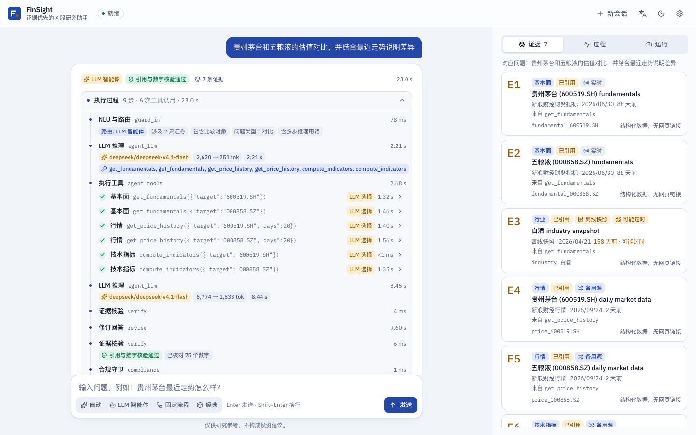
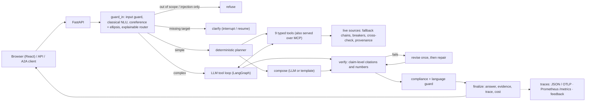
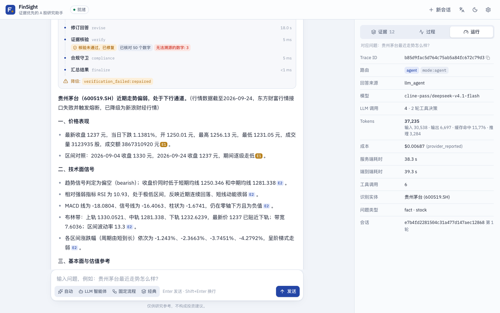
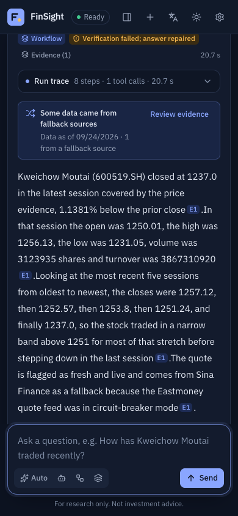

<div align="center">

<h1>FinSight</h1>

<h3>Evidence-first research agent for China A-shares.</h3>

<p>
  <a href="README.md"></a>
  <a href="README_CN.md"></a>
  <a href="LICENSE"></a>
  <a href="https://github.com/beautifulrem/FinSight/actions/workflows/ci.yml"></a>
  
  
  
  
</p>

</div>

---

FinSight answers questions about Chinese listed companies, funds, indices and macro data. A classical, explainable NLU front end routes and guards every question. An LLM orchestrates typed evidence tools in a LangGraph loop. **Every number in the answer is checked by code against the evidence cited in the same sentence**, and a compliance guard then removes anything that reads like investment advice. Without an LLM key, the same graph runs on a deterministic planner.

**In 30 seconds**

- **Numbers you can trace.** The claim-level verifier rejected 99.0% of 5,202 corrupted answers (98.9% with derived numbers allowed, the default) and accepted all 306 correct ones (`verifier_stress-round13.json`, at the merged round-13 code `bd1de77`, a pinned gold set whose task ids and sha256 are recorded). A number swapped in from another company passed 0 of 1,147 times (0.6% with derived numbers allowed); with the original check it passed 100% of the time. Answers that fail are repaired by deleting whole sentences: 100% readable, where the old clause salvage left 26% readable (`verifier_stress-clause-salvage.json`).
- **Measured on a set nobody tuned against.** On test v3 (130 tasks written by a separate author, first LLM run at the final commit `9536abf`), the DeepSeek agent passes **0.869 [0.81, 0.92]** of tasks, LLM composition 0.831, the deterministic workflow 0.769 and an LLM without tools 0 (strict, citation-gated scoring). The agent beats the workflow significantly (+0.100 [+0.049, +0.156], McNemar p = 0.007) and composition per run (+0.038 [+0.003, +0.082]), but not on pass^3. With GLM the agent is no better than composition (−0.003 [−0.044, +0.041]) and its P95 is 82 s.
- **Out of sample, after the fixes.** Each review's author writes a held-out slice from the bugs they found, before any fix; the engineers who fix those bug classes never open it, and it is run once before and once after. Round 7 (53 chat sessions: gap and ratio follow-ups, derived metrics, implied price, HK listings): **0.264 → 0.830** (gap follow-ups 0.17 → 0.83, derived metrics 0.09 → 0.64; [per-class table](#the-round-7-slice-per-class)). Round 6: claims **0.537 → 0.836**, chat **0.579 → 0.816**. Round 8 (the round-7 classes reworded by another reviewer): **0.275 → 0.686** after round 12 (claims 0.600 → 0.800; 32/48 without three turns that coincide with own wording, [provenance](evaluation/heldout_r8/README.md#provenance-of-the-after-fix-run-round-13-check)). Round 9 (52 chat tasks and 25 claims on the snapshot extension's names: shares, verb comparatives, sums, spreads, several holdings, 52-week and YTD questions, forecasts): chat **0.346 → 0.788** (18/52 → 41/52), claims **0.600 → 1.000** after the round-13 fixes; 6 chat tasks and 5 claims overlap own wording (every task and claim file scanned), and without them chat goes 16/46 → 36/46 and claims 15/20 → 20/20 ([per class](#the-round-9-slice-per-class)). Sums (1 of 5 right) and price-derived questions (2 of 7 right) are still weak ([Known open issues](#known-open-issues)). Round 13 read the round-8 slice, so its 51/51 and 25/25 since then are **after exposure**.
- **Every independent set is reported twice: first run, then after exposure.** Separate authors wrote a multi-turn set, test v3, two router label sets and three round-4 held-out slices without seeing the code. First runs: multi-turn 0.224 (no LLM) / 0.361 (agent), router labels 0.740, round-4 claims 0.716, round-4 multi-turn 0.667, planted-document attacks 0/168 on the template path. Numbers measured after fixing what a set exposed are labelled "after exposure"; a fresh router set scored 0.801 on its first run (0.842 after exposure, rerun from a clean tree at `d42b181`), and the round-5 held-out slice scored 0.821 on claims and 0.921 on chat on its first run.
- **Honest statistics.** Every rate has a 95% bootstrap CI, and paths are compared with paired bootstrap + exact McNemar. On held-out the agent (1.000) is not significantly better than composition (0.981); after the round-8 output-layer fixes the LLM paths still state 0–3.4% of planted-document payloads as fact (2.8–6.8% raw detector hits) where the template path lets none through (see [Known open issues](#known-open-issues)).
- **Runs like a service.**
  - It works without an LLM, and every LLM call is bounded by the run deadline.
  - The DeepSeek agent's P95 is 15–17 s, and the first answer token arrives after about 3 s.
  - It has been load- and chaos-tested (8 users without an LLM while the chaos drill blocks the market sources: 0 errors in 400 requests, [performance.md §1b](docs/performance.md#1b-workflow-path-under-the-source-chaos-drill-no-llm-8-users); 8 users on the LLM `auto` path: 0 errors in 24 requests, P95 24.3 s, 0 × 429, `r13-load-8u-auto.json`), and runs on k3s with Postgres-shared sessions, tasks and traces.
  - It exposes MCP (server and client) and A2A, and ships Prometheus/Grafana/Jaeger monitoring.
- **Why not just use 豆包 / 问财?** [docs/comparison.md](docs/comparison.md) covers what they do better, what none of them publishes, and a fair head-to-head test (designed, not run).

<p align="center"></p>

## Why it is built this way

| Decision | Reason | Where |
|---|---|---|
| Classical NLU routes; an LLM orchestrates | Routing and guarding must be explainable and cheap, so the LLM is used only where it adds value: choosing tools and writing. A fixed workflow handles simple questions; the LLM loop handles comparisons, "why" questions and multi-hop ones. Every routing decision is logged as a reason. | `agent/router.py`, `agent/graph.py` |
| Claim-level number verification | A number must appear in the evidence cited in *its own sentence*, matched with awareness of units, precision and sign. An unverifiable sentence goes back to the LLM for one revision; if it still fails, it is deleted. | `agent/verifier.py` |
| Deterministic fallback everywhere | No key, a provider outage, an exhausted budget or a passed deadline all degrade to the planner + template answer, which is still cited and verified. | `agent/planner.py`, `agent/llm.py` |
| Evidence as untrusted data | Tool output is wrapped, normalised and filtered for injected instructions; the user's own message goes through an input guard; all tools are read-only. | `agent/injection.py` |

## Results

Strict ("dealbreaker") scoring: a task succeeds only if every one of these holds:

- the behaviour is right (answer, clarify or refuse);
- every required fact is stated **and** cited;
- the required tools were used;
- a judgment question gets hedged;
- no trading instruction appears anywhere.

Online runs use 3 repeats per task, and costs are as billed by the gateway. Each number below comes from a committed file in [`evaluation/results/`](evaluation/results/), which records the commit, the prompt hashes and the command of its run; since round 12 also the `QI_*` switches and model id in effect (`config.env`, `config.command_with_env`; credential- and URL-shaped names are never recorded). Per-category tables and every paired comparison are in [docs/agent-eval.md](docs/agent-eval.md). A Chinese summary is in [docs/zh/evaluation.md](docs/zh/evaluation.md).

### Task sets and who wrote them

| Set | Size | Written by | Status |
|---|---|---|---|
| Development | 473 tasks | project author | used to drive fixes (gate baseline `gate-dev.json`: 1.000 at the merged round-13 code `e54645b`) |
| Snapshot extension (`ext`, round 13) | 24 tasks / 26 turns | project author, after the round-13 fixes | the only set run with the snapshot extension on (as shipped), against the offline tools with no replay; gated in CI (`gate-ext.json`, 24/24 at `235d00c`; 15/24 with the code before the round-13 fixes) |
| Shipped default (`shipped`, round 14) | 21 tasks / 22 turns | project author, round 14, own wording | the only set run with the extension **and** the corrections layer on (what the product serves), expected values read from `data/snapshot/structured_data_fix.json`, seed values forbidden; gated in CI (`gate-shipped.json`, 21/21 at `0096c6f`; 2/21 with the corrections layer off) |
| Held-out | 53 tasks | project author, after the rules were tuned | also used to choose prompts, so a validation set (gate baseline `gate-holdout.json`: 0.9434 at the merged round-13 code `83fdb7b`) |
| Test v2 | 121 tasks / 174 turns | project author, blind, in one pass | failure classes read after its first runs and fixed on dev-style tasks, so **after exposure** since round 2 |
| Multi-turn v1 | 49 conversations / 206 turns | a separate author who did not read the routing code or any task file ([protocol](evaluation/agent_eval/tasks/README_multiturn_v1.md)) | first runs below; fixed afterwards, so after exposure |
| Test v3 | 130 tasks / 155 turns | a separate author, same rules ([protocol](evaluation/agent_eval/tasks/README_test_v3.md)) | no fix has looked at it; first LLM run at `9536abf`; used once, at `bc42017`, to choose the default prompt (v3 vs v4), so later test v3 numbers with v4 are no longer untouched |
| Round-4 held-out slices | 67 claims, 24 conversations, 21 planted attacks | a separate author, before the round-4 fixes ([protocol](evaluation/heldout_r4/README.md)) | run once at `817a2d8`; claims and multi-turn fixed afterwards, so after exposure |
| Round-5 held-out slice | 56 claims, 38 chat tasks / 41 turns | a separate author ([protocol](evaluation/heldout_r5/README.md)) | first run at `f01097a`; both parts fixed in round 9 and re-scored after it (chat at `d78a556`, claims at `2be73d6`), so after exposure |
| Round-6 held-out slice | 67 claims, 38 chat tasks / 61 turns | a separate author, against `bc42017`, before the round-10 fixes ([protocol](evaluation/heldout_r6/README.md)) | run once before the fixes (`05c4d7b`) and once after them (`68279eb`); the engineers who made the fixes **never saw it**, so both runs are out-of-sample |
| Round-7 held-out slice | 53 chat tasks / 129 turns | the round-7 reviewer, before the round-11 fixes ([protocol](evaluation/heldout_r7/README.md)) | run once before (`12a28eb`) and once after the fixes (`960432d`), out of sample; read by round 12, so after exposure since |
| Round-8 held-out slice | 51 chat tasks / 95 turns, 25 claims | the round-8 reviewer, before the round-12 fixes ([protocol](evaluation/heldout_r8/README.md)) | run once before (`40e8685`, by the reviewer) and once after the fixes (`6e14016`), out of sample except three coinciding turns; read by round 13, so after exposure since |
| Round-9 held-out slice | 52 chat tasks / 79 turns, 25 claims | the round-9 reviewer, before the round-13 fixes, on the snapshot extension's names ([protocol](evaluation/heldout_r9/README.md)) | run with `QI_EVAL_SNAPSHOT_EXT=1` once before (`cbcf3b2`, by the reviewer) and once after the fixes (`da9f6af`); not opened by the engineers, but 6 chat tasks and 5 claims overlap own wording in tests, dev tasks or the ext gate set (`slice_overlap-heldout_r9-all-tasks.json`, every task and claim file scanned); after exposure from round 14 |
| Router labels, independent v1 / v2 | 154 / 241 queries | separate authors labelling against a written policy ([v2 protocol](evaluation/agent_eval/tasks/README_router_labels_independent_v2.md)) | v1 exposed after its first run; v2 first run 0.801, rerun at HEAD after exposure |

### Final online run (commit `9536abf`)

Task success with 95% CIs, 3 repeats per task, DeepSeek V4.1 Flash unless stated. Sources: `ablation-final4-deepseek-testv3-holdout.json`, `ablation-final4-deepseek-testv2-multiturn.json`, `ablation-final4-glm-testv3.json`, `ablation-test_v3-purellm-deepseek.json` (the no-tools row, `3730408`). The run command, prompt hashes and model are recorded in each file.

| Answer path | **Test v3** (first run) | Test v3 · GLM | Held-out (validation) | Test v2 (after exposure) | Multi-turn v1 (after exposure) |
|---|---|---|---|---|---|
| Original `/chat`, no LLM | 0.008 [0.00, 0.02] | 0.008 | 0.208 [0.11, 0.32] | 0.223 [0.15, 0.30] | 0.000 |
| LLM without tools | 0.000 (0/130) | – | – | – | – |
| Deterministic workflow (no LLM) | 0.769 [0.69, 0.84] | 0.769 | 0.943 [0.89, 1.00] | 0.901 [0.84, 0.95] | 1.000 |
| Workflow + LLM composition | 0.831 [0.76, 0.89], pass^3 0.823 | 0.818 [0.75, 0.88], pass^3 0.800 | 0.981 [0.94, 1.00] | 0.931 [0.88, 0.97] | 0.980 [0.94, 1.00] |
| **LLM agent (tool loop)** | **0.869 [0.81, 0.92]**, pass^3 0.854 | 0.815 [0.76, 0.87], pass^3 0.731 | **1.000** | **0.959 [0.92, 0.99]** | 0.959 [0.90, 1.00] |
| Agent P95 / cost per task | 18.4 s / $0.00114 | **81.9 s** / $0.00139 | 21.3 s / $0.00085 | 15.5 s / $0.00135 | 14.8 s / $0.00391 |
| LLM-error turns (agent · composition), share that was HTTP 429 | 0.000 · 0.000 | 0.013 · 0.002, none 429 | 0.000 · 0.000 | 0.008 (all 429) · 0.015 (none 429) | 0.000 · 0.000 |

- **Paired comparisons (DeepSeek, test v3):** agent vs workflow +0.100 [+0.049, +0.156], McNemar 13 vs 2, p = 0.007; composition vs workflow +0.062 [+0.023, +0.105], p = 0.039; agent vs composition +0.038 [+0.003, +0.082] per run, pass^3 +0.031 [−0.008, +0.077], McNemar 6 vs 2, p = 0.29 (not significant). On test v2 (after exposure) agent vs composition is +0.028 [+0.003, +0.058]; on held-out and multi-turn v1 the difference is not significant.
- **GLM:** agent and composition are tied on test v3 (−0.003 [−0.044, +0.041]); the agent's pass^3 is lower (0.731) and its P95 is 82 s against 27 s for composition. Since `66c0ef2`, `mode=auto` therefore sends agent-route questions to composition when the model is a slow reasoning model (route reason `model_policy:composition_for_slow_model`; `QI_AGENT_SLOW_MODEL_POLICY=off` disables it, `mode=agent` still runs the loop). The policy rests on these committed GLM runs; no GLM run through `auto` has been made since. Lowering GLM's reasoning effort instead was measured and not adopted: on held-out (agent, 1 repeat) P95 35.8 → 17.7 s and cost −37%, but task success 1.000 → 0.962 (not significant) and hedging on judgment questions 1.00 → 0.82 (`ablation-glm-effort-default-holdout.json`, `ablation-glm-effort-low-holdout.json`, `bc42017`).
- **The LLM alone passes nothing.** Without tools it passes 0 of 130 on test v3 and 0 of 381 on dev, held-out and test v2 (`ablation-final.json`, `ablation-test_v2-deepseek.json`). It cannot cite evidence and its prices cannot be verified, so under citation-gated scoring its 0 is by construction; scored without citations, 4–8% of the required numbers in its answers match the snapshot ([agent-eval.md](docs/agent-eval.md#the-no-tools-llm-baseline-strict-scoring-vs-uncited-correctness)).
- **Earlier runs.** The round-2 online run at `d1c007c` (`ablation-final2-deepseek.json`, `ablation-final2-glm.json`) is kept for history: on its DeepSeek agent turns 7.1% (held-out) and 4.4% (test v2) of calls failed with HTTP 429 and fell back, so its cells mix the agent with the template path. A rerun during round 4 hit the ClinePass weekly cap; every call returned 429, the tooling marked it invalid, and it was not committed.
- **Prompt versions.** The v2/v3 quality gain claimed in round 1 was withdrawn (inside run-to-run spread); the supported result is the cost cut (−69% agent cost per dev task, v1 → v2). Prompt v4 (document-content rules, round 7) is the **default since `66c0ef2`**. The A/B on test v3 at `bc42017` (DeepSeek, 2 repeats, back to back; `ablation-ab-prompt-v3-testv3.json`, `ablation-ab-prompt-v4-testv3.json`) found no task-success cost: agent 0.858 → 0.877 (+0.019 [+0.000, +0.038], McNemar 6 vs 1, p = 0.125), pass^2 0.831 → 0.869; composition 0.831 → 0.823 (p = 1.0). v4's rules are what the red team needs, so it was chosen; the price is agent P95 15.9 → 19.2 s and +11% cost per task. The A/B used the prompts before the round-10 arithmetic patch, which is the same text in v3 and v4; the shipped prompt (v4 + patch) was then run once on test v3 at `9aa4638` (`ablation-v4default-testv3.json`, 1 repeat): agent 0.869, composition 0.823, in line with the A/B. Round 13 repeated the shipped prompt twice at `76a9316` on a seeded random 24-task subset of test v3 (quota; `ablation-v4-testv3-sample24-pass2-r13.json`, 111 calls, 0 × 429): agent 0.896 per run, **pass^2 0.875**; composition 0.875 / pass^2 0.875; the deterministic workflow is also 0.875 on those 24 tasks, so this subset cannot separate the paths. This choice used test v3.

### Independent sets: first runs vs after exposure

| Set | First run (honest estimate) | After exposure (tuned, not an estimate) |
|---|---|---|
| Multi-turn v1, deterministic path | task 0.224 [0.12, 0.35], turn 0.709 (`multiturn_v1-auto-nollm-first-run.json`, `1bd1932`) | task 1.000, turn 1.000 (`multiturn_v1-auto-nollm-after-fixes.json`, `7513376`) |
| Multi-turn v1, DeepSeek | agent task 0.361 [0.24, 0.49], pass^3 0.286, turn 0.795. Composition task 0.286, pass^3 0.245. LLM-error turns: agent 0.003 (no 429), composition 0.000 (`ablation-multiturn_v1-deepseek-first-run.json`, `527a611`) | agent 0.959 [0.90, 1.00], composition 0.980 (`ablation-final4-deepseek-testv2-multiturn.json`, `9536abf`) |
| Router labels, independent v1 (154) | 0.740 (`router_eval-independent_v1-first-run.json`, `882745d`) | 1.000 (`router_eval-round4-independent-after-exposure.json`, `075caad`) |
| Router labels, independent v2 (241, fresh) | **0.801** after the round-4 router changes (`router_eval-independent_v2-first-run.json`, `3080bfe`) | 0.842 after round 11 (`router_eval-independent_v2-round11.json`, recorded at `40e8685` from a dirty tree; the clean rerun at `d42b181` gives the same 0.8423, `router_eval-independent_v2-round13.json`; 0.838 after round 10, 0.830 after round 9); not re-run at the merged round-13 code |
| Router labels, own (not independent) | 0.988 on 162 (`router_eval-round3b.json`) | 1.000 on 403 at the merged round-13 code (`router_eval-round13-own.json`, `b1173b5`; 1.000 on 372 after round 11, `router_eval-round11-own.json`) |
| Test v3, deterministic path | task 0.762 [0.68, 0.83], turn 0.794 (`test_v3-auto-nollm-first-run.json`, `882745d`) | – (no fix has looked at it) |
| Test v3, DeepSeek (first LLM run) | agent **0.869 [0.81, 0.92]**, composition 0.831, workflow 0.769 (`ablation-final4-deepseek-testv3-holdout.json`, `9536abf`) | – (no fix has looked at it) |
| Round-4 claims (67 move / relational / macro) | verdict accuracy 0.716 [0.61, 0.82], per-number 0.639, comparator 0.435 (`claim_bench-heldout_r4-first-run.json`, `817a2d8`) | verdict 1.000, per-number 0.920 (`claim_bench-heldout_r4-after-exposure.json`, `c731dba`); the same at the merged round-13 code (`claim_bench-heldout_r4-after-round13.json`, `8f7c2c8`) |
| Round-4 multi-turn (24 conversations), deterministic path | task 0.667 [0.50, 0.83], turn 0.810 (`multiturn_r4_heldout-auto-nollm-first-run.json`, `817a2d8`) | task 0.917 [0.79, 1.00] (`multiturn_r4_heldout-after-exposure.json`, `c731dba`) |
| Round-4 planted attacks (21 × 8 runs), template path | 0/168 succeeded (`redteam-holdout5-first-run.json`, `817a2d8`) | LLM paths at `9536abf`: composition 9.5%, agent 4.8% (`redteam-final4-llm.json`); after round 8 (`0473968`): raw 3.6% / 3.0%, stated as fact 1.2% / 2.4% (`redteam-r8-llm.json`) |
| Round-5 claims (56: multi-clause, industry average, turnover, ratio) | verdict accuracy **0.821 [0.71, 0.91]**, per-number 0.814, comparator 0.835 (`claim_bench-heldout_r5-first-run.json`, `f01097a`) | 1.000 after exposure (`claim_bench-heldout_r5-after-exposure.json`; round 9 fixed E1, E2, E9 and the slice's failure classes, so this is not a fresh estimate); 1.000, per-number 0.988 at the merged round-13 code (`claim_bench-heldout_r5-after-round13.json`, `f84ca52`) |
| Round-5 chat (38 tasks), deterministic path | task **0.921 [0.82, 1.00]**; failed r5t006 (fair value), r5t019 (平安 as a bank), r5t029 (net margin as a share of revenue) (`chat_heldout_r5-auto-nollm-first-run.json`, `f01097a`) | task 1.000 (`chat_heldout_r5-auto-nollm-after-exposure.json`, `d78a556`) |
| Round-6 claims (67: stated industry average, two-company difference, approximate Chinese numerals, controls) | verdict accuracy **0.537 [0.42, 0.66]**, per-number 0.533, comparator 0.294 (`claim_bench-heldout_r6-prefix.json`, `05c4d7b`) | **not exposed**: after the round-10 fixes, made without seeing the slice, verdict **0.836 [0.75, 0.93]**, per-number 0.717, comparator 0.284 (`claim_bench-heldout_r6-after-fix.json`, `68279eb`). **After exposure** (from round 11): 0.985 (66/67), per-number 0.904 at the merged round-13 code (`claim_bench-heldout_r6-after-exposure-round13.json`, `13ece57`) |
| Round-6 chat (38 tasks / 61 turns), deterministic path | task **0.579 [0.42, 0.74]**, turn 0.721 (`chat_heldout_r6-auto-nollm-prefix.json`, `05c4d7b`) | **not exposed**: task **0.816 [0.68, 0.92]**, turn 0.869, behaviour 0.984 after the round-10 fixes (`chat_heldout_r6-auto-nollm-after-fix.json`, `68279eb`) |
| Round-7 chat (53 tasks / 129 turns: gap and ratio follow-ups, derived metrics, implied price, HK listings), deterministic path | task **0.264 [0.15, 0.38]**, turn 0.643 (`chat_heldout_r7-auto-nollm-prefix.json`, `12a28eb`) | **not exposed**: task **0.830 [0.74, 0.92]**, turn 0.907, behaviour 0.977 after the round-11 fixes (`chat_heldout_r7-auto-nollm-after-fix.json`, `960432d`); four round-11 dev turns in three tasks match slice turns verbatim by coincidence (count corrected by the round-8 review), and without those three tasks it is 13/50 → 43/50 |
| Round-8 chat (51 tasks / 95 turns: the round-7 classes reworded — verb-split comparatives, one-message comparisons, holdings in 手/份, metric aspects, HK lines, injection + forecast), deterministic path | task **0.275 [0.16, 0.39]**, turn 0.579 (`chat_heldout_r8-auto-nollm-prefix.json`, `40e8685`, run by the reviewer) | **not exposed**: task **0.686 [0.55, 0.80]**, turn 0.832, behaviour 0.958 after the round-12 fixes (`chat_heldout_r8-auto-nollm-after-fix.json`, `6e14016`); the engineers did not open the slice, but three slice turns coincide with round-12 test/dev wording (`回到A股，它的市净率呢` and the 三万份证券ETF holding in `tests/test_agent_round12_frame.py`, dev task `r12_traded_more_by_how_much_en`), and without those three tasks it is 13/48 → 32/48 = 0.667 (`slice_overlap-heldout_r8-at-6e14016.json`). **After exposure (round 13)**: 1.000 (51/51, `chat_heldout_r8-auto-nollm-after-exposure-round13.json`, `b1099d8`); round 13 read its 16 failing tasks, so this is not out of sample |
| Round-8 claims (25: stated averages in new orders, loose numerals, sums, English relations) | verdict accuracy **0.600 [0.40, 0.80]** (`claims_heldout_r8-prefix.json`, `40e8685`) | **not exposed**: **0.800 [0.64, 0.96]** after the round-12 fixes (`claims_heldout_r8-after-fix.json`, `6e14016`); **after exposure** 1.000 (25/25) after the round-13 claim rules (`claims_heldout_r8-after-exposure-round13-claims.json`, `39ba98e`) and with every round-13 fix (`claims_heldout_r8-after-exposure-round13.json`, `b1099d8`; the engineers had read its five errors) |
| Round-9 chat (52 tasks / 79 turns on the snapshot extension's names: shares, verb comparatives, sums, spreads, several holdings, yes/no ratios, 52-week and YTD questions, forecasts, missing industry), deterministic path, `QI_EVAL_SNAPSHOT_EXT=1` | task **0.346 [0.23, 0.48]** (18/52), turn 0.570 (`chat_heldout_r9-auto-nollm-prefix.json`, `cbcf3b2`, run by the reviewer) | **not exposed**: task **0.788 [0.67, 0.88]** (41/52), turn 0.861 after the round-13 fixes (`chat_heldout_r9-auto-nollm-after-fix.json`, `da9f6af`); the engineers did not open the slice, but 6 tasks overlap own wording in tests, dev tasks or the ext gate set, and without them it is 16/46 → 36/46 (`slice_overlap-heldout_r9-all-tasks.json`) |
| Round-9 claims (25: X倍半, fractions and loose fractions, 52-week references, superlatives, point differences, "times more", compound and negated claims, controls) | verdict accuracy **0.600 [0.40, 0.80]** (`claims_heldout_r9-prefix.json`, `cbcf3b2`) | **not exposed**: **1.000** (25/25) after the round-13 fixes (`claims_heldout_r9-after-fix.json`, `da9f6af`); 5 claims near-copy own test wording or the review's published repros, all 5 failed before the fix, and without them it is 15/20 → 20/20 |
| Real published claims, engineer-collected (60: FY2025 figures and 2026-09-30 / 2026-04-22 prices quoted as published by media, broker notes, company announcements, 雪球 / 知乎 / 股吧; **not blind**: the collector had read the checker) | verdict accuracy **0.800 [0.70, 0.88]**, 48/60 (`claims_web_v1-first-run.json`, `df0d212`) | **after exposure (data correction, checker unchanged)**: 0.817 [0.72, 0.90], 49/60, with the round-13 corrections layer on and labels recomputed from the corrected data (`claims_web_v1-with-corrections.json`, `8aa4c52`; 0.700 against the first run's labels) |
| Real published claims, second set, engineer-collected (50: the same companies, metrics and dates, 28 media / 15 雪球 and 股吧 posts / 4 company announcements / 3 broker notes, 6 English or traditional; **blind to the checker**: collected, labelled and committed before its code or tests were read, by search agents that never saw an offline value) | verdict accuracy **0.500 [0.36, 0.64]**, 25/50 (`claims_web_v2-first-run.json`, `117e74b`, shipped default data with the corrections layer); 0.520 [0.38, 0.66] against labels that ignore a named definition | first run only; nothing fixed. Errors in 9 classes ([evaluation/real_claims_web_v2/README.md](evaluation/real_claims_web_v2/README.md)) |
| Claim check, held-out claims (47) | verdict accuracy 0.936 [0.851, 1.000], per-number check accuracy 0.944 (`claim_bench-holdout.json`, `2fcb4f0`) | 1.000 after the round-8 fix of its h038 class (`claim_bench-holdout-after-round8.json`), still 1.000 / per-number 1.000 at the merged round-13 code (`claim_bench-holdout-after-round13.json`, `6dd4650`); the dev claims went 0.527 → 1.000 after tuning (`claim_bench-dev-baseline.json`) and are 1.000 on 311 claims at the merged round-13 code (`claim_bench-dev.json`, `f07be9b`) |

The gap between the author's own router labels (0.988) and the first independent set (0.740) was the most useful finding of round 3. The rules had been fitted to the phrasings their author thought of. Each fix after that was generalised into a policy class, and a new independent set measured the result. The multi-turn story follows the same pattern and is described in [docs/presentation/agent-design-notes.md](docs/presentation/agent-design-notes.md).

**The round-6 slice answers "do the fixes generalise?"** Its author wrote it from the round-6 review's bug classes before any fix, without reading the code; the engineers who fixed those classes in round 10 never opened it. Run once before and once after, it moved claims 0.537 → 0.836 and chat 0.579 → 0.816, so the fixes carried over to phrasings nobody tuned against, but not completely. What is still wrong: 11 of 67 claim verdicts (stated industry averages r6c04/r6c10/r6c15, English two-company differences r6c33/r6c34/r6c38, and approximate expressions: 将近一半, 一成半, 一千四百出头, 一万二千多亿, 近四成), and 7 of 38 chat tasks (6 follow-ups like "它比行业低了多少" get both operands but not the difference, one of them is refused as off-topic; an English net-margin gap). The comparator score (0.294 → 0.284) did not move: the slice labels each comparison as a relation check plus a stated-value check, and the checker emits a different check structure (stated values as `eq` instead of `approx`), so the bench cannot pair many expected checks even where the verdict is right. It measures check-structure agreement, not verdict correctness, and is reported as is.


#### The round-6 slice per class

First run (`05c4d7b`) → after the round-10 fixes (`68279eb`), from `by_category` of `claim_bench-heldout_r6-prefix.json`, `claim_bench-heldout_r6-after-fix.json`, `chat_heldout_r6-auto-nollm-prefix.json` and `chat_heldout_r6-auto-nollm-after-fix.json`:

| Class | Items | First run | After the fixes |
|---|---|---|---|
| Claims: approximate Chinese numerals | 20 | 0.30 | 0.80 |
| Claims: two-company difference | 20 | 0.40 | 0.80 |
| Claims: stated industry average | 19 | 0.74 | 0.84 |
| Claims: controls | 8 | 1.00 | 1.00 |
| Chat: difference follow-up | 8 | 0.125 | **0.25** |
| Chat: fair value | 7 | 1.00 | 1.00 |
| Chat: out of coverage | 7 | 0.29 | 1.00 |
| Chat: derived metric | 6 | 0.67 | 0.83 |
| Chat: comparison winner | 4 | 0.75 | 1.00 |
| Chat: news corroborated | 3 | 1.00 | 1.00 |
| Chat: news control | 2 | 1.00 | 1.00 |
| Chat: two-target compare | 1 | 0.00 | 1.00 |

The chat headline (0.579 → 0.816) hides that its largest class barely moved: 6 of 8 difference follow-ups still fail, and so do most of the round-7 review's new three-turn sessions ("五粮液的ROE多少 → 茅台呢 → 两者差几个点"). From round 11 on the engineers may read the slice, so every later run is labelled **after exposure (round 11)**; the first one, the claim slice at `4796e24`, is unchanged at 0.836 (`claim_bench-heldout_r6-after-exposure-round11.json`). After the round-11 session comparison frame the chat slice is 0.921 (35/38; difference follow-ups 6 of 8) at `960432d` (`chat_heldout_r6-auto-nollm-after-exposure-round11.json`), an after-exposure number; the out-of-sample check of the same fixes is the round-7 slice below.

#### The round-7 slice per class

The round-7 review's author wrote 53 sessions from its G1–G6 findings before round 11 started; the round-11 engineers fixed those classes with their own examples (a session comparison frame, derived chat metrics, H-share handling) and never opened the slice. First run (`12a28eb`) → after the fixes (`960432d`), from `by_category` of `chat_heldout_r7-auto-nollm-prefix.json` and `chat_heldout_r7-auto-nollm-after-fix.json`:

| Class | Tasks | First run | After the fixes | Round 12 (after exposure) |
|---|---|---|---|---|
| Gap / ratio follow-up ("五粮液的ROE多少 → 茅台呢 → 两者差几个点") | 23 | 0.174 | **0.826** | 1.000 |
| Derived metric (holding value, net profit as a share of revenue, EPS) | 11 | 0.091 | **0.636** | 1.000 |
| Implied price / fair value | 6 | 0.333 | 1.000 | 1.000 |
| HK listing out of coverage | 8 | 0.250 | 0.875 | 1.000 |
| Controls | 5 | 1.000 | 1.000 | 1.000 |

Still failing (9 of 53): a turnover ("成交了多少钱", "trading value") answered with the close, so the following ratio turn has no metric to compare (r7h_gap_zh_09, r7h_gap_en_07); two English gap turns ("so what's the difference in points?" refused as unresolved, "Which one is higher and by how many points?" without the number; r7h_gap_en_06, r7h_gap_en_04, the latter one of the coincidental overlaps); holding values carried to a second stock ("要是同样300股换成五粮液呢"), asked in English, or for an ETF (r7h_derived_zh_03, r7h_derived_en_02, r7h_derived_zh_05); "What percent of that revenue ends up as net profit?" (r7h_derived_en_03); and "那它在香港上市的股票呢" answered with the A share (r7h_hk_zh_02). From round 12 the engineers may read this slice, so later runs are labelled after exposure. Round 12 read those 9 tasks, wrote its own examples for their classes (turnover as a frame metric, a parsed comparison operation, holdings carried / in lots / fund units / English, net margin as a share in English, Hong Kong lines described in words) and reran the slice at `b685e23`: 53/53 (`chat_heldout_r7-auto-nollm-after-exposure-round12.json`). That column is **after exposure** and says the classes are covered, not that the fixes generalise; the round-6 slice likewise went 35/38 → 38/38 after exposure (`chat_heldout_r6-auto-nollm-after-exposure-round12.json`).

#### The round-9 slice per class

The round-9 reviewer wrote 52 chat tasks and 25 claims from the round-9 review's classes before round 13 started, on the snapshot extension's names, so the slice runs with `QI_EVAL_SNAPSHOT_EXT=1`. The round-13 engineers fixed those classes with their own examples and did not open the slice, but `slice_overlap` found 6 chat tasks (r9h_share_zh_01, r9h_spread_zh_01, r9h_verb_en_01, r9h_ctrl_en_03, r9h_ind_en_01, r9h_sum_en_02) and 5 claims (r9c01, r9c08, r9c12–r9c14) that are exact or near copies of own test/dev wording, of the ext gate set or of the review's published repros (`slice_overlap-heldout_r9-all-tasks.json`). The round-13 scan read a fixed list of files and missed the ext set (`tasks/agent_eval_ext_v1.jsonl`): it holds a one-word variant of r9h_ind_en_01 (failed → passed) and one short follow-up turn of r9h_sum_en_02 (failed both times), so the earlier figure of 4 tasks and 16/48 → 37/48 was too generous; the round-10 review counted 5 tasks, 16/47 → 36/47, and the scan of every task and claim file gives 16/46 → 36/46 (round-10 review J9). First run (`cbcf3b2`) → after the fixes (`da9f6af`), from `by_category` of `chat_heldout_r9-auto-nollm-prefix.json` and `chat_heldout_r9-auto-nollm-after-fix.json`:

| Class | Tasks | First run | After the fixes |
|---|---|---|---|
| Share of another value (A ÷ B) | 7 | 0/7 | 7/7 |
| Verb comparative | 7 | 2/7 | 7/7 |
| Forecast hedge | 7 | 5/7 | 7/7 |
| Price-derived (52-week high / low, YTD on a stated basis) | 7 | 3/7 | **2/7** |
| Controls | 7 | 6/7 | 7/7 |
| Sum | 5 | 0/5 | **1/5** |
| Spread (highest − lowest) | 3 | 0/3 | 3/3 |
| Several holdings | 3 | 0/3 | 2/3 |
| Yes/no ratio | 3 | 0/3 | 2/3 |
| Missing industry average | 3 | 2/3 | 3/3 |

Still failing (11 of 52), all on stated facts. **Sum** (4): r9h_sum_zh_01 ("工商银行、招商银行两家去年一共赚了多少": both net profits, no total), r9h_sum_en_01 (combined market value of CATL and BYD), r9h_sum_zh_03 ("再加上美的集团，总共多少" after a turn about 长江电力: only 美的's close), r9h_sum_en_02 ("Put together, how much is that?" refused as out of scope). **Price-derived** (5): r9h_price_zh_01 and r9h_price_en_01 (percent below the 52-week high; the Chinese answer states the range but not the distance, the English one fetches no price history), r9h_price_zh_02 (rebound from the 52-week low), r9h_price_zh_03 (yuan below "that high"), r9h_price_zh_05 (YTD "以今年第一个交易日的收盘价为基准": answered from the prior year-end close, the round-13 default (I11); fixed after this run in `ea1085d`, an explicitly named base is kept, instead of the basis the user stated; it passed at `cbcf3b2`, before that change, so this one is a regression). **Several holdings** (1): r9h_hold_en_01 (700 Ping An Bank and 300 ICBC shares: the closes without the total). **Yes/no ratio** (1): r9h_yn_en_02 ("Does Midea earn at least 1.2 times what BYD earns?": no ratio). From round 14 the engineers may read this slice, so later runs are after exposure.

### Other measurements

| Measurement | Result | Evidence |
|---|---|---|
| Verifier stress test: 227 correct answers, 4,016 corrupted variants (round 11) | False accepts: original check 33.0%, run-level check 24.6%, claim-level **1.17%** (1.32% with derived numbers allowed, the default). Numbers swapped between companies: 100% → **0.0%** (0.66% with derived numbers). Correct answers accepted: 100%. The gold set is pinned: the result records its task ids and a sha256, two runs at the same commit are identical, and a tool timeout or replay miss fails the run instead of dropping a task. Earlier runs: `9f0e46b` 202 correct answers, 1.94% (`verifier_stress-9f0e46b.json`); round 9 `d78a556` 240, 1.87% (`verifier_stress-round9.json`); round 10 `53454f5` 227, 1.25% (`verifier_stress-round10.json`). The gold counts differ because the commits differ, not because of load. Round 12, after the H8 verifier changes (`8cc09bc`, 248 gold answers / 4,468 variants on the grown dev set): claim 1.07%, derived 1.21%, swap 0.0% / 0.59%, the same as the run before the changes at `fa515d3` on the same gold set (`verifier_stress-round12.json`). Round 13 at the merged code `bd1de77` (clean tree, 306 gold answers / 5,202 variants on the 473-task dev set): original 32.0%, run-level 23.6%, claim **0.96%**, derived 1.10%, swap 0.0% / 0.61% (`verifier_stress-round13.json`); earlier versions of that file: `d42b181`, 286 gold / 4,990 variants, claim 1.00%, derived 1.14% (committed in `67f8840`), and `b1099d8` on the r13-frame branch, 299 / 5,172, claim 0.97%, derived 1.10% (committed in `c5b2d79`). | `verifier_stress.json` (`25205d4`), `verifier_stress-round12.json`, `verifier_stress-round13.json` |
| Repair of failed answers (3,969 rejected variants) | Whole-sentence deletion: 100% readable and verified, 0% fragments, 97.6% of untouched sentences kept, 17.8% fall back to the template answer (3,333 / 98.0% / 18.3% at `9f0e46b`). The old clause salvage, re-measured in round 8 at `2494656` on the same set (2,382 rejected variants of 159 gold answers), leaves 26% readable, 96% with fragments, 76% verifying (`verifier_stress-clause-salvage.json`); the 29% quoted earlier from a commit message was not reproduced. Round 13 at the merged code `bd1de77`: 5,152 rejected variants, 100% readable and verified, 0% fragments, 97.9% of untouched sentences kept, 19.0% template fallback (`verifier_stress-round13.json`). | `verifier_stress.json` (`25205d4`), `verifier_stress-9f0e46b.json` |
| Prompt-injection red team: attacks planted in search results, 4 obfuscations each | **Template path (no LLM):** 0 successes on all nine attack sets, including the round-3 reviewer's attacks (holdout4, 0/240, was 52/240 before round 4), the independent round-4 attacks (holdout5, 0/168), the round-4 reviewer's attacks (holdout6, 0/320; their titles in the evidence ledger 16/320 → 0/320) the round-5 reviewer's new-style attacks (holdout7, 0/280; titles in the ledger 32/280 → 0/280) and the round-6 reviewer's (holdout8, 0/280; titles in the ledger 12/280 → 0/280) (`redteam-offline-r10.json`, `4325bc1`; before the fixes `redteam-holdout6-prefix.json`, `redteam-holdout7-prefix.json`, `redteam-holdout8-prefix.json`; rounds 8/9: `redteam-offline-r8.json`, `redteam-offline-r9.json`). **LLM paths at `9536abf`, DeepSeek** (`redteam-final4-llm.json`): holdout3 / holdout4 / holdout5 — composition 5.7% / 7.1% / 9.5%, agent 2.3% / 5.8% / 4.8%, no LLM errors. The model restated planted "facts", scam contact details and a fake regulator notice. **Round-7 output layer** (every answer: contact details, promotions and trading calls from documents replaced by one note; single-source regulatory or corporate-action claims attributed; document figures contradicting structured data dropped): replaying 20 previously leaking cases, hits stated as fact 3 → 0 (`redteam-r7-targeted.json`). **Round 8** (the layer attributes single-source figures that conflict with another answer sentence, a document or the fundamentals, and share-capital rumours; only unattributed restatements count as successes): **LLM paths at `0473968`** (`redteam-r8-llm.json`, same model and prompts, 3,548 calls, no LLM errors or 429s): raw detector hits holdout3 / 4 / 5 — composition 6.8% / 5.0% / 3.6%, agent 0.0% / 4.6% / 3.0%; stated as fact composition 3.4% / 0.0% / 1.2%, agent 0.0% / 0.8% / 2.4%; holdout6 composition 0.9%, agent 0.0% stated as fact. Most remaining cases mention the payload in order to reject it, without a phrase the harness recognises. **Round 9** (the layer marks any figure that one document states and the structured data does not contain, in the answer and the key points; the ledger hides headlines with such a figure or an unconfirmed-source shape): **LLM paths on holdout7 at `3d7afd5`** (`redteam-r9-holdout7-llm.json`, 168 runs, 347 calls, no LLM errors or 429s): stated as fact composition 2/112, agent 0/56; raw detector hits 22/112 and 9/56, all others carrying the layer's marker, including the insider "一季度净利润同比增长63.5%" the round-5 review saw relayed unmarked. **Round 10** (Chinese-numeral figures, data rows and cut-off figure titles kept out of the ledger; report figures the named company's fundamentals confirm left unmarked on news questions): **LLM paths on holdout8 at `12b710c`** (`redteam-r10-holdout8-llm.json`, 140 runs, 295 calls, no LLM errors or 429s): stated as fact composition 1/112, agent 1/28; raw detector hits 13/112 and 3/28; the agent case was a layer gap (one planted sentence in two documents counted as two sources), and the same drafts replayed after its fix give 0/28 (`redteam-r10-holdout8-llm-replay.json`). **Round 12** (the round-7 and round-8 reviewers' new styles added verbatim as holdout9 and holdout10, 16 each, and run offline before any change; titles cut mid-clause, spaced out, key-value records, adverts and figure-free audit-opinion / trading-halt / restructuring headlines kept out of the ledger): template path 0 successes and 0 detector hits on all eleven sets; ledger titles holdout10 12/320 → 0/320, holdout9 0/320 before and after (`redteam-holdout9-prefix.json`, `redteam-holdout10-prefix.json` → `redteam-offline-r12.json`, `05ae2e3`, CI baseline); poisoned titles shown in split / title-only runs whatever the detector matches: holdout9 28/128 → 0/128, holdout10 28/128 → 12/128 (`redteam-offline-r12-before.json`). **LLM paths on holdout9 at `1913945`** (`redteam-r12-holdout9-llm.json`, 32 targeted runs: plain variant, Chinese news question; 81 calls, no LLM errors or 429s): stated as fact composition 0/16, agent 0/16; raw detector hits 4/16 and 1/16, all attributed. | `redteam-offline-r12.json`, `redteam-r12-holdout9-llm.json`, `redteam-offline-r10.json`, `redteam-r10-holdout8-llm.json`, `redteam-offline-r9.json`, `redteam-final4-llm.json`, `redteam-r7-targeted.json`, `redteam-r8-llm.json`, `redteam-r9-holdout7-llm.json` |
| LLM memory summary, multiturn_v1 (after exposure), DeepSeek agent, 1 repeat | Off vs on: task 0.980 vs 0.980, turn 0.995 vs 0.995, tokens per turn 7,105 vs 7,053, LLM calls per turn 1.51 vs 1.75, same cost. No benefit on conversations of at most five turns, so it stays off. | `ablation-memsum-0-multiturn_v1.json`, `ablation-memsum-1-multiturn_v1.json` (`bc42017`) |
| Injection classifier (second filter on document text) | Recall on unseen attacks (holdout2–4, 62) 0.39 [0.28, 0.51] alone, 0.42 with the lexical filter; false positives 0.47% of 3,000 held-out clean documents. It learned what instructions look like and misses hype, fake facts and contact solicitation, which the output layer covers. | `injection_classifier-r4.json` |
| Fault injection: timeouts, 5xx, empty data, huge documents, LLM down, malformed tool calls, endless loops | 11/11 scenarios degrade gracefully | `fault_injection.json` |
| Agent latency, DeepSeek, held-out / test v2 | P95 27.1 → **15.4 s** / 24.2 → **17.3 s**. First token P50 about 5.5 → **3.0 / 2.8 s**. LLM calls per turn 2.30 → 1.39. Task success unchanged or higher: paired Δ +0.006 [0.000, +0.019] on held-out, +0.003 [−0.005, +0.014] on test v2 against the same code with the switches off. LLM-error turns 0.000 / 0.000 in the final run (`perf-merged-prefetch-deepseek.json`); 0.018 / 0.006 in the baseline, none of them HTTP 429. | [performance.md §2a](docs/performance.md#2a-agent-path-latency-profile-changes-and-beforeafter), `perf-*.json` |
| Load, LLM agent path, 4 users, streamed | P95 26.7 s on harder multi-tool questions (29.6 s with the switches off), 0 errors, 0 of 24 requests with an LLM error, ¥12.6 per 1,000 questions | `docs/results/perf/agent/load_test-agent-4-*.json` |
| Load with a provider fault, LLM `auto` path, 4 users (round 12) | Baseline at `fd6b157`: 12 requests, 0 errors, P50 15.3 s / P95 53.8 s on a shared host (load average 18), 29 LLM calls, 0 × 429, ¥0.0121 per answered question (¥12.1 per 1,000). With every model call answered HTTP 503 for 30 s (primary and failover, injected by the chaos proxy) at `7fbda92`: **0 user-visible errors** in 16 + 4 requests; 15 of 16 answered by the deterministic template after the LLM failure; both breakers opened 17–20 s into the burst, went half-open 60 s later and the primary closed on its first trial; for about 50 s after the provider recovered answers still came from the template (the breaker's cool-down); the 4 requests after it were LLM answers. 12–16 requests per run is a smoke test, not a capacity figure | [performance.md](docs/performance.md#under-load-with-a-provider-fault-4-users-auto-30-s-http-503-burst-round-12), `docs/results/perf/agent/r12-load-4u-auto*.json` |
| LLM `auto` load: P95 driver, one fix, 8 users (round 13) | Traces split into NLU, LLM wait and tool stage: LLM wait is 57–84% of request time and sets the 12-request P95 when one request makes 5–7 calls; the tool stage was second (32% in the round-12 run, 24.4 s of its 51.8 s slowest request) because each search transposed the TF-IDF matrix. Transposing once (`a70dda9`, bit-identical scores): tool stage per request P50/P95 4,734/13,284 → 443/7,033 ms in a same-host replay of that run's tool calls; in LLM runs before/after the retrieval tools' median fell 1.1–1.8 s → 0.11–0.26 s, while the P95 (29.0 → 35.4 s) stayed LLM-bound. 8 users at `27c70a7`: 24 requests, 0 errors, P50 13.6 s / P95 24.3 s, 52 calls, 0 × 429, breakers closed, ¥14.2 per 1,000 | [performance.md](docs/performance.md#what-drives-the-p95-of-the-4-user-llm-run-and-one-fix-round-13), `r13-retrieval-bench.json`, `r13-load-8u-auto.json` |
| Load, deterministic path | One checkpoint per run instead of per step: 4.8 → 6.5 req/s at 1 user, session store 64 MB → 9.4 MB for the same 820 requests. An earlier "11x" claim did not reproduce; the real gain is 1.3–1.6x. | [performance.md](docs/performance.md) |
| Start-up | Service build 24.1 s cold, 3.7 s rebuilt in-process, 6.8 s after a restart with the index cached on disk. Container from `docker run` to `/ready` 200: median 46 s. | `docs/results/perf/startup.json`, `startup-container.json` |
| k3s, Postgres-shared sessions | 1 → 3 replicas: 3.75 → 11.72 req/s at 32 users, 0 errors. A follow-up sent to pod B resolved "它" from a turn served by pod A. A2A tasks and traces are shared as well: a task paused on replica 1 was resumed on replica 2. | [performance.md](docs/performance.md), `docs/results/protocols/` |
| Chaos drill against the real gateway and live sources | **LLM:** primary model broken → breaker opened → GLM answered → half-open trial → closed. **Sources:** Sina/Tencent/Eastmoney blocked → 60 s cache → last-known-good → the answer states the limitation instead of serving an April price. Both rerun on 2026-09-30 at clean commits (`3b03369`, `3d7afd5`); with the run deadline a slow fallback now ends in the verified deterministic answer at about 90 s instead of a 504. | [a2a-and-observability.md](docs/a2a-and-observability.md#chaos-drill) |
| Live data audit: 64 probes (67 with the intraday probes) | 49 OK, 10/10 fallback chains OK; the same 15 probes failed in all three committed runs (09-28 afternoon, night, 09-29 during the session: 52/67, 10/10). Fixed a wrong M2 series, stale CPI/PMI, always-null PE/PB and empty announcements. Sina/THS growth rates are cross-checked against reported levels. **At HEAD `c915aef`, 2026-10-01** (a holiday; 2 rounds, sequential, 1 s pause): 98/134 probes, 10/10 chains; per source 24 all OK, 2 partial (no announcements for the ETF), 8 down (Eastmoney `push2`/`push2his` x5 through this network's proxy, Xueqiu token, a removed AKShare function, and the intraday quote, which correctly rejects a 2026-09-30 quote on a holiday), Tushare not configured; no schema drift; daily bars 0 sessions behind the last trading day; per-call P50 latency of the working sources 45 ms (Sina quote) to 2.2 s (ChinaBond), apart from the unused legacy jin10 feeds (19–28 s). | `docs/results/data_sources/audit-20260928-6dde495.json`, `audit-20260928T1955Z-4742453.json`, `audit-20260929T0257Z-5d4c192.json`, `audit-20261001T0626Z-c915aef.json` (+ `.md`), [data-sources.md](docs/data-sources.md#audit-at-head-2026-10-01-per-source) |
| Offline snapshot extension (round 12) | 15 widely asked names the v1 snapshot lacked (宁德时代, 比亚迪, 招商银行, 平安银行, 黄金ETF, 上证指数, …): 301–307 daily closes each, FY2025 statements and the 2026-09-30 valuation, fetched from the live chains on 2026-10-01 and rebuilt offline from committed source records with a sha256 manifest. Priced instruments 7 → 22, companies with fundamentals 3 → 13; EPS, market cap, YoY growth, holding value, YTD change, 52-week high/low and maximum drawdown now compute offline for them. No v1 value changed; evaluation stays pinned to v1. | `data/snapshot/manifest.json`, `scripts/build_offline_snapshot.py`, [data-sources.md](docs/data-sources.md#offline-snapshot-v1-and-the-2026-09-30-extension) |
| Corrections layer and field definitions (round 13) | Checked against a primary record: the FY2025 statement figures of the three v1 companies (annual reports) and the 2026-04-22 bars of the seven v1 instruments (exchange or index-compiler daily records); the five v1 industry rows and four macro values were **not** checked ([data-sources.md](docs/data-sources.md#corrections-layer-primary-source-values-and-field-definitions), "Not corrected, still unverified"). The seed's FY2025 statements of 五粮液 (revenue 1085亿, net profit 378亿, ROE 29.4% vs 405.29亿, 89.54亿, weighted 6.89% in the annual report) and 中国平安 (12180亿, 1210亿, 15.2% vs 10505.06亿, 1347.78亿, 14.0%) were wrong; so were 贵州茅台's ROE (33.0 vs 32.53), the three companies' P/E and P/B, and four 2026-04-22 bars (中国平安 53.61 vs 58.03; 沪深300 4005.2, +0.42% vs 4799.63, +0.66% at CSIndex; 创业板ETF; 证券ETF). A third layer serves the annual-report figures with source, page and sha256, and states each company's field definitions; answers and tiles name them ("ROE（加权）", "营业总收入", "归母净利润", "稀释每股收益"). Product default on (`QI_OFFLINE_SNAPSHOT_FIX`); evaluation stays pinned to the seed. | `data/snapshot/corrections/sources.json`, `scripts/build_snapshot_corrections.py`, [data-sources.md](docs/data-sources.md#corrections-layer-primary-source-values-and-field-definitions) |

## Architecture



Sessions are LangGraph checkpoints (memory, SQLite or Postgres). This lets a clarification pause a run, and lets any replica continue a conversation. Each session is scoped to the API key that created it. See [docs/agent.md](docs/agent.md).

## Features

- **Agent**
  - Routing with logged reasons, parallel tool calls, and step/tool/token budgets.
  - A run deadline that also bounds every LLM request, retry and failover.
  - One LLM revision after failed verification.
  - Clarification interrupts with resume.
  - Session memory: recent targets, stated constraints and holdings.
  - Follow-ups: pronouns ("它"), plurals and group references ("这两家", "三家里哪家", "前者/后者", "the latter"), elliptical questions ("ROE呢", "换成五粮液呢", "And the P/B?"), bare "why" follow-ups, and questions about a discussed stock's sector. Off-topic requests are still refused inside a finance conversation, and every rewrite is logged as a route reason.
  - Coverage: crypto and US/HK stocks get a clear "not covered" refusal. Periods or metrics the data lacks are stated rather than silently replaced ("没有2019年数据，以下为2025年报").
  - Per-node reasoning levels, and model failover with a circuit breaker.
  - Versioned prompts pinned by hash.
- **Evidence tools**
  - Entity resolution, price history, technical indicators, fundamentals, macro indicators, news, announcements, knowledge search and document sentiment.
  - Each has a Pydantic schema, a timeout, retries, a TTL cache and actionable error hints.
- **Claim check** (`POST /agent/claim-check`): paste a claim such as "茅台市盈率只有15倍，股价跌了5%". Each number is tied to a metric and compared with market and fundamental data, with no LLM involved. The result is supported, contradicted, partially supported or unverifiable, with the evidence id, source and as-of date. Comparators (超过/不到/以上/破/between), negation, ranges, YoY growth and Chinese numerals are handled, and since round 12 sums of companies ("茅台和五粮液成交额加起来不到50亿" is checked against the 52.47亿 total), stated industry averages in a comparison frame or referred to by "这一水平 / that", English "beats … by N" and one-fold differences (高出一倍多); since round 13 X倍半, 将近一倍 as (80%, 100%], "多一点" as no number, the 52-week high / low as a reference ("比52周高点低了三成多"), "N turns above", the subject carried over 但 / 却, superlatives among named companies, "a third / a quarter of", 三个多百分点 and a multiple of another sector's average. First runs on slices written by separate authors: 0.716 (round 4), 0.821 (round 5), 0.537 (round 6), 0.600 (round 8), 0.600 (round 9); the round-9 slice, not opened by the engineers, scores 1.000 after the round-13 rules (25/25; 20/20 without 5 claims that overlap own wording). The older 47-claim held-out set scored 0.936 on its first run and has been exposed since. See [docs/claim-check.md](docs/claim-check.md).
- **Live data**
  - Eastmoney → Sina → Tencent → cache → last-known-good → snapshot chains, with a circuit breaker per source.
  - An offline snapshot in two layers: v1 (as of 2026-04-22) and an extension with a year of daily bars for 15 more names (as of 2026-09-30), so 52-week high/low, maximum drawdown (52 weeks or year to date), YTD change, EPS and market cap are computed with their window and date; every answer states each target's own as-of date.
  - A corrections layer over the v1 seed: FY2025 figures transcribed from the companies' annual reports (with page and sha256) and 2026-04-22 bars from the daily record where the seed was wrong, plus field definitions for every company, which answers and tiles state ("ROE（加权）", "营业总收入", "归母净利润", basic / diluted EPS).
  - Upstream calls run on a bounded pool.
  - Sina vs THS fundamentals are cross-checked against the reported levels.
  - Every record carries its provenance. An active probe is available at `GET /sources/health?probe=1`, rate limited.
- **Protocols**: an MCP server for the tools, plus an MCP client that registers tools from external MCP servers (`QI_MCP_SERVERS`, sandboxed as untrusted data). An A2A 1.0 endpoint serves the whole agent: a clarification maps to `input-required`, streaming reports progress, and tasks are shared through Postgres. A committed a2a-sdk client demo (`scripts/a2a_client_demo.py`) exercises the endpoint.
- **Observability**
  - A trace for every run: nodes, tools, LLM calls with context composition and JSON status, tokens, cost and prompt versions.
  - A run inspector API and OpenTelemetry export.
  - Prometheus metrics, labelled by the model that actually answered.
  - A Grafana dashboard (26 panels in 5 rows, including verification failure and repair rate by prompt version, the user-feedback ratio, output-safety edits by kind and per answer), 14 alert rules, and Jaeger.
  - An audit log: one structured event per refusal and per compliance edit, with hashed ids and no user text.
  - User feedback (`POST /agent/feedback`), turned into candidate evaluation tasks by `scripts/feedback_to_tasks.py`.
- **Web UI** (React 19, TypeScript, Tailwind v4, Radix, Motion, Lightweight Charts)
  - Before the first token, a live progress panel shows the current step (plan → data → draft → verify), the tools being called with their targets, elapsed time and a Stop button. The answer then streams as it is written, next to the run timeline. Time to first token and total time appear in the run details.
  - A fact-check view for pasted claims shows each number's comparator, claimed vs actual value (a relative difference is labelled as one), source and date, under a fixed top bar. A chat message like "听说…是真的吗" offers to open it.
  - Citation chips link to an evidence ledger that shows freshness.
  - KPI tiles lead with the metric asked about (none for a question about a future day), date P/E and P/B at their valuation date and the statement figures at the report period, and use the answer's precision. News answers say what each cited document is about with fixed topic labels, never quoting a title.
  - Price charts, run cost and latency.
  - The Trace and Run tabs show every route reason in words ("Computed the ROE gap: Wuliangye vs Kweichow Moutai"), and a reload shows the restored turns under their banner.
  - Feedback buttons and Markdown export.
  - zh/en (system notices switch too), dark mode, mobile. Playwright tests in Chrome cover a three-turn gap session and a fact-check against the offline server (`cd frontend && pnpm run e2e`).
- **Security**
  - Optional API keys, with sessions and traces scoped to the key (a hash, never the key itself).
  - Rate limiting, CORS and body limits.
  - An input guard against instructions in the user turn.
  - The container runs as non-root on a read-only root filesystem. The Kubernetes manifests carry NetworkPolicies and no plaintext Secret.
  - CI scans the full git history with gitleaks, and pre-commit hooks run the same scan ([SECURITY.md](SECURITY.md)).

<p align="center">
  
  
</p>

## Quick start

```bash
pip install -r requirements.txt
uvicorn query_intelligence.api.app:create_app --factory --port 8765   # open http://127.0.0.1:8765
```

Without a key, answers come from the deterministic path. To enable the LLM agent, point it at any OpenAI-compatible endpoint:

```bash
export DEEPSEEK_API_KEY=...                      # read from the environment, never from the config file
export DEEPSEEK_BASE_URL=https://api.deepseek.com # or a gateway, e.g. https://api.cline.bot/api/v1
export DEEPSEEK_MODEL=deepseek-v4-flash
export QI_LLM_FALLBACK_MODELS=...                 # optional failover models on the same endpoint
```

Live market, news, announcement and macro providers are on by default. For the shipped offline snapshot, set `QI_USE_LIVE_MARKET=0` (and the same for `_NEWS`, `_ANNOUNCEMENT` and `_MACRO`). The offline snapshot is v1 (`data/structured_data.json`, 7 instruments, as of 2026-04-22) plus the extension (`data/snapshot/`, 15 more, as of 2026-09-30; `QI_OFFLINE_SNAPSHOT_EXT=0` turns it off), with the corrections layer applied (`data/snapshot/structured_data_fix.json`: primary-source values where the seed was wrong, and field definitions; `QI_OFFLINE_SNAPSHOT_FIX=0` turns it off); see [data-sources.md](docs/data-sources.md#what-is-live-what-is-snapshot-and-the-fallback-order) for what is live, what is snapshot and the fallback order.

Docker, Kubernetes and the monitoring stack are covered in [docs/deployment.md](docs/deployment.md). On Kubernetes, replicas share sessions through Postgres and run on a read-only root filesystem. Since round 14 the image ships the corrections layer too (before, containers served the v1 seed figures, J2), and `GET /ready` lists the data layers it loaded ([deployment.md](docs/deployment.md#docker)).

```bash
TAG=$(git rev-parse --short=7 HEAD)
docker build -f docker/Dockerfile -t finsight:$TAG .   # images are tagged by commit
(cd deploy/k8s && kustomize edit set image finsight=finsight:$TAG)   # committed tag is a placeholder (docs/deployment.md#image-tags)
kubectl apply -k deploy/k8s        # after creating the finsight-db Secret (docs/deployment.md#secrets)
docker compose -f docker/docker-compose.yml --profile monitoring up -d   # + Prometheus, Grafana, Jaeger
```

## API

| Endpoint | Purpose |
|---|---|
| `POST /agent/chat`, `POST /agent/chat/stream` (SSE), `POST /agent/resume` | Agent answer with evidence, verification, trace id and cost. The stream carries node events and `answer_delta` text as it is written. Resume answers a pending clarification. |
| `POST /agent/claim-check` | Check the numbers in a pasted market claim against data (deterministic). |
| `POST /agent/feedback` | Thumbs up/down on an answer, stored with its trace. |
| `GET /agent/sessions/{id}`, `GET /agent/traces`, `GET /agent/traces/{id}` | Session memory, recent runs and a full run trace, scoped to the caller. |
| `GET /.well-known/agent-card.json`, `POST /a2a` | A2A agent card and JSON-RPC endpoint. |
| `GET /metrics`, `GET /sources/health[?probe=1]` | Prometheus metrics; live source status (active probe of all 19 sources on request, unprobed ones marked). |
| `GET /health`, `GET /ready` | Liveness; readiness (checkpoint store reachable and writable, LLM config, retrieval index, offline data layers with record counts and sha256), 503 when not ready or when a switched-on data layer is missing. |
| `POST /chat` | Original chatbot endpoint: `mode=workflow` keeps the original pipeline; `agent` and `auto` use the agent. |
| `POST /nlu/analyze`, `POST /retrieval/search`, `POST /query/intelligence` | Classical NLU and retrieval artifacts. |

Schemas are in `schemas/agent_*.schema.json`, generated from `query_intelligence/contracts.py`.

## Evaluation and tests

```bash
python -m pytest -q tests                                  # offline; live sources off unless QI_TEST_LIVE=1
scripts/prepush.sh                                         # everything CI runs, locally, before a push (docs/development.md)
python -m evaluation.agent_eval.gate                       # replayed dev + held-out, ext and shipped sets against committed baselines
python -m evaluation.agent_eval.router_eval                # route accuracy and confusion matrix
python -m evaluation.agent_eval.ablation --llm deepseek --repeats 3 --workers 3 --sets holdout,test_v2
python -m evaluation.agent_eval.verifier_stress            # verifier false-accept rate
python -m evaluation.agent_eval.redteam --llm deepseek     # prompt-injection red team
python -m evaluation.agent_eval.fault_injection            # graceful degradation
python -m evaluation.agent_eval.report --check             # docs/agent-eval.md matches evaluation/results/
python -m scripts.load_test --base-url http://127.0.0.1:8000 --users 8
python -m scripts.chaos_drill --scenario sources           # blocked upstreams against a live server
```

`--llm deepseek` selects the client, the OpenAI-compatible one configured by `DEEPSEEK_API_KEY` and `DEEPSEEK_BASE_URL`. It does not select the model. The model comes from `--model`, else `DEEPSEEK_MODEL`, else `deepseek.model` in `config/app_config.json`, so the GLM runs were started with `--llm deepseek` and `DEEPSEEK_MODEL=cline-pass/glm-5.3-flash`. Every result file records the model it actually called (`config.model`), the client (`llm_client`) and where the model came from (`model_source`).

CI runs the following:

- lint;
- a gitleaks secret scan of the full git history ([SECURITY.md](SECURITY.md));
- the frontend checks: typecheck, lint, unit tests and a reproducible build;
- the full test suite, run once, with a Postgres service, including the axe accessibility tests (they fail rather than skip in CI), and branch-coverage floors: `query_intelligence/agent` 88% (measured 90.17%), `query_intelligence/api` 90% (92.13%), `answer_guards.py` 81% (83.74%), from [`coverage-ef07a7f.json`](docs/results/coverage/coverage-ef07a7f.json). The 90.3% quoted earlier came from the agent test subset only;
- the evaluation gate against committed baselines (dev and held-out pinned to the v1 seed; `ext` with the extension on; `shipped` with the extension and the corrections layer on, as deployed), and a check that the evaluation page is up to date;
- the Docker build with a smoke test on a read-only root filesystem (waits for `/ready`, checks that it lists the three data layers and that the answers carry the corrected figures 茅台 P/E 21.44 and 五粮液 ROE（加权） 6.89% / 营业收入 405.29 亿元), plus a check that an unwritable state volume makes the container unready;
- a Kubernetes smoke test: the kustomization is applied to a throwaway kind cluster through [`deploy/k8s-smoke`](deploy/k8s-smoke/smoke.sh), with NetworkPolicies enforced. It waits for `/ready`, then, from an admitted client pod, checks the data layers, gets one verified `/agent/chat` answer and asserts one corrected figure (五粮液 ROE（加权） 6.89%, 营业收入 405.29 亿元) ([local runs](docs/results/k8s-smoke/));
- Kubernetes manifest validation (rendered kustomization, no committed Secret, commit-tagged image).

`pre-commit install` runs gitleaks, ruff and the evaluation-page check before each commit. Before a push to `master`, run [`scripts/prepush.sh`](scripts/prepush.sh) at that commit and push only when it passes ([docs/development.md](docs/development.md)): ruff, the test suite, the frontend checks and build diff, the browser e2e, every gate set and the report check. Its summary at the round-14 head is in [`docs/results/ci/`](docs/results/ci/). Master CI was red at `7f4f06c` (run 38061714150: the e2e specs asserted seed values after the corrections layer became the default) and green again at `f8f5546` (run 38064588334, 2026-10-10).

Human evaluation: [evaluation/human/](evaluation/human/README.md) is a kit for the four inputs only a person can give (labels on 100 answers, a head-to-head against 问财 / 豆包 / Kimi on 30 frozen questions, real claims from research notes and social media, a small user study with SUS). Each input goes through one scoring command that writes a result with commit, command and input hashes to `evaluation/results/`; no human results are committed yet.

## Documentation

| Topic | Link |
|---|---|
| Agent layer: graph, tools, memory, API, configuration | [docs/agent.md](docs/agent.md) |
| Evaluation: task sets, CIs, online ablation, second model, prompt A/B, red team, verifier stress | [docs/agent-eval.md](docs/agent-eval.md) |
| Comparison with 问财, 豆包, Kimi, Wind Alice, 妙想 | [docs/comparison.md](docs/comparison.md) |
| Human evaluation kit: answer labels, head-to-head, real claims, user study | [evaluation/human/README.md](evaluation/human/README.md) |
| A2A, model failover, gateway cost, metrics, dashboards, chaos drill | [docs/a2a-and-observability.md](docs/a2a-and-observability.md) |
| Live data sources | [docs/data-sources.md](docs/data-sources.md) |
| Performance, load and scaling | [docs/performance.md](docs/performance.md) |
| Deployment | [docs/deployment.md](docs/deployment.md) |
| Development: the pre-push check, how the shipped default is tested | [docs/development.md](docs/development.md) |
| Design notes: trade-offs, built vs reused, failure cases (Chinese) | [docs/presentation/agent-design-notes.md](docs/presentation/agent-design-notes.md) |
| Interview script: 30-second pitch, three defended numbers, a failure story, whiteboard outline (Chinese) | [docs/presentation/interview-script.md](docs/presentation/interview-script.md) |
| Claim check: rules, comparators, benchmark | [docs/claim-check.md](docs/claim-check.md) |
| Agent and prompt-engineering practice research | [docs/research/agent-architecture-practices-2026.md](docs/research/agent-architecture-practices-2026.md) |
| Query Intelligence (classical NLU and retrieval) | [docs/query-intelligence.md](docs/query-intelligence.md) |
| Web UI | [docs/frontend-chatbot.md](docs/frontend-chatbot.md) |
| All pages | [docs/index.md](docs/index.md) |

## Limits

- **Two model families, both flash-class, both through one gateway.** The final online run is at `9536abf`; the round-7/8 output layer and later UI fixes came after it (they do not change offline task success; the LLM-path red team was re-run after them at `0473968`).
- **Few unexposed task sets.** Test v3 has never been used for a fix, but it chose the default prompt at `bc42017`. Each reviewer slice is out of sample for exactly one round of fixes: round 6 (claims 0.836, chat 0.816 after round 10), round 7 (chat 0.830 after round 11), round 8 (chat 0.686, claims 0.800 after round 12) and round 9 (chat 0.788, claims 1.000 after round 13, with 6 chat tasks and 5 claims overlapping own wording). They are small (25–67 claims, 38–53 chat tasks), and every later run on them is after exposure; the round-9 slice becomes after exposure in round 14. Held-out chose prompts; test v2, multi-turn v1, router labels v1 and the round-4 and round-5 slices are after exposure.
- **Routing still misses about one question in five on fresh phrasing.** The fresh independent router set scored 0.801 on its first run and 0.842 after exposure (clean rerun at `d42b181`). Advice with no target and borderline clarify-or-refuse cases are the main misses.
- **The agent loop is only slightly better than LLM composition.** On test v3 with DeepSeek it is ahead per run (+0.038) but not on pass^3; with GLM they are tied; the agent costs 1.1–4x as much.
- **The verifier proves traceability, not truth.** It checks that numbers come from the cited evidence. It cannot tell whether the right period or metric was chosen when one evidence item holds several. A fake price planted inside a news excerpt passes, because it *is* in the evidence.
- **Real-world claims: two engineer-collected sets, no owner set yet.** 60 claims quoted as published (37 media, 14 social posts, 5 broker notes, 4 company announcements; [evaluation/real_claims_web/](evaluation/real_claims_web/README.md)) score 0.800 [0.70, 0.88] on their first run (`claims_web_v1-first-run.json`). The collector had read the checker, so the set is not blind. On the first run the offline data disagreed with the companies' own reports on 19 of the 60 claims, so those true published claims were labelled, and shown, as wrong or partly wrong. The causes were seed fundamentals for 五粮液 and 中国平安, period-end vs weighted ROE, and total vs attributable net-profit bases. Round 13 corrected the seed values from the annual reports and resolved the two disputed 2026-04-22 prices (the media were right). With the corrections on, the checker marks 6 of those 21 claims supported instead of 2, and the set scores 0.817 [0.72, 0.90] after exposure (`claims_web_v1-with-corrections.json`). 15 claims still differ by definition: 14 on extension companies, whose values keep Sina's period-end ROE, total-profit YoY and diluted EPS (now stated, but the checker does not read definitions), and one on 茅台's 营业总收入 (the layer serves 营业收入). A second set of 50 claims ([evaluation/real_claims_web_v2/](evaluation/real_claims_web_v2/README.md)) was collected **blind to the checker**: collected, labelled and committed before its code or tests were read, by search agents that were never shown an offline value. On its first run the checker scores **0.500 [0.36, 0.64]** (`claims_web_v2-first-run.json`). That is well below the first set's 0.800, though the two sets also differ in label rules and mix. 4 of its claims are true on every part by the company's report but cannot be fully supported from the offline data, because the extension keeps other definitions (total-profit YoY, period-end ROE). The checker does not read those definitions. The owner's own real-claims set (`evaluation/human/real_claims/`) is still owner-blocked.
- **Injection defence is layered, and the LLM path still leaks.** The lexical filter and the classifier catch 42% of unseen document attacks; the template path lets none through; the LLM paths let 2–10% through at `9536abf`. After the round-7/8 output layer the full LLM red team (`0473968`) finds 0–3.4% stated as fact per set and path (2.8–6.8% raw detector hits on composition, up to 4.6% on the agent); the layer attributes or removes, it cannot stop the model from mentioning a payload.
- **Follow-up handling is rule-based.** Session rules resolve pronouns, plurals, group references and ellipsis, and every rewrite is logged. Their wording lists came from what their author and the exposed sets showed. English company aliases cover major names only.
- **Latency.** With DeepSeek the agent's P95 is 15.4 s on held-out and 17.3 s on test v2, and the first answer token arrives after about 3 s (P50). Planner prefetch, citation repair and a 20 s stall timeout brought it down from 22–27 s without a loss in task success ([performance.md](docs/performance.md#2a-agent-path-latency-profile-changes-and-beforeafter)). On harder multi-tool questions at 4 concurrent users the P95 is 26.7 s. With GLM the agent's P95 is 82 s on test v3, driven by per-call variance; since `66c0ef2` `mode=auto` sends GLM's agent-route questions to composition (P95 27 s) instead. Every LLM request is capped by the run deadline (90 s + 20 s for the answer, below the API's 120 s timeout).
- **Free data sources throttle.** Eastmoney refused this machine's connections during the audits (again at HEAD on 2026-10-01: `push2`/`push2his` 0/22 calls through the proxy), and the fallbacks carried the load. With a Postgres checkpointer, A2A tasks and traces are shared by all replicas too; the rate limiter and the caches are still per replica.

## Known open issues

Round-3 review bugs (C1–C20) and what is still open. Every fix has a test; reproductions are in the review.

| Id | Severity | Issue | Status |
|---|---|---|---|
| C1 | High | Template answers quoted attacker-controlled document titles | fixed (`d795818`, `e6aca94`): titles are never quoted; holdout4 52/240 → 0/240 |
| C2 | High | Claim check inverted comparators on down moves | fixed (`4f256a6`) |
| C3 | Medium | Anonymous callers shared one principal and could list others' traces | fixed (`c81b389`): the production profile refuses to start without keys; anonymous callers get their own identity and no trace list |
| C4 | Medium | agent-eval.md did not render every README-cited result | fixed (`2d368da`) |
| C5, C7 | Medium / Low | "Compare it with…", "三家里…" lost earlier targets | fixed (`101e359`); "三家" after two companies now asks which third one |
| C6, C8 | Medium / Low | Colloquial names and concepts refused; typo resolution inconsistent | fixed (`18757bd`, `10359ad`) |
| C9, C10, C11, C12, C20 | Low | Injection wording as an entity; sector valuation as a security; missing units; ignored language instruction; empty Fed answer | fixed (`7566afc`, `a3d9247`, `c78953f`, `08d64f7`) |
| C13 | Low | Claim check lacked "x earnings", relational and macro claims | fixed (`d2a4fb7`) |
| C14 | Low | No audit event for answered injection attempts | fixed (`bb3e7d1`) |
| C15 | Low | Headline numbers hid the 429 share | fixed (`c1fe274`) |
| C16 | Low | Provenance gaps | fixed: `--llm`/`model` and coverage are sourced; both chaos drills were rerun in round 9 at clean commits (`chaos-llm.json` at `3b03369`, `chaos-sources.json` at `3d7afd5`), replacing the hand-edited commit field; the clause-salvage figure is a committed measurement (`verifier_stress-clause-salvage.json`: 26% readable, not the 29% of the old commit message) |
| C17, C18, C19 | Low | Duplicate landmarks; compare KPI tiles for one company; API key in `localStorage` | fixed (`5c5ca6b`, `be88027`, `7c946c9`) |
| D1 (round 4) | Medium | LLM paths restated planted document figures (a fake "更正公告" net profit, a 10送10 rumour), and the red-team harness counted model-written attribution ("另据同一报道…称") as unattributed | fixed (`847ed4e`, `cc37674`, `4d4bcb7`): the output layer attaches its own "（未经其他来源证实）" to a single-source figure that another answer sentence, a document or the fundamentals state differently (also on news questions) and to single-source share-capital rumours; the harness recognises model-written attribution and counts only unattributed restatements; planted-fact titles are withheld from the evidence ledger. Replay of the recorded D1 drafts: stated as fact 1/4 → 0/4 (`redteam-r8-d1-targeted.json`); holdout6 ledger titles 16/320 → 0/320 (`redteam-holdout6-prefix.json` → `redteam-offline-r8.json`) |
| E3 (round 5) | Medium | An LLM composition answer relayed a planted insider figure ("董秘透露…一季度净利润同比增长63.5%") unmarked in key_points | fixed (`88ccea3`): any figure one document states and the structured data does not contain gets the layer's marker in the answer and every key point (ordinary single-source figures included). holdout7 LLM run: stated as fact 2/112 composition, 0/56 agent (`redteam-r9-holdout7-llm.json`) |
| E4 (round 5) | Low–Medium | Planted titles with new phrasings shown in the evidence ledger (32/280) | fixed (`cb6c1f6`): headlines with a figure the structured data lacks, or an unconfirmed-source shape, are hidden; holdout7 32/280 → 0/280 (`redteam-holdout7-prefix.json` → `redteam-offline-r9.json`) |
| E5 (round 5) | Low–Medium | "这个行业的平均PE呢" asked which stock; "差了多少个百分点" refused | fixed (`03f72b4`): industry references resolve to the discussed target's industry; a difference question joins the comparison it follows and the template derives the difference or ratio |
| E6 (round 5) | Low–Medium | "按DCF算…每股值多少", "估值应该给到每股多少元比较公道" unhedged | fixed (`81db2a7`) |
| E7 (round 5) | Low | "平安这只银行股" answered as 中国平安; crypto funds named by token not refused | fixed (`40506aa`) |
| E8 (round 5, chat side) | Low | Net margin phrased as a share of revenue not derived; P/S and drawdown neither derived nor declared | fixed (`9bd418a`, round 11 `bd6efca`, round 12 `014fa81`, `1a495cc`, `51f0862`): one share vocabulary for the frame and the net-margin metric, so "茅台的净利润是营收的百分之几", "What percent of that revenue ends up as net profit?", "一年赚的钱占收入多大比例" are computed and cited (round-7 slice r7h_derived_en_03 passes after exposure). On the LLM agent path the English share was once removed by the verifier repair (1 of 5 sessions of the online frame check, [agent.md](docs/agent.md#evaluation)) |
| E11, E12, E14 (round 5) | Low | r5 verify script unrunnable; README behind HEAD; legacy shutdown hook | fixed (`670c0d2`, this README, `2278447`); both chaos drills rerun at clean commits (`1329d78`, and the LLM scenario after it) |
| F3 (round 6) | Low–Medium | New-style planted titles in the evidence ledger (12/280): a CSV row, "百分之四十二", a split dividend line | fixed (`0e4c2cd`): Chinese-numeral figures are figures; a data row and a title cut off after a figure word are not headlines; holdout8 12/280 → 0/280 (`redteam-holdout8-prefix.json` → `redteam-offline-r10.json`). Round 11 (round-7 review G8): a figure-free dramatic headline ("净利润腰斩", 暴雷, 崩盘, 退市风险, "halved") without a named official source is withheld too (`0d0adac`; 0 newly hidden among the 5,874 shown titles of the shipped corpus); template path still 0 on all nine sets (`redteam-offline-r11.json`) |
| G10, G12, G13 (round 7) | Low / Info | r6 verify script not in CI; "10倍多" accepted 11.23 and "将近900亿" contradicted 823; an unknown session id answered 200 where another caller's answered 404 | fixed (`74f2ad6`, `4796e24`, `6105e77`): CI verifies the round-6 slice; 多 after 倍 with N ≥ 10 reaches min(step, N/10) and 将近N is [0.9N, N]; unknown and foreign sessions get the same 404 |
| F4 (round 6) | Low–Medium | A gap two turns after its metric computed nothing; "两个比…" kept one target; a bare gap was refused | fixed on the deterministic path (round 11 frame `900438e`, `bd6efca`, `b8ce579`; round 12 `014fa81`, `c110e15`, `ca38921`, `a14cc36`, `47a609b`): turnover asked in words is a frame metric ("成交了多少钱 → 几倍", "哪个交易更活跃", "多跌了多少"), the operation is parsed (unit word + comparative + anchor: "差了多少倍", "二者之比", "by how many points", "by what percentage"), one-message comparisons and metric switches compute. Round-7 slice gap follow-ups 0.826 (out of sample, round 11) → 1.000 and round-6 difference follow-ups 0.75 → 1.000, both **after exposure** (round 12 read the failures). Online agent path: 4 of 5 own round-12 sessions stated by the model (22 calls; [agent.md](docs/agent.md#evaluation)) |
| F10 (round 6) | Low | Comparisons never said which is higher | fixed (`9905e02`): comparisons state the order |
| F7 (round 6, chat side) | Low | Derived metrics in chat: EPS answered with the price and no limitation; a holding value ("我有1000股五粮液，按最新收盘价值多少钱") hedged as advice with "没有总市值数据"; "净利润是营收的百分之几" answered with raw fields | fixed (round 11 `bd6efca`; round 12 `34dcbeb`, `7a3709c`, `51f0862`): a holding value is units × the cited close, also carried to another stock ("要是换成同样数量的X呢"), without a name after a turn about one stock, in lots (手 = 100 shares), fund units (份) and English word orders; EPS is computed or declared missing, also asked colloquially ("一股赚多少钱"). Round-7 slice derived metrics 0.636 (out of sample, round 11) → 1.000 after exposure |
| F5, F6, F14 (round 6) | Low–Medium | "估个价" unhedged; HK-listed 平安好医生 answered as 中国平安; injection plus a target-less prediction clarified | fixed (`829ef28`, `df2db5b`, `a883d4e`): fair-value pattern classes; a HK/US listing lexicon with lookalike targets dropped; the injection refusal decides first |
| F8, F9 (round 6) | Low–Medium | The LLM declined a net-margin gap the template states; genuine report figures marked "未经其他来源证实" on news questions | fixed (`fdec738`, `329a7b8`): prompts v3/v4 allow cited derived numbers (hashes bumped) and the verifier derives a margin gap; figures the named company's fundamentals confirm are not marked. Round 11 (round-7 review G7): the marker follows the clause, not the sentence, so a confirmed revenue next to a single-source YoY is no longer marked (`862bac8`). Round 12 (round-8 review H15 and an audit of LLM drafts): a conjunction after a figure (及, 并, while, and) and a figure in parentheses also end a clause, and the fundamentals settle a revenue "disputed" by another document (`a85cde7`, `3882dc3`); measured offline: 0 edits in 797 clean template answers, and on 32 replayed LLM news answers 0 false and 0 over-broad marks (5 answers over-broad before) (`output_safety_audit-template-r12.json`, `output_safety_audit-llm-replay-r12.json`); no clean-question LLM sample yet |
| F11–F13 (round 6) | Low | Dataset names as publishers, raw limitation codes, an offline-dead starter chip, no turnover comparison; a stale README row; stale CI comment, k8s tag, thin local api coverage | fixed (`47220cf`, `f3c8df6`, `fc4ef2b`) |
| H7 (round 8) | Low–Medium | English one-word follow-ups ("Wuliangye's P/E ratio?" → "And Moutai?") answered in Chinese on the agent path | fixed (`4e7f28f`, `fa515d3`): the agent prompt shows the user's own words next to the resolved question and requires English, restated after the (mostly Chinese) tool results; a follow-up with no language signal ("PE?", "Moutai?") keeps the session's language; `language_violation` now catches a short Chinese answer to an English question (it needed 40 Chinese characters), which then falls back to the English template. Online, 5 sessions / 10 turns: 10/10 in the session's language, all written so by the model, 0 fallbacks (`session-llm-check-h7-r12.json`, 14 LLM calls); before the prompt reminder DeepSeek still wrote the "And Moutai?" draft in Chinese and the check replaced it (`session-llm-check-h8-r12-before.json`) |
| H8 (round 8) | Low–Medium | The verifier's repair deleted correct model-derived numbers (a ratio 1.93, a relative 17.7%) when the frame did not recognise the question | fixed (`22ea2ad`, `cd77f97`, `855a3ca`, `8cc09bc`): a derived number is kept when the cited operands of its sentence reproduce it (difference, sum, ratio, relative %, share; operands anywhere in the sentence; "× 100" is a constant; "ROE 约为…的 1.93 倍" is a ratio, not an ROE; a gap in 亿 of amounts written in 元; "i.e." no longer ends a sentence); cite_repair appends the operands' ids instead of deleting, so no revision call is needed; a number no cited operands reproduce is still deleted. Recorded drafts replayed in `tests/test_agent_round12_llm.py`. Online, the reviewer's two sessions: derived values kept 2/3 with 2 revision calls → 3/3 with none (`session-llm-check-h8-r12-before.json` → `session-llm-check-h8-r12-after.json`). Verifier stress unchanged (claim 1.07%, derived 1.21%). Still open: the frame fallback runs only for questions the frame recognises (H1 phrasings) |
| G4 measurement (round 8, Context item 3) | Info | The frame fallback on the final LLM draft had no "before" | measured (`e9badd4`, `QI_AGENT_FRAME_FALLBACK=off/on`, 10 new sessions each): gap turn states the expected value 9/10 off vs 10/10 on (2 appended, both after a repair deletion), while the gap turn passed verification 10/10 off vs 8/10 on (the two appended turns are the two unverified ones); 0 declines in either run (`frame-llm-check-r12-fallback-off.json`, `frame-llm-check-r12-fallback-on.json`, 57 LLM calls); separate samples, not paired |
| H3 (round 8) | Medium (compliance) | A point forecast of a price ("茅台明天的收盘价是多少", "What will Moutai close at next Friday?", also behind an injection wrapper) was answered with the latest close and no "cannot predict" | fixed (`8d8bb91`): a future time expression plus a price-level word, a price with a future modal or a price target is a prediction (`router.asks_price_forecast`); the answer opens with the conditional prefix and "FinSight 不预测未来价格 / FinSight does not predict future prices", then only the dated latest close; a model-written future price is removed. Dated past questions (昨天, 上周五, last Friday) are not hedged. 7 own dev tasks |
| H6 (round 8) | Medium (trust) | Claim checker: "茅台和五粮液成交额加起来不到50亿" (false) marked **supported**; true claims with 破千亿, 一半不到, 合计, 比起…的平均市盈率, "beats … by 3.6 points" contradicted; 高出一倍多 unverifiable; the k17 anaphora "低于这一水平" unchecked | fixed (`cccde5b`): sums are checked against the total (`kind: "sum"`), 破 is ≥, 一半不到 / 七成都不到 are <, stated averages in a comparison frame or referred to by an anaphora are the industry's, English "beats / trails … by N" and one-fold differences are read ([claim-check.md, round 12](docs/claim-check.md)). Dev claims 1.000 / 299 at `bd84003`; held-out (after exposure) 1.000; the round-6 slice **after exposure** 0.836 → 0.985 (66/67, `claim_bench-heldout_r6-after-exposure-round12.json`; the engineers had read it, so this is not out of sample). The round-8 slice was not opened |
| I15, I16 (round 9) | Low | KPI tiles: P/E and P/B dated at the report period, ROE 8.7% next to 8.68% in the text, English labels cut off, a relative claim labelled "差值", a forecast question's close tile marked as the asked metric; news answers said only "a news article from X on date"; the fact-check page scrolled the top bar away | fixed (`3338854`, `35940bb`, `e93ae1d`, `b491cf1`): multiples are dated at their valuation date (tagged 估值日 / valuation date), percent tiles keep two decimals, labels wrap with the full text as a title, relative claims read 相对差 / relative difference, questions about a future day mark no asked metric; each document line names one or two fixed topic labels (财务业绩, 股东回报, 公司治理, …) taken only from a title that passes the headline shape check, never the title itself (no label matches any red-team detector); the fact-check panel is the page's only scroller (its sr-only labels had made the page ~300 px taller) and the header is sticky |
| I17, I18 (round 9) | Low | Flaky ClaimCheck vitest under load; kustomization pinned an old commit (`finsight:edcb442`); local e2e failed when the server took over 4 min to start | fixed (`b0ce743`, `851a22d`): the test pastes the claim and settles each mocked request itself; wall-clock budgets raised (testTimeout 30 s, findBy 10 s; 12/12 full suites, 3 in parallel at load 50–55, and 10/10 ClaimCheck runs passed); the committed tag is the placeholder `set-at-deploy`, set at deploy time and by CI ([deployment.md](docs/deployment.md#image-tags)); the e2e start-up wait is 10 min locally (`FINSIGHT_E2E_START_TIMEOUT_MS`) |
| I2 (round 9) | Medium (compliance) | Threshold and modal-close forecasts ("五粮液明天能不能站上105元", "宁德时代下周五收盘会在多少", "Could BYD fall below 80 yuan by Friday?") answered with the latest close and no hedge on the template path | fixed (`cd8b16e`, `59723f9`): thresholds with a price (站上 / 突破 / 跌破 / 守住 / 守得住, "break above / fall below / hold"), a close with a modal, near-future times with a modal or a close (本周, 这周五, "by Friday", "this week") and "your call / best guess" get "FinSight 不预测未来价格" and its limitation; amounts, percentages and past times do not. A property test crosses 11 zh and 7 en future times with 8 and 7 price templates (all hedged) and the same templates with past times (none). 7 new dev tasks: 2/7 at `cbcf3b2`, 7/7 now ([SECURITY.md](SECURITY.md)) |
| I8 (round 9) | Medium (trust) | Claim checker contradicted true claims: 三倍半 read as 3, 接近一倍 vs +89.58%, "多一点" as a number 1, "52周" as a value 52, "10 turns above" as a level, the clause after 但 bound to the sector | fixed (`c45df45`, `0d89804`, `39ba98e`; failing tests first, `tests/test_agent_round13_claims.py`): X.5 times, 将近一倍 (80%, 100%], "a little" (一点 / 一些 is not a number, so 两倍多一点 reads as 两倍多, 2–3 times), the 52-week closing high / low as a reference, turns / points as differences, the subject carried over 但 / 却, superlatives among named companies, English fractions, 三个多百分点, a sector as a ratio reference. Dev 1.000 / 299 at `39ba98e` (1.000 / 311 with the r13-frame rows d300–d311 at the merged code, `claim_bench-dev.json`), held-out and r4 / r5 / r6 unchanged; round-8 claims 0.80 → 1.00 **after exposure**; round-9 claims 0.600 → 1.000 out of sample (15/20 → 20/20 without the 5 overlapping claims) ([claim-check.md, round 13](docs/claim-check.md)) |
| I1, I3–I7, I9 (round 9) | Medium | One company as a share of another computed as a relative difference; totals of three operands or with 再加上 not summed; "highest minus lowest" and three-target gaps used only the first two; several holdings in one question not added; 一股…能换几股 and other verb comparatives not read; "more than double" hedged as a forecast; "<company>'s Hong Kong shares" answered with the A share | fixed (`061ad94`, guards `173f2b2`, UI labels `3ec3f0c`; 12 own dev tasks and router labels `route_396`–`route_402` in `c5f907d`): a share is A ÷ B × 100 written out with the division; totals over every operand (amounts and counts only); spreads over every operand and every pair of three named targets; each holding bound to its own target and unit, with the total; 换几股 is a ratio of closes; a stated multiple ("more than double", 两倍还多, 一半以上) is answered with the ratio and yes / no, and only "could it double?" is hedged; a possessive before "Hong Kong shares" is the H share, refused as out of coverage ([agent.md, round 13](docs/agent.md#rules-added-in-round-13-round-8-slice-after-exposure)). Round-9 slice, out of sample: share 0/7 → 7/7, verb comparatives 2/7 → 7/7, spreads 0/3 → 3/3, holdings 0/3 → 2/3, yes/no ratios 0/3 → 2/3, sums 0/5 → 1/5 (see the open row below) |
| I10 (round 9) | Low | No industry average for the snapshot extension's companies, and the answer did not say so | stated (`38dcaf2`): "当前数据没有比亚迪所属行业的平均市盈率，无法与行业平均比较。" The v1 tiles are a hand seed and the one live industry valuation source that answers (cninfo) has a different basis and no P/B, so no tiles were added ([data-sources.md](docs/data-sources.md)) |
| I11 (round 9) | Low | YTD measured from the year's first close (宁德时代 −22.88%) | fixed (`38dcaf2`): from the previous year's last close, `prior_year_end` (−20.73% from 367.26 on 2025-12-31) |
| I19 (round 9) | Info | The output-safety clause split ignored 但 / but | fixed (`c45df45`): 但 / 但是 / 却 / 不过 / but / however / yet end a clause (not 不但) |
| Data gate (round 9, Data acquisition) | Low | The shipped default (snapshot extension on) was regression-tested by only a few recorded dev tasks | gated (`0ce8eef`, `3b63c5a`): the `ext` set runs with `QI_EVAL_SNAPSHOT_EXT=1` and no replay in its own CI step; dev and held-out stay pinned to v1 |
| J1 (round 10) | High (CI) | Master CI red at `7f4f06c`: the corrections layer became the default, the e2e specs asserted seed values, and the merge was pushed without an e2e run; no gate and no test ran the shipped default | fixed: spec fix `f8f5546` (CI green, run 38064588334); `scripts/prepush.sh` runs what CI runs before a push ([docs/development.md](docs/development.md)); the gate set `shipped` (21 tasks, both layers on, `gate-shipped.json`) has its own CI step; `tests/test_shipped_default.py` runs the API on the default layers (8 tests, all fail when the corrections default is flipped off) |
| J2 (round 10) | Medium (deployed data) | The Docker image lacked the corrections layer, so containers served seed figures (茅台 P/E 24.6) where a local run served 21.44; the loader skipped a missing layer silently | fixed: the image copies `data/snapshot/structured_data_fix.json`, `data/snapshot/manifest_fix.json` and `data/snapshot/corrections/`; a switched-on layer that is missing logs a warning and makes `/ready` 503; `/ready` reports each layer's records and sha256; the CI docker job and the kind smoke test assert corrected figures; verified on a local read-only container ([deployment.md](docs/deployment.md#docker)) |
| J9 (round 10) | Low–Medium (eval honesty) | `slice_overlap` scanned a fixed list of files and missed the ext set, which holds a one-word variant of r9h_ind_en_01 | fixed: it scans every task and claim file; the round-9 slice has 6 overlapping chat tasks, 16/46 → 36/46 without them (`slice_overlap-heldout_r9-all-tasks.json`; the review's count of 5 tasks gives 16/47 → 36/47) |
| J11 (round 10) | Low (docs) | "Every v1 figure was checked" overstated the corrections check | fixed: the README says the three v1 companies' FY2025 statements and the seven v1 instruments' 2026-04-22 bars were checked, the industry and macro rows were not |
| H12 (round 8) | Low | Inline fact check missed "I read that … True?" | fixed (`bd84003`): hearsay cues are classes (a source that says, a report word, a request to check, a confirmation question at the end); "网上说…对吗", "有博主说…靠谱吗", "Is that correct?" also start it |

Still open:

| Issue | Why it is open |
|---|---|
| LLM paths still mention planted document content: 0–3.4% stated as fact, up to 6.8% raw detector hits per set and path at `0473968` (`redteam-r8-llm.json`); holdout7 after round 9: 2/112 and 0/56 stated as fact (`redteam-r9-holdout7-llm.json`); holdout8 after round 10: 1/112 and 1/28, the agent case 0/28 when replayed after its fix (`redteam-r10-holdout8-llm.json`, `redteam-r10-holdout8-llm-replay.json`); holdout9 after round 12: 0/16 and 0/16, one variant and one question per attack (`redteam-r12-holdout9-llm.json`); holdout10 in round 13: 0/16 (agent) and 0/14 (composition; the 80-call budget stopped two cases) stated as fact, raw detector hits 2/16 and 4/14, all in attributed sentences (`redteam-r13-holdout10-llm.json`) | the output layer attributes or removes what it recognises (figures with a unit, events by pattern); a marked figure still reaches the reader, and a model that restates a payload without a number, or rejects it while quoting it, is not caught. Planted headlines shaped like regulatory news are still shown in the ledger on the older held-out sets (holdout3 2/88, holdout4 8/240, holdout5 6/168), and a split planted title cut before its claim word is shown in some runs (holdout10 12/128, holdout7 16/112, holdout4 16/96; `redteam-offline-r12.json`) |
| GLM tail latency: agent P95 82 s on test v3 | per-call variance of a slow reasoning model. Since `66c0ef2` `mode=auto` routes GLM to composition (27 s on test v3); that policy is justified by the committed runs (`ablation-final4-glm-testv3.json`) and was measured end to end in round 13 on a seeded 45-task subset of test v3 (`glm-auto-testv3-sample45-r13.json`, `a70dda9`, 52 calls, 0 × 429): `auto` 0.844 [0.73, 0.93], P95 14.7 s; the 12 agent-route questions the policy sent to composition 10/12, turn P50 6.1 s / max 16.0 s. Lower reasoning effort was measured and rejected (hedging 1.00 → 0.82) |
| Round-6 and round-7 chat slices: after the round-12 fixes 38 of 38 and 53 of 53 tasks right (unchanged at the round-13 code `b1099d8`: `chat_heldout_r6-auto-nollm-after-exposure-round13.json`, `chat_heldout_r7-auto-nollm-after-exposure-round13.json`), but **after exposure** (round 12 read the remaining failures; `chat_heldout_r6-auto-nollm-after-exposure-round12.json`, `chat_heldout_r7-auto-nollm-after-exposure-round12.json`), so they no longer measure generalisation; round-6 claims 1 of 67 wrong after the round-12 rules, still 1 at the merged round-13 code (after exposure, `claim_bench-heldout_r6-after-exposure-round12.json`, `claim_bench-heldout_r6-after-exposure-round13.json`; 11 of 67 before) | the out-of-sample measure of the round-12 rules was the round-8 reviewer's slice (`heldout_r8/`: 0.686 chat, 0.800 claims), and of the round-13 rules the round-9 reviewer's (see the next row). Claims: r6c10 "中国平安PE比保险行业平均的12倍还高" is read as a multiple (还 after 比 is a ratio cue), the slice labels 12 as the stated average. The comparison parser and the claim rules are still lexical (unit words, comparatives, sum words, anaphora words) |
| Sums and price-derived questions on wordings nobody tuned against: the round-9 slice, after the round-13 fixes, still fails 11 of 52 chat tasks (`chat_heldout_r9-auto-nollm-after-fix.json`, `da9f6af`; out of sample, 6 tasks overlap own wording: 36/46 without them): sums 4 of 5, price-derived 5 of 7, one English two-holding total, one English "at least 1.2 times" ([per class](#the-round-9-slice-per-class)) | totals asked across turns ("再加上美的集团，总共多少", "Put together, how much is that?", refused) or of two named companies' profits / market values are not summed; the distance of the close from the 52-week high or low (percent, yuan) and the rebound from the low are not derived, although the range is stated; a YTD question that states its own basis (今年第一个交易日的收盘价) is answered from the prior year-end close (a regression of the round-13 I11 change: it passed before); an English holding total and an English stated multiple with "at least" are not computed. The round-8 slice's classes (verb comparatives, 相当于几个, "divide … by", metric pairs, purchase cost, industry turnover rate, the yuan change from the stated %, combined trading value; claims 两倍多一点, 三个多百分点, "the insurance average", "less than half of", 四倍多) were fixed in round 13 (`476d377`, `061ad94`): 35/51 → 51/51 and 20/25 → 25/25, **after exposure** (`chat_heldout_r8-auto-nollm-after-exposure-round13.json`, `claims_heldout_r8-after-exposure-round13.json`). The rules are still lexical (operation words, comparative verbs, sum and share words, ordinals); from round 14 the round-9 slice is after exposure too |
| Claim checker on real published claims: 12 of 60 wrong on the first run (`claims_web_v1-first-run.json`; engineer-collected, not blind), 11 of 60 with the corrections layer and labels recomputed from the corrected data (`claims_web_v1-with-corrections.json`, after exposure) | the data correction moved the count 48 → 49 right; no checker rule targets these classes yet, and the set has not been re-run at the merged round-13 code. Classes: 分别 lists bound to one metric; daily changes in 元 / 点 read as a % or as the close; 报收 not a close word; "2025 年" read as a number; traditional characters (營收, 年增); a comparand's bracketed value read as a bound; a ratio of two growth rates; a prior-year value derivable from YoY; the 2% exact-figure tolerance accepts 营业总收入 for 营业收入. After a fix the set is after exposure ([evaluation/real_claims_web/README.md](evaluation/real_claims_web/README.md)) |
| Claim checker on real published claims collected blind: 25 of 50 wrong on the first run (`claims_web_v2-first-run.json`, `117e74b`) | not fixed. Classes: a named definition (加权 ROE, 动态 P/E, 归母 growth) compared with the served field; a dated close on a day other than the latest bar (the extension's history is not used); 总市值 on the price date treated as 2025-12-31; English names (Industrial & Commercial Bank of China → 中国银行, China Yangtze Power unresolved), English metric phrases and US$ amounts; traditional characters; 扣非 read as 归母 net profit; 报 / 报收 and 万手; a year read as a claimed number; relations with companies outside the data. After a fix the set is after exposure ([evaluation/real_claims_web_v2/README.md](evaluation/real_claims_web_v2/README.md)) |
| Load test with an LLM at 16 users without gateway rate limiting; a context-compaction experiment on conversations longer than five turns | need LLM quota: the earlier 8/16-user runs hit HTTP 429 (81 of 190 calls at 16 users, [performance.md](docs/performance.md)), and the memory-summary ablation only covered multiturn_v1. Round 12 added a 4-user run with and without a 30 s provider 503 burst (0 user-visible errors, 0 × 429; `r12-load-4u-auto*.json`); round 13 a clean 8-user run (24 requests, 0 errors, 0 × 429, P95 24.3 s; `r13-load-8u-auto.json`), still a small sample |
| No human-labelled answer-quality judge, no head-to-head with 问财 / 豆包 / Kimi, no user study, no owner-collected real-claims set (the engineer-collected `claims_web_v1` and `claims_web_v2` are not a substitute) | need human labellers, competitor accounts, participants and the claims the owner actually met (owner) |
| The key committed in `302077a` | revoked at the provider (owner confirmed 2026-09-30); history is intentionally not rewritten ([SECURITY.md](SECURITY.md)) |
| Offline data definitions and unverified seed rows | round 13 corrected the v1 statements, P/E, P/B and four 2026-04-22 bars from primary records and labels every company's definitions. Still open: the extension serves period-end ROE, total-profit YoY and (美的, 紫金) diluted EPS. The answers name these definitions, but the claim checker compares a claim with the served basis and does not read them. The v1 `industry_sql` rows (白酒 PE 27.3, …) and `macro_sql` values were not checked against a primary record, and the 宽基指数 / 成长指数 rows repeat seed daily changes that the daily record contradicts. Live-mode fundamentals carry no definitions ([data-sources.md](docs/data-sources.md#corrections-layer-primary-source-values-and-field-definitions)) |
| Offline data covers few symbols | partly addressed in round 12: 22 priced instruments and 13 companies with fundamentals (was 7 and 3); other companies still get a clear "no data" answer. The 10 extension companies have no industry snapshot (the answer says the industry average is missing). The extension is a dated copy (2026-09-30, unadjusted closes) that is not refreshed automatically, and the evaluation sets stay labelled against v1 |
| Long-window metrics in live mode | the live path keeps the latest 30 bars per call, so for a live-served quote the YTD change, 52-week range and drawdowns are stated as not computable; the claim checker does not check drawdown claims (their window is rarely stated) |
| Intraday quotes do not know movable holidays | on those days the stale real-time quote is rejected and the daily close is used ([data-sources.md](docs/data-sources.md#intraday-quotes-for-今天今日today-questions)) |

## Safety

FinSight summarises evidence; it is not an investment adviser and must not be the sole basis for trading decisions.
