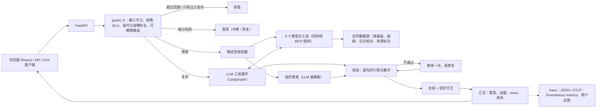

<div align="center">

<h1>FinSight</h1>

<h3>证据优先的 A 股研究 Agent。</h3>

<p>
  <a href="README.md"></a>
  <a href="README_CN.md"></a>
  <a href="LICENSE"></a>
  <a href="https://github.com/beautifulrem/FinSight/actions/workflows/ci.yml"></a>
  
  
  
  
</p>

</div>

---


FinSight 回答关于 A 股上市公司、基金、指数和宏观数据的问题：

- 经典、可解释的 NLU 负责理解、守卫和路由；
- LLM 在 LangGraph 循环里编排类型化的取证工具；
- **答案里的每个数字都由代码对照同一句引用的证据逐句核对**；
- 最后由合规节点删除任何像投资建议的表述。

没有 LLM Key 时，同一张图由确定性规划器完成回答。

## 30 秒看懂

- **数字可追溯**：逐句校验器把每个数字绑定到本句引用的证据。5,452 个被篡改的答案里，它只误放 **0.95%**；324 个正确答案全部通过（[校验器压力测试](docs/agent-eval.md#verifier-stress-test-324-gold-answers-5452-corrupted-variants-verifier_stress-round14json)）。
- **在没人调过的任务集上测**：测试集 v3 由独立作者编写，共 130 个任务，这里报的是首次 LLM 运行。在要求引用的一票否决口径下，DeepSeek Agent 通过 **0.869** [0.81, 0.92]，确定性固定流程 0.769，不调工具的 LLM 为 0（[测试集 v3](docs/agent-eval.md#test-set-v3-independent-author-untouched-first-runs)）。
- **修复之后的样本外结果，并把重合算进去**：每轮评审在任何修复之前，按自己发现的缺陷写一组保留切片。最近一组切片经过一轮修复后从 **0.250 → 0.792**（对话 12/48 → 38/48）。去掉与自写测试措辞重合的任务后结论仍然成立：按文本 35/45，按内容 32/42，按评审更严的口径 29/38（[来源说明](evaluation/heldout_r10/README.md#provenance-of-the-after-fix-run-what-the-record-shows-round-11-review-k16)）。
- **首次运行的数字照报，不被替换**：每套独立任务集都同时保留首次运行的数字和之后标为「暴露后」的数字。例如新写的独立路由标注首次得 0.801，盲收集的真实说法首次得 0.500（[评测历史](docs/zh/evaluation-history.md#独立任务集首次运行与暴露后)）。
- **按服务标准交付**：没有 LLM 也能运行，每次 LLM 调用都受运行截止时间约束。做过压测和故障演练，k3s 多副本经 Postgres 共享会话。提供 MCP 和 A2A，配有 Prometheus、Grafana、Jaeger 监控（[性能](docs/zh/performance.md)、[部署](docs/zh/deployment.md)）。

<p align="center"></p>

## 为什么这样设计

| 决策 | 理由 | 位置 |
|---|---|---|
| 经典 NLU 路由，LLM 负责编排 | 路由和守卫必须可解释、便宜；LLM 只用在它有价值的地方（选工具、组织答案）。简单问题走固定流程，对比、归因、多跳问题交给 LLM 工具循环。每个路由决定都记录理由。 | `agent/router.py`、`agent/graph.py` |
| 逐句的数字校验 | 数字必须出现在**本句**引用的证据里，按单位、写出的精度和正负号匹配。不通过时让 LLM 修改一次，仍不通过就删除该句。 | `agent/verifier.py` |
| 处处有确定性兜底 | 没有 Key、模型故障、预算耗尽或超过截止时间时，都降级到规划器 + 模板答案，依然有引用、依然经过校验。 | `agent/planner.py`、`agent/llm.py` |
| 证据是不可信数据 | 工具结果被包装、规范化并过滤注入指令；用户消息本身也经过输入守卫；工具全部只读。 | `agent/injection.py` |

## 架构



会话保存在 LangGraph checkpointer 中（内存、SQLite 或 Postgres），因此澄清可以暂停一次运行，任意副本都能接着对话；会话归属于创建它的 API Key。详见 [docs/zh/agent.md](docs/zh/agent.md)。

主要组成：

- **工具**：9 个类型化取证工具，覆盖实体、行情、技术指标、基本面、宏观、新闻、公告、知识检索和情感。每个工具都有 Pydantic schema、超时和重试。
- **声明核查**：`POST /agent/claim-check` 对照数据核查一句市场说法里的数字（例如「茅台市盈率只有15倍」），不用 LLM。
- **数据**：实时数据源有降级链和熔断。离线快照带更正层，提供一手来源的数值。
- **运维**：每次运行都有 trace，服务导出 Prometheus 指标。
- **网页前端**：React 19，有实时进度面板、证据面板和指标卡片，支持中英文和深色模式。

完整列表见 [docs/zh/features.md](docs/zh/features.md)。

## 快速开始

**本地**（Python 3.13）：

```bash
pip install -r requirements.txt
uvicorn query_intelligence.api.app:create_app --factory --port 8765   # 打开 http://127.0.0.1:8765
```

没有 Key 时由确定性路径回答。启用 LLM Agent（任何 OpenAI 兼容接口均可）：

```bash
export DEEPSEEK_API_KEY=...                      # 只从环境变量读取，不要写进配置文件
export DEEPSEEK_BASE_URL=https://api.deepseek.com # 或网关，例如 https://api.cline.bot/api/v1
export DEEPSEEK_MODEL=deepseek-v4-flash
```

实时行情、新闻、公告、宏观默认开启。若只用随仓库提供的离线快照（截至 2026-04-22 和 2026-09-30，含更正层），设置 `QI_USE_LIVE_MARKET=0`，`_NEWS`、`_ANNOUNCEMENT`、`_MACRO` 同样设为 0（[数据源](docs/zh/data-sources.md)）。

**Docker**：

```bash
TAG=$(git rev-parse --short=7 HEAD)
docker build -f docker/Dockerfile -t finsight:$TAG .
docker run -d --name finsight -p 8000:8000 finsight:$TAG    # 加 -e DEEPSEEK_API_KEY=... 走 LLM 路径
curl http://127.0.0.1:8000/ready                            # 列出已加载的离线数据层
```

Kubernetes 与监控栈见 [docs/zh/deployment.md](docs/zh/deployment.md)。

**网页前端**：打开服务根地址（下图为运行详情，以及移动端、深色、英文界面）。

<p align="center">
  
  
</p>

## 测什么、怎么测

任务成功是「一票否决」口径，以下条件缺一不可：

- 行为（回答 / 澄清 / 拒答）正确；
- 每个必需事实都陈述**且**引用；
- 调用了必需工具；
- 判断类问题有限定语；
- 全文没有交易指令。

在线运行每个任务重复 3 次。每个比率都附 95% bootstrap 置信区间，路径之间做配对 bootstrap 和精确 McNemar 检验。下表每个数字都来自 [`evaluation/results/`](evaluation/results/) 里已提交的文件，文件记录了 commit、Prompt 哈希、模型和运行命令。

| 测什么 | 结果 | 证据 |
|---|---|---|
| 测试集 v3：独立作者写的 130 个任务，首次 LLM 运行，DeepSeek | Agent **0.869** [0.81, 0.92]，LLM 组织答案 0.831，确定性固定流程 0.769，不调工具的 LLM 0/130。Agent 对固定流程 +0.100 [+0.049, +0.156]，McNemar p = 0.007。Agent 对组织答案在 pass^3 上不显著 | [`ablation-final4-deepseek-testv3-holdout.json`](docs/agent-eval.md#test-set-v3-independent-author-untouched-first-runs) |
| 校验器压力测试：324 个正确答案，5,452 个篡改答案 | 篡改答案误放 **0.95%**（默认允许派生数字时 1.08%）；正确答案全部通过；换入另一家公司的数字 0.0% 放过（允许派生数字时 0.58%） | [`verifier_stress-round14.json`](docs/agent-eval.md#verifier-stress-test-324-gold-answers-5452-corrupted-variants-verifier_stress-round14json) |
| 最近一组评审切片：48 个对话任务、24 条声明，一轮修复前后各跑一次 | 对话 **0.250 → 0.792**，声明 0.667 → 0.833。去掉重合任务后：12/45 → 35/45（文本），12/42 → 32/42（加内容），11/38 → 29/38（评审的口径） | [`chat_heldout_r10-auto-nollm-after-fix.json`](docs/agent-eval.md#round-10-held-out-chat-slice-independent-author-before-and-after-the-round-14-fixes)、[`slice_overlap-heldout_r10-content-at-3480a96.json`](evaluation/heldout_r10/README.md#provenance-of-the-after-fix-run-what-the-record-shows-round-11-review-k16) |
| 更早的评审切片（对话，首次 → 一轮修复后） | 第六轮 0.579 → 0.816；第七轮 0.264 → 0.830；第八轮 0.275 → 0.686；第九轮 0.346 → 0.788 | [评测历史](docs/zh/evaluation-history.md#独立任务集首次运行与暴露后) |
| 独立路由标注（新写的 241 条） | 首次 0.801，暴露后 0.842 | [`router_eval-independent_v2-first-run.json`](docs/agent-eval.md#router-label-sets) |
| 对核查器盲收集的真实公开说法（50 条） | 首次 0.500 [0.36, 0.64]；针对其错误类别修改核查器后 0.840（暴露后） | [`claims_web_v2-first-run.json`](evaluation/real_claims_web_v2/README.md) |
| 第三套盲收集的真实公开说法（50 条） | 首次 0.540 [0.40, 0.68]（第 14 轮核查器）；针对其错误类别修改核查器后 0.900（第 15 轮，暴露后） | [`claims_web_v3-first-run.json`](evaluation/real_claims_web_v3/README.md)、[`claims_web_v3-after-exposure-round15.json`](evaluation/real_claims_web_v3/README.md#round-15-after-exposure-checker-changed) |
| 第四套盲收集的真实公开说法（50 条） | 首次 0.740 [0.62, 0.86]（第 15 轮核查器，第三套的规则之前）；之后 0.780（暴露后） | [`claims_web_v4-first-run.json`](evaluation/real_claims_web_v4/README.md) |
| 投毒到文档里的提示注入 | 模板路径在 13 个攻击集上 0 次成功；LLM 路径每个集合当作事实陈述 0–3.4% | [`redteam-offline-r15.json`](docs/agent-eval.md#prompt-injection-red-team-offline-template-path-after-round-15-all-thirteen-sets-ci-baseline)、[`redteam-r8-llm.json`](docs/zh/evaluation-history.md#其他测量) |
| 延迟与负载 | DeepSeek Agent P95 15.4 秒（保留集），首字约 3 秒；数据源故障演练下 8 个用户（无 LLM）400 个请求 0 错误 | [性能](docs/zh/performance.md) |
| CI 门禁（与已提交基线比较） | 开发集 524 个任务 1.000，保留集 53 个 0.9434，ext 68 个 1.000，发布默认配置 21 个 1.000 | [门禁基线](docs/agent-eval.md#offline-gate-baselines-ci-compares-against-these) |

更多细节：

- 每轮的完整表格、每组评审切片的分类结果和其他全部测量见 [docs/zh/evaluation-history.md](docs/zh/evaluation-history.md)。
- 中文评测摘要见 [docs/zh/evaluation.md](docs/zh/evaluation.md)。
- 含全部配对比较的生成页见 [docs/agent-eval.md](docs/agent-eval.md)（英文）。

自己跑一遍：

```bash
python -m pytest -q tests                                  # 离线；除非 QI_TEST_LIVE=1，否则不访问实时数据源
scripts/prepush.sh                                         # 推送前在本地跑 CI 跑的全部检查（docs/zh/development.md）
python -m evaluation.agent_eval.gate                       # 快照回放的开发集 + 保留集，以及 ext、shipped 集，与已提交基线比较
python -m evaluation.agent_eval.router_eval                # 路由准确率与混淆矩阵
python -m evaluation.agent_eval.ablation --llm deepseek --repeats 3 --workers 3 --sets holdout,test_v2
python -m evaluation.agent_eval.verifier_stress            # 校验器误放率
python -m evaluation.agent_eval.redteam --llm deepseek     # 提示注入红队
python -m evaluation.agent_eval.fault_injection            # 平稳降级
python -m evaluation.agent_eval.report --check             # docs/agent-eval.md 与 evaluation/results/ 一致
python -m scripts.load_test --base-url http://127.0.0.1:8000 --users 8
python -m scripts.chaos_drill --scenario sources           # 对运行中的服务屏蔽上游数据源
```

推送到 `master` 之前，[`scripts/prepush.sh`](scripts/prepush.sh) 在本地跑一遍 CI 的全部步骤（[docs/zh/development.md](docs/zh/development.md)）。`master` 最近一次 CI 运行是 [38077019773](https://github.com/beautifulrem/FinSight/actions/runs/38077019773)：在 `4ad3380` 上 8 个 job 全部通过。CI 怎么跑、人工评测工具包怎么用，见 [docs/zh/evaluation-history.md](docs/zh/evaluation-history.md#ci推送前检查与人工评测工具包)。

## 局限

- **未暴露的任务集很少**：每组评审切片只对一轮修复是样本外的。切片规模小（38–53 个对话任务），而且每组都有一部分与自写测试措辞重合，见上面的重合计数。「工程师在修复后运行之前没打开过切片」是工程师的陈述：那次运行是从评审的目录读取切片的，没有任何记录能证明是否打开过（[来源说明](evaluation/heldout_r10/README.md#provenance-of-the-after-fix-run-what-the-record-shows-round-11-review-k16)）。
- **比较类问题靠词表泛化**：比较语法按词类判断运算，而词类是正则表达式，词类之外的问法仍会漏掉。最近一组切片修复后仍有 48 个里的 10 个对话任务失败。
- **路由在新问法上约有五分之一出错**：新写的独立标注上为 0.801。
- **Agent 工具循环只比「LLM 组织答案」略好**：DeepSeek 上单次成功率领先，pass^3 不显著；GLM 上两者持平，Agent 成本是后者的 1.1–4 倍。
- **校验证明的是可追溯，不是真实**：投毒到新闻正文里的假价格能通过校验，因为它确实「在证据里」。
- **LLM 路径有时仍会转述投毒文档的内容**：输出层只能对它认出的内容注明出处或删除，不能阻止模型提到投毒内容。
- **有些结果需要所有者提供**：目前还没有人工答案标注，没有与问财 / 豆包 / Kimi 的对比，没有用户研究，也没有所有者收集的真实说法。[工具包](evaluation/human/README.md)已经就绪。

完整的局限说明（含每条的数字和限定）见 [docs/zh/evaluation-history.md](docs/zh/evaluation-history.md#完整的局限说明)。

## 已知未修复问题

第三轮以来每个评审缺陷都列在 [docs/zh/known-issues.md](docs/zh/known-issues.md)：已修复的给出修复 commit 和测试，另有一张表列出仍未解决的事项和原因。本轮新增的行写进下表，本轮结束时并入该页。

| 编号 | 严重度 | 问题 | 状态 |
|---|---|---|---|
| K16（第十一轮） | 低–中（评测如实） | 第十轮切片修复后运行的来源被当作事实陈述（「没打开过」），而且只统计了文本层面的重合 | 已修复：[切片说明](evaluation/heldout_r10/README.md#provenance-of-the-after-fix-run-what-the-record-shows-round-11-review-k16)写明记录显示的事实：那次运行读的是评审的目录，切片之后才进入仓库（`367636b`）。`slice_overlap --content` 增加了内容层面的检查。去掉内容重合后，第十轮对话为 12/42 → 32/42，第九轮对话为 16/42 → 33/42 |
| K17（第十一轮） | 低（界面） | 成本盈亏乘式写成「200 × -90.5」；数据日期横幅没包含估值日；切换到英文后，中文那一轮的推荐追问仍是中文 | 已修复（`d9d2923`、`1e2c38c`）：写成「200 × (−90.5)」；横幅的日期范围包含估值日；推荐追问和默认免责声明随界面语言切换。测试：`tests/test_round15_ui_nits.py`、vitest |
| K18（第十一轮） | 低（文档） | README 有 1.85 万词，「30 秒看懂」是五大段 | 已修复：README 改为落地页，长内容原样移到 [docs/zh/evaluation-history.md](docs/zh/evaluation-history.md)、[docs/zh/known-issues.md](docs/zh/known-issues.md) 和 [docs/zh/features.md](docs/zh/features.md) |

## API

| 接口 | 用途 |
|---|---|
| `POST /agent/chat`、`/agent/chat/stream`（SSE）、`/agent/resume` | 带证据、校验结果、trace id 和成本的 Agent 回答；流式输出；澄清后恢复 |
| `POST /agent/claim-check` | 核查一句说法里的数字（不用 LLM） |
| `GET /agent/traces/{id}`、`/agent/sessions/{id}` | 运行 trace 和会话记忆，只返回调用方自己的 |
| `GET /.well-known/agent-card.json`、`POST /a2a` | A2A 服务卡片与 JSON-RPC 接口 |
| `GET /metrics`、`/health`、`/ready` | Prometheus 指标、存活检查、就绪检查（含离线数据层） |
| `POST /chat`、`/nlu/analyze`、`/retrieval/search` | 原聊天接口，以及经典 NLU 与检索产物 |

全部接口见 [docs/zh/features.md](docs/zh/features.md#api)；schema 位于 `schemas/agent_*.schema.json`。

## 文档

| 主题 | 链接 |
|---|---|
| 评测历史：每轮表格、切片分类结果、其他测量、完整局限 | [docs/zh/evaluation-history.md](docs/zh/evaluation-history.md) |
| 已知问题：每个评审缺陷、修复与测试，以及仍未解决的事项 | [docs/zh/known-issues.md](docs/zh/known-issues.md) |
| 完整功能列表、完整 API 表与完整的快速开始 | [docs/zh/features.md](docs/zh/features.md) |
| Agent 层：图、工具、记忆、API、配置 | [docs/zh/agent.md](docs/zh/agent.md) |
| 评测（中文摘要） | [docs/zh/evaluation.md](docs/zh/evaluation.md) |
| 评测完整版（生成）：任务集、置信区间、在线消融、第二模型、Prompt A/B、红队、校验器压力测试 | [docs/agent-eval.md](docs/agent-eval.md)（英文） |
| 与问财、豆包、Kimi、Wind Alice、妙想的对比 | [docs/zh/comparison.md](docs/zh/comparison.md) |
| 人工评测工具包：回答标注、产品对比、真实说法、用户研究 | [evaluation/human/README.md](evaluation/human/README.md) |
| A2A、模型容灾、网关成本、监控、看板、故障演练 | [docs/zh/a2a-and-observability.md](docs/zh/a2a-and-observability.md) |
| 实时数据源与离线快照 | [docs/zh/data-sources.md](docs/zh/data-sources.md) |
| 性能、压测与扩展 | [docs/zh/performance.md](docs/zh/performance.md) |
| 部署 | [docs/zh/deployment.md](docs/zh/deployment.md) |
| 开发：推送前检查，发布默认配置如何被测试 | [docs/zh/development.md](docs/zh/development.md) |
| 设计复盘：取舍、自研与复用、失败案例 | [docs/presentation/agent-design-notes.md](docs/presentation/agent-design-notes.md) |
| 面试讲稿：30 秒介绍、三个可辩护的数字、失败故事、白板提纲 | [docs/presentation/interview-script.md](docs/presentation/interview-script.md) |
| 声明核查：规则、比较词、基准 | [docs/zh/claim-check.md](docs/zh/claim-check.md) |
| Agent 与 Prompt 工程实践调研 | [docs/research/agent-architecture-practices-2026.md](docs/research/agent-architecture-practices-2026.md)（英文） |
| Query Intelligence（经典 NLU 与检索） | [docs/zh/query-intelligence.md](docs/zh/query-intelligence.md) |
| 网页前端 | [docs/zh/frontend-chatbot.md](docs/zh/frontend-chatbot.md) |
| 全部文档 | [docs/zh/index.md](docs/zh/index.md) |

## 安全声明

FinSight 只做证据汇总，不是投资顾问，不能作为交易决策的唯一依据。
