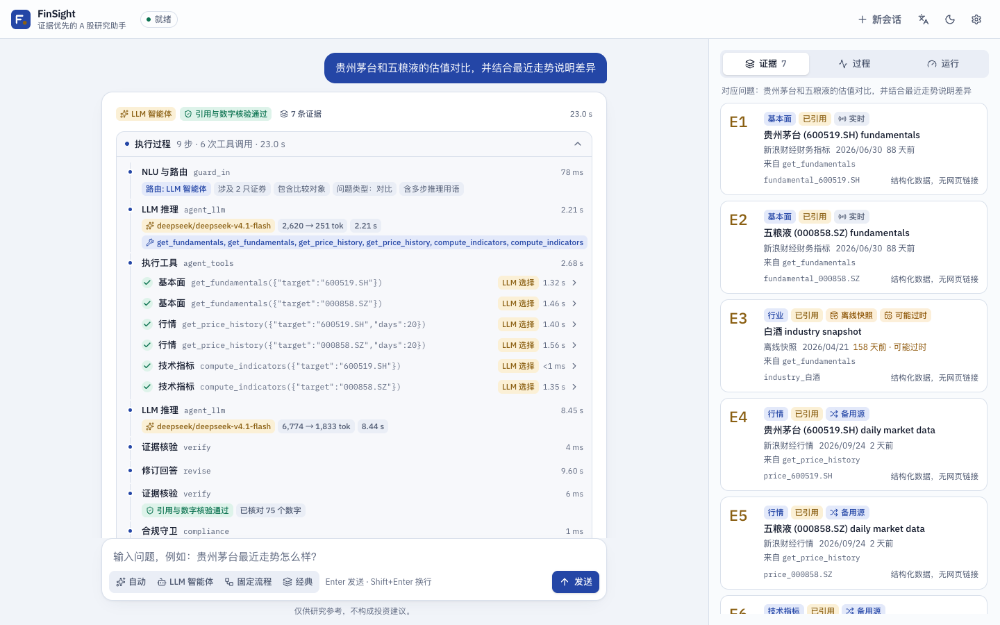
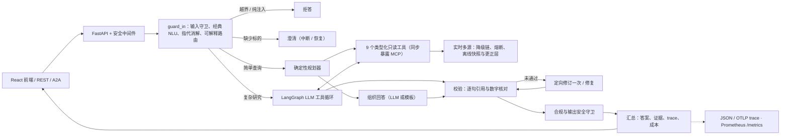
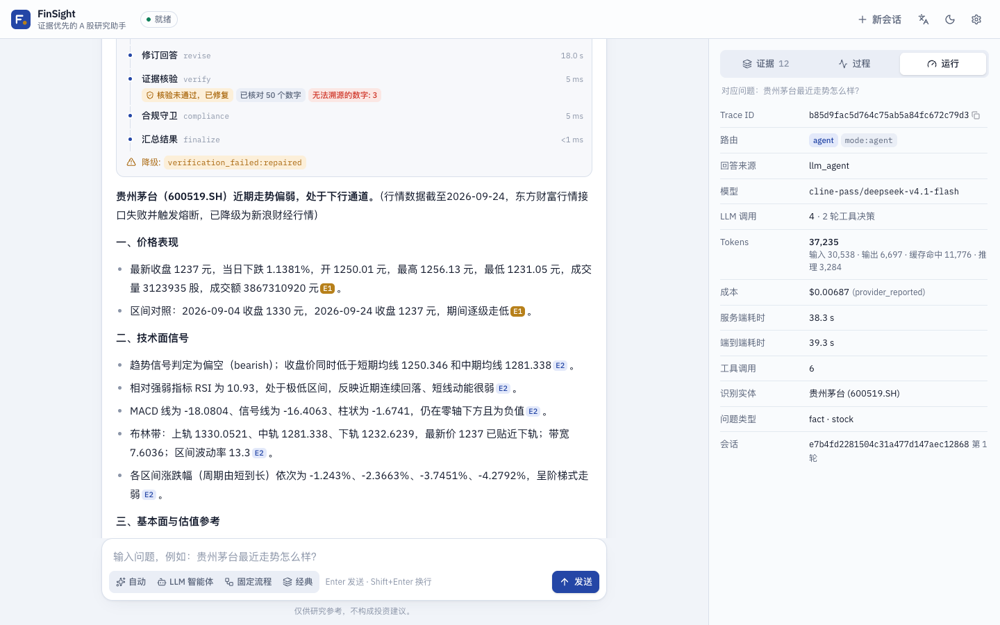
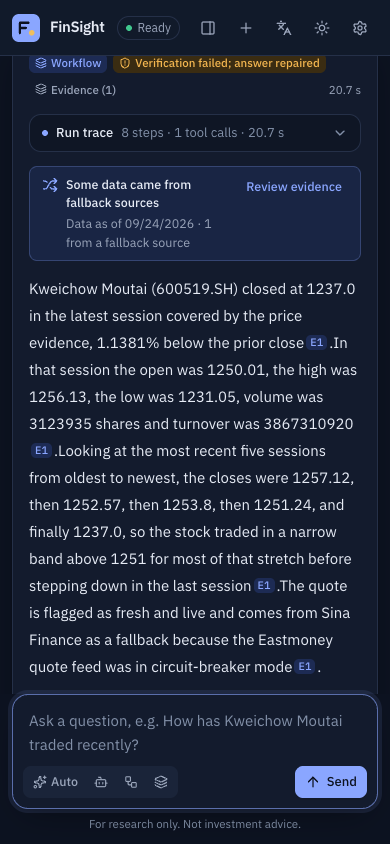

<div align="center">

# FinSight

**基于可解释查询智能（Query Intelligence）的证据优先金融分析与研究 Agent**

[-b31b1b?style=flat)](https://ebooks.iospress.nl/doi/10.3233/FAIA261107)
[](https://github.com/beautifulrem/FinSight/actions/workflows/ci.yml)
[](requirements.txt)
[](docs/zh/agent.md)
[](frontend)
[](LICENSE)

[发表论文](#发表论文) ·
[快速开始](#快速开始) ·
[系统架构](#系统架构) ·
[评测与验证](#评测与验证) ·
[接口契约](#api) ·
[文档导航](#文档导航) ·
[引用格式](#引用) ·
[English](README.md)

</div>

> [!IMPORTANT]
> FinSight 面向中国金融市场（A 股、ETF/基金、指数、行业与宏观指标）提供可追溯的证据汇总与数值核查。本项目**不是**投资顾问，不输出买卖建议或仓位指令，亦不得作为交易决策的唯一依据。

<p align="center">
  
</p>

## 发表论文

> **FinSight: An Evidence-First Financial Analysis Chatbot with Explainable Query Intelligence**
> Ruiqi Xie, Jiachang Zhang, Mingxi Shi, Shiyi Li, Mingyuan Gao, Zihao Yin, Adela S.M. Lau *（香港大学计算与数据科学学院 / 统计及精算学系 Data Science Lab）*
> 收录于 *Digitalization and Management Innovation V*（*Frontiers in Artificial Intelligence and Applications*，FAIA 第 433 卷），IOS Press，2026 年 10 月（DMI 2026），开放获取（`CC BY-NC 4.0`）。
> [IOS Press](https://ebooks.iospress.nl/doi/10.3233/FAIA261107) · [DOI: `10.3233/FAIA261107`](https://doi.org/10.3233/FAIA261107) · [BibTeX 引用](#引用)

本仓库同时包含**已发表论文中的经典可解释 Query Intelligence 流水线**，以及在此基础上持续演进的**可验证研究 Agent 服务平台**：

| 层次 | 范围与核心模块 | 证据契约、接口与代表性指标 |
|---|---|---|
| **1. 可解释查询智能底座** *（FAIA 2026 论文核心）* | 经典 NLU（`query_intelligence/nlu/`：规范化、别名/CRF/纠错实体消歧、TF-IDF + 线性/树分类器、越界与澄清门控、Source Planner）、混合检索与 `MarketAnalyzer`（`query_intelligence/retrieval/`）、逐句 FinBERT 情感分析（`sentiment/`）及受约束 LLM 总结（`scripts/llm_response.py`、`query_intelligence/chat/`）。 | 显式类型化 `NLUResult` 与 `RetrievalResult` 契约（`POST /nlu/analyze`、`/retrieval/search`、`/query/intelligence`、`/chat`）。**10,000** 条双语查询：金融域召回率 **0.975**、越界拒答准确率 **0.9729**、意图 micro-F1 **0.9407**、主题 micro-F1 **0.9208**、Recall@10 **0.9664**，**32/32** 契约模糊测试全通过（[docs/zh/query-intelligence.md](docs/zh/query-intelligence.md)）。 |
| **2. 可验证研究 Agent 平台** *（论文发表后扩展）* | LangGraph 工具循环与确定性规划兜底（`query_intelligence/agent/`）、带实时多源降级链/熔断/溯源的 9 个只读类型化工具（`integrations/sources/`）、逐句数值校验器（`agent/verifier.py`）、零 LLM 市场声明核查（`agent/claim_check.py`）、MCP/A2A 协议服务、Postgres 会话存储、可观测栈与 React 19 前端（`frontend/`）。 | `POST /agent/chat`、`/agent/chat/stream`（SSE）、`/agent/resume`、`/agent/claim-check`、`/a2a` 与 MCP 服务（`query_intelligence.agent.mcp_server`）。独立未接触测试集 v3 严格一票否决通过率 **0.869**；5,631 条篡改回答压力测试误放率仅 **0.92%**（[docs/zh/agent.md](docs/zh/agent.md)、[docs/zh/evaluation.md](docs/zh/evaluation.md)）。 |

## 核心特性

- **证据生产与语言生成严格解耦**：经典可审查的 NLU 与混合检索产出带稳定 `evidence_id` 的结构化与文档证据，不引入黑盒向量库或 LLM 替代路由、实体消歧与越界守卫。
- **逐句数值与引用校验**：回答中的每个数字都由代码对照**同一句**所引用的证据核验（感知单位、量级、精度与正负号）；未通过校验的句子仅触发一次定向修订，仍不通过则删除。
- **零 Key 确定性兜底**：未配置 LLM API Key，或遇到上游限流、超时、预算耗尽时，同一张执行图自动降级为确定性规划器 + 模板回答，依然保留完整引用与数值校验。
- **面向不可信文档的纵深防御**：全部 9 个工具均为只读；外部文档经不可信数据信封与注入过滤器隔离，配合输出安全与合规守卫防御投毒数字、港美股/仿冒名称误配、未来价格预测与荐股话术。
- **生产级服务交付**：支持 SSE 流式输出、Postgres 多副本共享会话/限流/Trace、MCP 与 A2A 1.0 协议、Prometheus + Grafana + Jaeger 监控、非 root 只读容器与 Kubernetes 清单，以及 React 19 中英双语工作台。

## 快速开始

### 本地启动 API 与网页前端（Python 3.13）

```bash
pip install -r requirements.txt
uvicorn query_intelligence.api.app:create_app --factory --port 8765
# 浏览器打开 http://127.0.0.1:8765
```

### 命令行体验论文 Query Intelligence 流水线

无需启动 Web 服务，直接查看显式 `NLUResult` 与 `RetrievalResult` JSON 证据产物：

```bash
python manual_test/run_manual_query.py --query "你觉得中国平安怎么样？"
```

### 启用 LLM Agent（可选）

不配置 Key 时默认走确定性路径；配置任意 OpenAI 兼容接口即可启用 LLM 编排：

```bash
export DEEPSEEK_API_KEY=...
export DEEPSEEK_BASE_URL=https://api.deepseek.com
export DEEPSEEK_MODEL=deepseek-v4-flash
```

实时行情、新闻、公告与宏观源默认开启并带自动离线降级。若仅使用随仓离线快照与更正层，请将 `QI_USE_LIVE_MARKET=0`、`QI_USE_LIVE_NEWS=0`、`QI_USE_LIVE_ANNOUNCEMENT=0`、`QI_USE_LIVE_MACRO=0`（详见 [docs/zh/data-sources.md](docs/zh/data-sources.md)）。

### Docker 运行

```bash
TAG=$(git rev-parse --short=7 HEAD)
docker build -f docker/Dockerfile -t finsight:$TAG .
docker run -d --name finsight -p 8000:8000 finsight:$TAG   # 加 -e DEEPSEEK_API_KEY=... 启用 LLM
curl http://127.0.0.1:8000/ready
```

Kubernetes（`deploy/k8s/`）、Postgres 会话共享与监控栈配置见 [docs/zh/deployment.md](docs/zh/deployment.md)。

## 系统架构



会话以 LangGraph checkpoint 持久化（内存、SQLite 或 Postgres），支持澄清中断恢复与多副本无状态扩展，并按调用方 API Key 或签名匿名 Cookie 严格隔离。

<details>
<summary><b>目录结构</b></summary>

```text
FinSight/
├── query_intelligence/
│   ├── nlu/            # 经典 NLU：规范化、别名/CRF/纠错实体消歧、分类器、Source Planner
│   ├── retrieval/      # 查询构建、结构化与文档混合检索、LTR 排序、MarketAnalyzer 摘要
│   ├── agent/          # LangGraph 编排、9 个只读工具、逐句数值校验器、声明核查、MCP 与 A2A
│   ├── integrations/   # Tushare / AKShare / 巨潮 / efinance 实时数据源、熔断器与数据溯源
│   ├── api/            # FastAPI 路由、鉴权、请求体上限、限流、就绪探针与 SSE 流式接口
│   └── contracts.py    # NLUResult、RetrievalResult 与 Agent Pydantic 契约定义
├── sentiment/          # 下游逐句 FinBERT 与离线经典词典金融情感分析
├── frontend/           # React 19 + TypeScript 双语工作台（产物提交于 query_intelligence/web/dist）
├── evaluation/         # 可复现评测集、claim_bench、校验器压力测试、提示注入红队与保留切片
├── data/ & models/     # 随仓离线快照与更正层、运行时词表与 SHA-256 校验模型
├── schemas/            # 导出的 JSON Schema（nlu_result、retrieval_result、agent_*）
├── deploy/ & docker/   # 多阶段 Dockerfile、Compose、Kubernetes kustomize 与 kind 冒烟脚本
└── scripts/ & training/# 训练流水线、受约束 LLM 输出、压测与故障演练、CI 时间预算检查
```

</details>

## API

| 接口 | 用途 |
|---|---|
| `POST /agent/chat`、`/agent/chat/stream`（SSE）、`/agent/resume` | 带证据、校验结果、trace ID 与成本的 Agent 回答；流式输出；澄清后恢复 |
| `POST /agent/claim-check` | 零 LLM 金融声明数值核查（例如「茅台市盈率只有15倍」） |
| `GET /agent/traces/{id}`、`/agent/sessions/{id}` | 按调用方隔离的运行 trace 与会话记忆查询 |
| `GET /.well-known/agent-card.json`、`POST /a2a` | A2A 1.0 服务卡片与 JSON-RPC 接口 |
| `GET /health`、`/ready`、`/metrics` | 存活探针、就绪探针（检查点、模型、离线数据层）与 Prometheus 指标 |
| `POST /query/intelligence`、`/nlu/analyze`、`/retrieval/search`、`/chat` | 论文核心 Query Intelligence 流水线（`NLUResult` + `RetrievalResult`）与经典问答接口 |

完整接口说明与 Schema（`schemas/*.schema.json`）见 [docs/zh/features.md](docs/zh/features.md#api)。

<p align="center">
  
  &nbsp;
  
</p>

## 评测与验证

所有指标均来自 [`evaluation/results/`](evaluation/results/) 中已提交的可复现结果文件（含 commit、模型、Prompt 哈希与运行命令）。Agent 评测采用严格一票否决口径（行为正确、全部必需事实陈述且引用、必需工具已调用、判断类有限定语、全文无交易指令）。

| 评测项 | 核心结果 | 来源 |
|---|---|---|
| **论文 Query Intelligence**（10,000 条中英查询） | 金融召回 **0.975**、越界准确率 **0.9729**、意图 F1 **0.9407**、主题 F1 **0.9208**、Recall@10 **0.9664** | [FAIA 2026](https://ebooks.iospress.nl/doi/10.3233/FAIA261107) · [docs/zh/query-intelligence.md](docs/zh/query-intelligence.md) |
| **独立测试集 v3**（130 题，首次未接触运行，DeepSeek） | Agent **0.869** [0.81, 0.92]、LLM 组织答案 0.831、确定性流程 0.769、无工具 LLM 0/130 | [docs/agent-eval.md](docs/agent-eval.md#test-set-v3-independent-author-untouched-first-runs) |
| **校验器压力测试**（333 条正例、5,631 条篡改） | 严格模式误放 **0.92%**（允许派生数字 1.05%）、正例通过 **100%**、跨公司换数 **0.0%** | [docs/agent-eval.md](docs/agent-eval.md#verifier-stress-test-333-gold-answers-5631-corrupted-variants-verifier_stress-round18json) |
| **提示注入红队**（16 套攻击集） | 模板路径 **0 / 3,796** 成功；最新定向 LLM 切片（holdout13）Agent **0/16**、组织答案 **0/13** | [docs/agent-eval.md](docs/agent-eval.md#prompt-injection-red-team-offline-template-path-after-round-18-all-sixteen-sets-ci-baseline) |
| **延迟与故障压测** | DeepSeek P95 **15.4 秒**（首字约 3 秒）；上游全阻断演练下 8 并发 400 请求 **0 错误** | [docs/zh/performance.md](docs/zh/performance.md) |
| **离线 CI 门禁基线** | 开发集（558）**1.000**、保留集（53）**0.943**、ext（123）**1.000**、发布默认（21）**1.000** | [docs/agent-eval.md](docs/agent-eval.md#offline-gate-baselines-ci-compares-against-these) |

<details>
<summary><b>自动生成的完整评测账本、CI 状态与已知局限</b></summary>

### 核心摘要

<!-- generated:pitch (python -m evaluation.agent_eval.readme) -->
- **数字可追溯**：逐句校验器把每个数字绑定到本句引用的证据。5,631 个被篡改的答案里，它只误放 **0.92%**（默认允许派生数字时 1.05%）；333 个正确答案全部通过（[校验器压力测试](docs/agent-eval.md#verifier-stress-test-333-gold-answers-5631-corrupted-variants-verifier_stress-round18json)，第 18 轮，`3e1008d`）。
- **在没人调过的任务集上测**：测试集 v3 由独立作者编写，共 130 个任务，这里报的是首次 LLM 运行。在要求引用的一票否决口径下，DeepSeek Agent 通过 **0.869** [0.81, 0.92]，确定性固定流程 0.769，不调工具的 LLM 为 0/130（[测试集 v3](docs/agent-eval.md#test-set-v3-independent-author-untouched-first-runs)）。
- **修复之后的样本外结果，并把重合算进去**：每轮评审在任何修复之前，按自己发现的缺陷写一组保留切片。最近一组（第十四轮）切片经过一轮修复后从 **0.160 → 0.740**（对话 8/50 → 37/50；声明 0.542 → 0.917），之前两组为 **0.413 → 0.978** 和 **0.320 → 0.840**。去掉与自写措辞重合的任务后最近一组仍然成立：按文本 35/48，按内容 28/40，按内容特征 17/22（[来源说明](evaluation/heldout_r14/README.md#before-the-after-fix-run)）。
- **首次运行的数字照报，不被替换**：每套独立任务集都同时保留首次运行的数字和之后标为「暴露后」的数字。例如新写的独立路由标注首次得 0.801，盲收集的真实说法首次得 0.500（[评测历史](docs/zh/evaluation-history.md#独立任务集首次运行与暴露后)）。
- **按服务标准交付**：没有 LLM 也能运行，每次 LLM 调用都受运行截止时间约束。做过压测和故障演练，k3s 多副本经 Postgres 共享会话。提供 MCP 和 A2A，配有 Prometheus、Grafana、Jaeger 监控（[性能](docs/zh/performance.md)、[部署](docs/zh/deployment.md)）。
<!-- /generated:pitch -->

### 完整指标表

<!-- generated:headline-table (python -m evaluation.agent_eval.readme) -->
| 测什么 | 结果 | 证据 |
|---|---|---|
| 测试集 v3：独立作者写的 130 个任务，首次 LLM 运行，DeepSeek | Agent **0.869** [0.81, 0.92]，LLM 组织答案 0.831，确定性固定流程 0.769，不调工具的 LLM 0/130。Agent 对固定流程 +0.100 [+0.049, +0.156]，McNemar p = 0.007。Agent 对组织答案在 pass^3 上不显著 | [`ablation-final4-deepseek-testv3-holdout.json`](docs/agent-eval.md#test-set-v3-independent-author-untouched-first-runs) |
| 校验器压力测试（第 18 轮，`3e1008d`）：333 个正确答案，5,631 个篡改答案 | 篡改答案误放 **0.92%**（默认允许派生数字时 1.05%）；正确答案通过 100%；换入另一家公司的数字 0.0% 放过（允许派生数字时 0.56%） | [`verifier_stress-round18.json`](docs/agent-eval.md#verifier-stress-test-333-gold-answers-5631-corrupted-variants-verifier_stress-round18json) |
| 最近一组评审切片（第十四轮）：50 个对话任务、24 条声明，一轮修复前后各跑一次 | 对话 **0.160 → 0.740**，声明 0.542 → 0.917。去掉重合任务后：7/48 → 35/48（文本），4/40 → 28/40（加内容），2/22 → 17/22（加内容特征） | [`chat_heldout_r14-auto-nollm-after-fix.json`](docs/agent-eval.md#round-14-held-out-chat-slice-independent-author-before-and-after-the-round-18-fixes)、[`slice_overlap-heldout_r14-at-f20c6c3.json`](evaluation/heldout_r14/README.md#before-the-after-fix-run) |
| 上一组评审切片（第十三轮）：46 个对话任务、22 条声明，一轮修复前后各跑一次 | 对话 **0.413 → 0.978**，声明 0.636 → 1.000。去掉重合任务后：18/44 → 43/44（文本），15/39 → 38/39（加内容），11/27 → 26/27（加内容特征） | [`chat_heldout_r13-auto-nollm-after-fix.json`](docs/agent-eval.md#round-13-held-out-chat-slice-independent-author-before-and-after-the-round-17-fixes)、[`slice_overlap-heldout_r13-at-71cb928.json`](evaluation/heldout_r13/README.md#committed-to-the-repository-after-the-round-17-fixes) |
| 更早一组评审切片（第十二轮）：50 个对话任务、26 条声明，一轮修复前后各跑一次 | 对话 **0.320 → 0.840**，声明 0.423 → 0.923。去掉重合任务后：16/49 → 42/49（文本），14/43 → 37/43（加内容），14/35 → 31/35（加内容特征） | [`chat_heldout_r12-auto-nollm-after-fix.json`](docs/agent-eval.md#round-12-held-out-chat-slice-independent-author-before-and-after-the-round-16-fixes)、[`slice_overlap-heldout_r12-at-9564263.json`](evaluation/heldout_r12/README.md#committed-to-the-repository-after-the-round-16-fixes) |
| 更早的评审切片（对话，首次 → 一轮修复后） | 第六轮 0.579 → 0.816；第七轮 0.264 → 0.830；第八轮 0.275 → 0.686；第九轮 0.346 → 0.788；第十轮 0.250 → 0.792；第十一轮 0.200 → 0.733 | [评测历史](docs/zh/evaluation-history.md#独立任务集首次运行与暴露后) |
| 独立路由标注（新写的 241 条） | 首次 0.801，暴露后 0.842 | [`router_eval-independent_v2-first-run.json`](docs/agent-eval.md#router-label-sets) |
| 对核查器盲收集的真实公开说法，第 2 套（v2，50 条） | 首次 0.500 [0.36, 0.64]（`117e74b`）；之后 0.840（第 18 轮核查器，暴露后） | [`claims_web_v2-first-run.json`](evaluation/real_claims_web_v2/README.md) |
| 对核查器盲收集的真实公开说法，第 3 套（v3，50 条） | 首次 0.540 [0.40, 0.68]（`7ea8f5d`）；之后 0.880（第 18 轮核查器，暴露后） | [`claims_web_v3-first-run.json`](evaluation/real_claims_web_v3/README.md) |
| 对核查器盲收集的真实公开说法，第 4 套（v4，50 条） | 首次 0.740 [0.62, 0.86]（`110e656`）；之后 0.780（第 18 轮核查器，暴露后） | [`claims_web_v4-first-run.json`](evaluation/real_claims_web_v4/README.md) |
| 对核查器盲收集的真实公开说法，第 5 套（v5，50 条） | 首次 0.680 [0.56, 0.80]（`c795172`）；之后 0.680（第 18 轮核查器，暴露后） | [`claims_web_v5-first-run.json`](evaluation/real_claims_web_v5/README.md) |
| 对核查器盲收集的真实公开说法，第 6 套（v6，60 条） | 首次 0.650 [0.52, 0.77]（`642ead2`）；之后 0.650（第 18 轮核查器，暴露后） | [`claims_web_v6-first-run.json`](evaluation/real_claims_web_v6/README.md) |
| 投毒到文档里的提示注入 | 模板路径在 16 个攻击集上 0 次成功（3,796 次运行）；最近一次完整 LLM 运行（`0473968`）每个集合当作事实陈述 0–3.4%；最近一次定向集（holdout13）Agent 0/16，组织答案 0/13 | [`redteam-offline-r18.json`](docs/agent-eval.md#prompt-injection-red-team-offline-template-path-after-round-18-all-sixteen-sets-ci-baseline)、[`redteam-r8-llm.json`](docs/agent-eval.md#prompt-injection-red-team-llm-paths-after-round-8-0473968)、[`redteam-r16-holdout13-llm.json`](docs/agent-eval.md#prompt-injection-red-team-llm-paths-on-holdout13-round-12-reviewers-styles-in-round-16) |
| 延迟与负载 | DeepSeek Agent P95 15.4 秒（保留集），首字约 3 秒；数据源故障演练下 8 个用户（无 LLM）400 个请求 0 错误 | [性能](docs/zh/performance.md) |
| CI 门禁（与已提交基线比较） | 开发集 558 个任务 1.000，保留集 53 个 0.943，ext 123 个 1.000，发布默认配置 21 个 1.000 | [门禁基线](docs/agent-eval.md#offline-gate-baselines-ci-compares-against-these) |
<!-- /generated:headline-table -->

### CI 与推送前检查状态

<!-- generated:ci-status (python -m evaluation.agent_eval.readme) -->
推送到 `master` 之前，[`scripts/prepush.sh`](scripts/prepush.sh) 在本地跑一遍 CI 的全部步骤（[docs/zh/development.md](docs/zh/development.md)）。最近一次提交的摘要是 [`prepush-cf36ec5.md`](docs/results/ci/prepush-cf36ec5.md)（`cf36ec5`，2026-10-14，全部步骤通过）：pytest 4,891 个通过、71 个跳过；在发布默认数据（扩展层和更正层）上再跑一遍（去掉固定在种子上的测试）：4,789 个通过、70 个跳过、103 个未选中。`master` 最近一次记录的 CI 运行是 [38113129617](https://github.com/beautifulrem/FinSight/actions/runs/38113129617)：在 `aa73005` 上10 个 job 全部通过（2026-10-11 记录于 [`ci-run-aa73005.json`](docs/results/ci/ci-run-aa73005.json)，由 `python scripts/record_ci_run.py` 从 GitHub API 生成）；占用预算比例最高的 job `agent-eval-extras` 用了 60 分钟里的 28.9 分钟。页首的徽章显示 `master` 当前的状态。推送前检查会让所属 job 估计超过超时 60% 的步骤失败（[CI 时间预算](docs/zh/development.md#ci-时间预算)）。CI 怎么跑、人工评测工具包怎么用，见 [docs/zh/evaluation-history.md](docs/zh/evaluation-history.md#ci推送前检查与人工评测工具包)。
<!-- /generated:ci-status -->

### 已知局限

<!-- generated:limits (python -m evaluation.agent_eval.readme) -->
- **未暴露的任务集很少**：每组评审切片只对一轮修复是样本外的。切片规模小（38–60 个对话任务），而且每组都有一部分与自写测试措辞重合，见上面的重合计数。「工程师在修复后运行之前没打开过切片」是工程师的陈述：那次运行是从评审的目录读取切片的，没有任何记录能证明是否打开过（[来源说明](evaluation/heldout_r10/README.md#provenance-of-the-after-fix-run-what-the-record-shows-round-11-review-k16)）。
- **比较类问题靠词表泛化**：比较语法按词类判断运算，而词类是正则表达式，词类之外的问法仍会漏掉。最近一组切片（第十四轮）修复后仍有 50 个里的 13 个对话任务失败（[按类别](docs/agent-eval.md#round-14-held-out-chat-slice-independent-author-before-and-after-the-round-18-fixes)）。
- **路由在新问法上约有 20% 出错**：新写的独立标注首次 0.801，暴露后 0.842。
- **Agent 工具循环只比「LLM 组织答案」略好**：DeepSeek 上单次成功率领先，pass^3 不显著；GLM 上两者持平，Agent 成本是后者的 1.1–4 倍。
- **校验证明的是可追溯，不是真实**：投毒到新闻正文里的假价格能通过校验，因为它确实「在证据里」。
- **LLM 路径有时仍会转述投毒文档的内容**：输出层只能对它认出的内容注明出处或删除，不能阻止模型提到投毒内容。
- **有些结果需要所有者提供**：目前还没有人工答案标注，没有与问财 / 豆包 / Kimi 的对比，没有用户研究，也没有所有者收集的真实说法。[工具包](evaluation/human/README.md)已经就绪。
<!-- /generated:limits -->

更完整的逐轮历史与局限分析见 [docs/zh/evaluation-history.md](docs/zh/evaluation-history.md) 与 [docs/zh/known-issues.md](docs/zh/known-issues.md)。

</details>

<details>
<summary><b>复现验证命令</b></summary>

```bash
python -m pytest -q tests                                  # 离线全量测试
QI_TEST_SHIPPED_DEFAULT=1 python -m pytest -q tests        # 发布默认数据（快照扩展 + 更正层）测试
scripts/prepush.sh                                         # 本地完整 CI 镜像与时间预算检查
python -m evaluation.agent_eval.gate                       # 离线门禁基线（dev / holdout / ext / shipped）
python -m evaluation.agent_eval.verifier_stress            # 校验器误放率压力测试
python -m evaluation.agent_eval.redteam --llm deepseek     # 提示注入红队测试
python -m evaluation.agent_eval.report --check             # 校验 docs/agent-eval.md 与 README 生成区块
```

</details>

## 文档导航

| 主题 | 中文 | English |
|---|---|---|
| 文档总览与模块职责 | [index.md](docs/zh/index.md) · [modules.md](docs/zh/modules.md) | [index.md](docs/index.md) · [modules.md](docs/modules.md) |
| Query Intelligence 底座（论文核心） | [query-intelligence.md](docs/zh/query-intelligence.md) | [query-intelligence.md](docs/query-intelligence.md) |
| 研究 Agent、工具与安全护栏 | [agent.md](docs/zh/agent.md) · [features.md](docs/zh/features.md) | [agent.md](docs/agent.md) · [features.md](docs/features.md) |
| 声明核查与数据源架构 | [claim-check.md](docs/zh/claim-check.md) · [data-sources.md](docs/zh/data-sources.md) | [claim-check.md](docs/claim-check.md) · [data-sources.md](docs/data-sources.md) |
| 数值分析、情感分析与受约束回答 | [numerical-analysis.md](docs/zh/numerical-analysis.md) · [sentiment.md](docs/zh/sentiment.md) · [llm-response.md](docs/zh/llm-response.md) | [numerical-analysis.md](docs/numerical-analysis.md) · [sentiment.md](docs/sentiment.md) · [llm-response.md](docs/llm-response.md) |
| 网页前端、MCP、A2A 与可观测性 | [frontend-chatbot.md](docs/zh/frontend-chatbot.md) · [mcp.md](docs/zh/mcp.md) · [a2a-and-observability.md](docs/zh/a2a-and-observability.md) | [frontend-chatbot.md](docs/frontend-chatbot.md) · [mcp.md](docs/mcp.md) · [a2a-and-observability.md](docs/a2a-and-observability.md) |
| 部署、性能与开发规范 | [deployment.md](docs/zh/deployment.md) · [performance.md](docs/zh/performance.md) · [development.md](docs/zh/development.md) | [deployment.md](docs/deployment.md) · [performance.md](docs/performance.md) · [development.md](docs/development.md) |
| 模型训练与评测体系 | [training.md](docs/zh/training.md) · [evaluation.md](docs/zh/evaluation.md) · [evaluation-history.md](docs/zh/evaluation-history.md) | [training.md](docs/training.md) · [agent-eval.md](docs/agent-eval.md) · [evaluation-history.md](docs/evaluation-history.md) |
| 已知问题与同类产品对比 | [known-issues.md](docs/zh/known-issues.md) · [comparison.md](docs/zh/comparison.md) | [known-issues.md](docs/known-issues.md) · [comparison.md](docs/comparison.md) |
| 演讲资料与人工评测套件 | [docs/presentation/](docs/presentation/README.md) | [evaluation/human/](evaluation/human/README.md) |

## 引用

仓库根目录同时提供 [`CITATION.cff`](CITATION.cff)（支持 GitHub 原生 **Cite this repository**）：

```bibtex
@incollection{xie2026finsight,
  title     = {FinSight: An Evidence-First Financial Analysis Chatbot with Explainable Query Intelligence},
  author    = {Xie, Ruiqi and Zhang, Jiachang and Shi, Mingxi and Li, Shiyi and Gao, Mingyuan and Yin, Zihao and Lau, Adela S.M.},
  booktitle = {Digitalization and Management Innovation V},
  series    = {Frontiers in Artificial Intelligence and Applications},
  volume    = {433},
  publisher = {IOS Press},
  year      = {2026},
  month     = oct,
  isbn      = {978-1-64368-695-0},
  issn      = {0922-6389},
  doi       = {10.3233/FAIA261107},
  url       = {https://ebooks.iospress.nl/doi/10.3233/FAIA261107}
}
```

## 参与贡献、安全政策与许可证

- **参与贡献**：请参阅 [CONTRIBUTING.md](CONTRIBUTING.md) 与 [docs/zh/development.md](docs/zh/development.md)。
- **安全披露**：发现安全漏洞请按 [SECURITY.md](SECURITY.md) 通过私密渠道提交。
- **开源协议**：[MIT](LICENSE)
