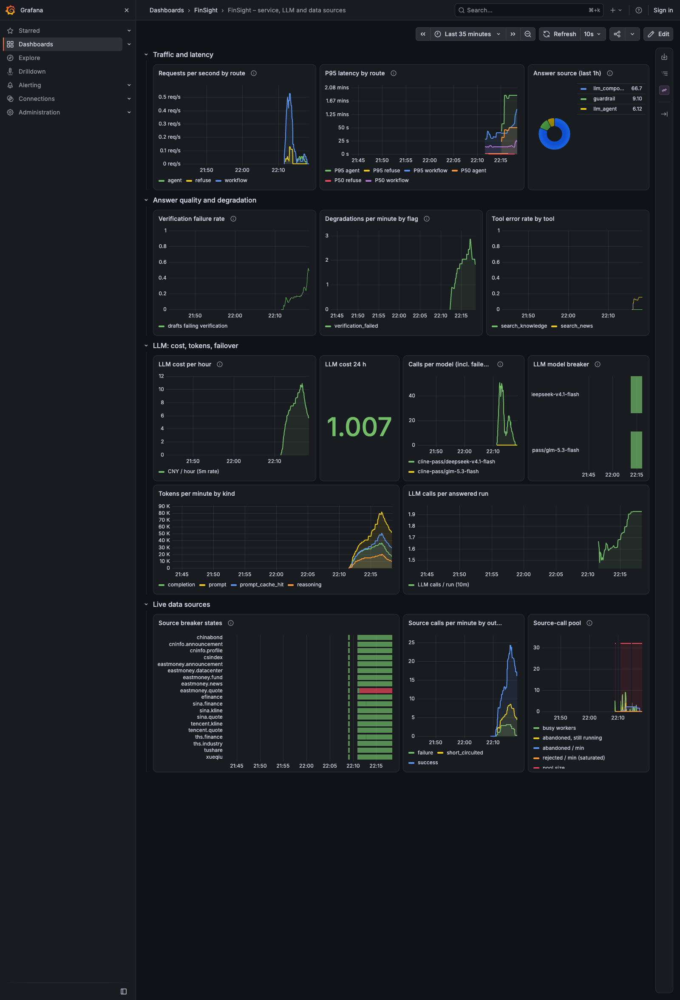

# A2A, Model Failover & Observability

Languages: English | [中文](zh/a2a-and-observability.md)

This page documents FinSight's agent-to-agent interoperability (A2A 1.0), Postgres multi-replica shared stores, LLM failover and cost accounting, run tracing, Prometheus/Grafana/Jaeger monitoring, chaos drills, and structured audit logging.

## A2A (Agent2Agent 1.0)

While MCP exposes individual tools, **A2A** (`query_intelligence/agent/a2a_server.py`, built on `a2a-sdk` 1.x) exposes the entire research agent so peer agents can delegate multi-step questions and receive verified artifacts.

| Endpoint | Purpose |
|---|---|
| `GET /.well-known/agent-card.json` | Public discovery card advertising skills (`equity_research`, `comparison`, `macro_linkage`), JSON-RPC interface, and streaming |
| `POST /a2a` | A2A 1.0 JSON-RPC 2.0 endpoint (`SendMessage`, `SendStreamingMessage`, `GetTask`, `SubscribeToTask`, `CancelTask`); requires `A2A-Version: 1.0` |

**Protocol mapping & isolation**:
- **`contextId` & tenant scoping**: Caller principals (`key:<sha256[:12]>` or signed cookie) own all tasks and sessions. Client-supplied `contextId`s must match an already-owned session (uniform `"Context not found."` on unknown or cross-tenant IDs), and `MAX_QUERY_LENGTH` (`2000`) is enforced.
- **Clarification & artifacts**: Clarification interrupts map to `TASK_STATE_INPUT_REQUIRED` and resume on the same task/context. Completed tasks emit two artifacts: `answer` (cited prose + disclaimer) and `evidence` (structured evidence sources, verification report, route, trace ID, follow-ups).
- **Streaming**: `SendStreamingMessage` emits `working` node/tool progress updates, artifact updates, and terminal status; internal errors are redacted before transmission.
- **Switches**: `QI_A2A_ENABLED=0` disables A2A routes; `QI_A2A_MODE` (default `auto`) selects agent mode; `QI_PUBLIC_BASE_URL` sets the advertised URL.

```bash
python scripts/a2a_client_demo.py --url http://127.0.0.1:8000   # add --api-key KEY when auth is enabled
python -m pytest -q tests/test_agent_observability_a2a.py tests/test_a2a_client_demo.py
```

### Interop with another framework: the JavaScript SDK client

`tools/a2a-js-client/interop.mjs` drives FinSight with the official `@a2a-js/sdk` 1.2.1 client across 16 protocol checks (card discovery, `sendMessage`, `getTask`, `input-required` + resume, `sendMessageStream`, `resubscribeTask` returning `UnsupportedOperationError` `-32004` on terminal tasks, and `cancelTask`). Verified **16/16** ([`docs/results/protocols/a2a-js-interop.txt`](results/protocols/a2a-js-interop.txt)):

```bash
(cd tools/a2a-js-client && npm ci)
node tools/a2a-js-client/interop.mjs --url http://127.0.0.1:8861
python -m pytest -q tests/test_a2a_js_interop.py
```

## Shared stores for several replicas

Setting `QI_AGENT_CHECKPOINT_DB=postgresql://...` moves all four stateful stores to PostgreSQL so stateless replicas behind a load balancer share state cleanly:

| Store | In-Memory Default | PostgreSQL Table | Override |
|---|---|---|---|
| Sessions (LangGraph checkpoints) | `InMemorySaver` | `PostgresSaver` checkpoint tables | — |
| A2A tasks | `BoundedInMemoryTaskStore` (2,000 cap) | `finsight_a2a_tasks` (7-day retention) | `QI_A2A_TASK_DB=memory` |
| Traces (`/agent/traces*`) | `RecentTraceStore` (ring of 200) | `finsight_agent_traces` (`QI_AGENT_TRACE_MAX_ROWS=50000`, 14 d) | `QI_AGENT_TRACE_DB=memory` |
| Rate limiter | In-process token bucket | `finsight_rate_buckets` | `QI_RATE_LIMIT_DB=memory` |

All Postgres stores are owner-scoped, degrade safely to local memory with redacted warnings if Postgres is unreachable (`QI_STORE_CONNECT_TIMEOUT_S=5`), and are verified across two live replicas (`tests/test_agent_shared_stores_postgres.py`, `scripts/shared_store_probe.py`; see [docs/results/protocols/README.md](results/protocols/README.md)).

## LLM gateway, failover and cost

`query_intelligence/agent/llm.py` supports standard OpenAI-compatible Chat Completions as well as envelope gateways (`{"success": true, "data": {...}}`).

- **Failover (`QI_LLM_FALLBACK_MODELS`)**: Wraps primary and backup models in `FallbackLLM` with per-model circuit breakers (open after 3 consecutive failures, `60 s` cooldown, half-open trial). Streaming avoids concatenating backup deltas onto partial failed outputs. When all models are unavailable, the graph falls back to deterministic template answers (`degraded: llm_error`).
- **Cost accounting**: Resolves cost from configured price tables (`QI_LLM_PRICE_*`) or gateway-reported `usage.cost` (converted via `QI_LLM_USD_CNY` when set), tracking prompt, completion, reasoning, and cache-hit tokens per model.

## Run inspector

- `GET /agent/traces?limit=50&session_id=...` and `GET /agent/traces/{trace_id}` return caller-scoped run summaries and full node/tool/LLM spans (`403` for anonymous callers).
- `POST /agent/feedback` records thumbs up/down feedback tied to `trace_id` into `QI_FEEDBACK_PATH` (`outputs/feedback/feedback.jsonl`); `scripts/feedback_to_tasks.py` converts flagged runs into candidate evaluation tasks.
- Set `QI_AGENT_OTEL=1` or `OTEL_EXPORTER_OTLP_ENDPOINT` to export OpenTelemetry spans to Jaeger, Tempo, or Langfuse.

## Prometheus metrics

`GET /metrics` exports trace-fed counters/histograms plus scrape-time operational state (`OpsMetricsCollector`):

- **Traffic & quality**: `finsight_agent_runs_total{route,answer_source}`, `finsight_agent_run_seconds`, `finsight_tool_calls_total{tool,outcome}`, `finsight_tool_seconds`, `finsight_answer_verification_total{prompt_version,outcome}`, `finsight_feedback_total{rating,prompt_version}`, `finsight_degradations_total{flag}`.
- **LLM & sources**: `finsight_llm_calls_total{model}`, `finsight_llm_tokens_total{model,kind}`, `finsight_llm_cost_total{model,currency}`, `finsight_llm_circuit_state{model}`, `finsight_source_circuit_state{source}`, `finsight_source_calls_total{source,outcome}`, `finsight_source_pool_*`.
- **Security & safety**: `finsight_audit_events_total{event,category}`, `finsight_injection_redactions_total{source,outcome}`, `finsight_output_safety_edits_total{kind}`.

## Dashboards, alerts and the monitoring stack

`docker/docker-compose.yml` ships a `monitoring` profile (all ports bound to `127.0.0.1` by default) combining FinSight, Prometheus, Grafana, and Jaeger:

```bash
docker compose -f docker/docker-compose.yml --profile monitoring up -d
# Grafana http://127.0.0.1:3300 · Prometheus :9090 · Jaeger :16686
```

- **Grafana dashboard** (`monitoring/grafana/finsight-dashboard.json`): 26 panels across 5 rows (traffic, quality, LLM cost/breakers, data source breakers/pool, per-prompt verification/feedback/audit/output-safety edits).
- **Prometheus alerts** (`monitoring/prometheus/alerts.yml` + `alerts_test.yml`): 14 rules covering downtime, P95 latency, verification/repair regressions, tool/LLM/source breakers, cost burn, injection spikes, negative feedback, and output-safety edit rate (`> 0.5` edits/answer). Verified via `promtool test rules` and `pytest -q tests/test_monitoring_config.py`.



## Chaos drill

`scripts/chaos_drill.py` injects live network faults without stubbing server internals:

```bash
python -m scripts.chaos_drill --scenario llm --fallback-model <backup-model>
python -m scripts.chaos_drill --scenario sources --source-cooldown 20 --max-stale 90
```

- **LLM fault drill** (`docs/results/chaos/llm/chaos-llm.json`): Primary HTTP 404 triggers failover to backup model, opens primary circuit (`state=2`), bounds slow failover under the run deadline with deterministic fallback (zero HTTP 504s), and auto-recovers after cooldown.
- **Data source block drill** (`docs/results/chaos/sources/chaos-sources.json`): Blocking Eastmoney/Sina/Tencent (`403`) transitions cleanly from live → TTL cache → last-known-good → explicit missing-data limitation → live recovery with 100% HTTP 200 verified answers.

## Audit log

`query_intelligence/agent/audit.py` emits privacy-preserving JSON events (`finsight.audit` logger, daily-rotated `QI_AUDIT_LOG_PATH` JSONL, and Prometheus counters) for every refusal, compliance edit, and injection redaction. Events store only hashed principals (`key:<sha256[:12]>` / `anon:<hash>`) and HMAC-SHA256 `query_hash`/`session_hash` (`QI_AUDIT_HASH_KEY`)—never raw user text or keys. Verified by `pytest -q tests/test_agent_audit_metrics.py`.
