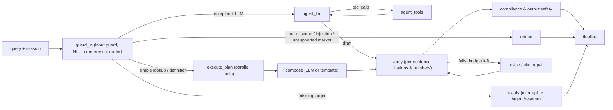

# Agent Layer

Languages: English | [中文](zh/agent.md)

The Agent Layer (`query_intelligence/agent/`) extends the published paper's Query Intelligence pipeline ([DOI: `10.3233/FAIA261107`](https://ebooks.iospress.nl/doi/10.3233/FAIA261107)) with a stateful LangGraph research orchestrator, 9 typed read-only tools, sentence-level numeric claim verification, and deterministic offline fallback. Classical NLU and hybrid retrieval remain the explainable router and evidence backbone.

Two execution paths share one LangGraph state graph:

- **`workflow`**: A deterministic planner derives tool calls from `NLUResult` and executes them in parallel; an LLM composes prose over the returned evidence, falling back to a cited template without an API key.
- **`agent`**: A plan-seeded LangGraph LLM tool loop (`agent_llm` ⇄ `agent_tools`) executes additional tool steps under strict step, token, and wall-clock budgets.

`mode=auto` selects the path per turn; `mode=workflow` and `mode=agent` force a path (never bypassing input/safety guards). Without an API key—or on outage/deadline—`agent` automatically degrades to `workflow` and records the downgrade in `degraded`.

## Graph



| Node | Responsibility |
|---|---|
| `guard_in` | Strips instruction-like spans from user text, detects answer language, runs classical NLU with session context, resolves follow-ups/pronouns/ellipses, checks market coverage (A-shares/funds/indices/China macro), and routes with explicit `route_reasons`. |
| `refuse` | Returns a localized refusal with machine code (`out_of_scope_query`, `prompt_injection_request`, or `out_of_coverage`). |
| `clarify` | Pauses via LangGraph `interrupt()` when a target is missing; resumed via `POST /agent/resume` or a target-only follow-up turn. |
| `execute_plan` | Runs planned tool calls in parallel (`max_parallel_tools=4`). |
| `agent_llm` / `agent_tools` | Plan-seeded tool loop bounded by `max_llm_steps`, `max_tool_calls`, `token_budget`, and `run_deadline_s`; suppresses duplicate identical tool calls. |
| `compose` | Generates grounded prose via LLM or `compose_template`, explicitly stating missing periods, metrics, or unavailable targets. |
| `verify` / `revise` | Enforces per-sentence numeric and `evidence_id` binding; repairs missing citations (`cite_repair`) or sends one revision prompt before dropping unsupported clauses. |
| `compliance` / `finalize` | Applies output safety (`output_safety.py`), advice/forecast hedging, freshness notes, language guard, disclaimer, trace emission, and cost accounting. |

### Routing Policy (`agent/router.py`)

Guards run first; remaining finance questions route by complexity:

| Route | Trigger | Examples |
|---|---|---|
| `refuse` | Non-finance, off-topic tasks (coding/translation), injection-only input, or unsupported assets (crypto, US/HK stocks, GDR/ADR) | `"写个Python爬虫"`, `"比特币还能涨吗"`, `"腾讯港股股价"` |
| `clarify` | Dangling pronouns/references or metrics/advice with no target and no session antecedent | `"这只股票能买吗"`, `"市盈率多少"` |
| `workflow` | Single-target factual lookups and glossary definitions | `"茅台的PE和PB分别多少"`, `"什么是LPR"` |
| `agent` | Multi-entity comparisons, causal `"why"` questions, macro-to-market analysis, valuations/judgments, multi-hop research | `"茅台和五粮液哪个估值更低"`, `"降息对银行股有什么影响"` |

Empirical ablations (`docs/agent-eval.md`) validate this hybrid split: on untouched Test v3 (DeepSeek), plan-seeded `agent` reaches **0.869** vs **0.831** (`workflow` + LLM) and **0.769** (template-only), while seeding the loop from the planner cuts LLM calls by ~35% and P50 latency by ~3 s. For slower reasoning models configured with `prefer_composition` (e.g., GLM), `QI_AGENT_SLOW_MODEL_POLICY=on` routes complex `auto` queries through `workflow` + LLM composition.

## Tools

All 9 read-only tools inherit from `tools/base.py` (Pydantic schemas exported to OpenAI & MCP, timeouts, retries, TTL caches, normalized error codes, and stable `evidence_id`s):

| Tool | Backing Source |
|---|---|
| `resolve_entity` | Classical NLU entity/alias/CRF/colloquial/typo resolver (`data/runtime/`) |
| `get_price_history` | Live chain (Tushare or Eastmoney → Sina → Tencent → efinance) + intraday quote during A-share hours; offline snapshot + corrections |
| `compute_indicators` | `MarketAnalyzer` (returns, MA5/MA20, RSI-14, MACD, Bollinger bands, 20d volatility) |
| `get_fundamentals` | Live Sina + THS cross-checked financials & Eastmoney/Tencent valuation; offline snapshot + primary-source definitions |
| `get_macro_indicators` | Live Eastmoney datacenter (CPI, PMI, M2, LPR) + ChinaBond 10Y yield; offline snapshot |
| `search_news`, `search_announcements`, `search_knowledge` | Hybrid retrieval (live news / Cninfo / Eastmoney notices / PostgreSQL FTS / TF-IDF + LTR) |
| `analyze_sentiment` | Offline classical classifier by default; FinBERT with `QI_AGENT_SENTIMENT_BACKEND=finbert` |
| `explain_concept` | Curated bilingual glossary of A-share concepts and KPI metric definitions (`evidence_id: glossary_<term>`) |

Data tools attach digit-free `provenance` metadata (`source`, `mode`, `as_of`, `fetched_at`, `freshness`, `fallback_reason`, `note`). See [docs/data-sources.md](data-sources.md) and [docs/mcp.md](mcp.md).

## Memory and Sessions

- **Server-issued, tenant-scoped sessions**: Omit `session_id` to start a conversation; clients reuse the returned `session_id`. Supplying an unknown or another caller's `session_id` returns a uniform `404` (`session <id> not found`) across `/agent/chat`, `/agent/chat/stream`, `/agent/resume`, and `GET /agent/sessions/{id}`.
- **Persistence**: Memory by default; configure `QI_AGENT_CHECKPOINT_DB` with a SQLite file path or `postgresql://` DSN for multi-replica sharing (`QI_AGENT_DURABILITY=exit` writes one checkpoint per turn). Per-session locks serialize concurrent requests.
- **Follow-up & coreference (`agent/memory.py`)**: Resolves pronouns (`它`, `这两家`, `前者/后者`, `the former/latter`), group queries (`三家里面哪家`), elliptical metric/target switches (`ROE呢`, `换成五粮液呢`), dangling `"why"` turns, comparison anchors, sector follow-ups, and inline clarification replies. Every rewrite logs an inspectable `route_reasons` code.
- **Session memory card**: Compact extractive card carrying up to 6 `recent_targets`, stated `user_constraints` (risk/horizon/scope), up to 5 `stated_holdings`, and active `comparison_frame`. Optional older-turn LLM summarization (`QI_AGENT_MEMORY_SUMMARY=1`, off by default) stays disabled since ablations showed no gain on ≤5-turn sessions.

## Safety, Compliance, and Guardrails

FinSight enforces layered defenses across both input and output paths (see [SECURITY.md](../SECURITY.md) for deployment security):

1. **Input guard & untrusted-data envelope (`agent/injection.py`, `text_safety.py`)**: Strips instruction-like spans and fake role/system tags from user prompts before NLU; wraps tool outputs as untrusted data and redacts injected instructions (`instruction_like_text_removed_from_evidence`).
2. **Evidence-list & headline hygiene (`text_safety.py`)**: Deterministic answers never quote raw document bodies and suppress titles showing links, contact handles, promotional/advice wording, planted figures, unconfirmed rumours, romanized pinyin advice, lookalike scripts, or unverified regulatory claims.
3. **Sentence-level claim verifier (`agent/verifier.py`)**: Every number in an answer must match an `evidence_id` cited *in that same sentence*, accounting for units (`亿`/`万`/`%`/billion), written precision, and directional sign. Cross-company swaps and document-planted figures contradicting structured fundamentals are rejected.
4. **Output safety & compliance (`agent/output_safety.py`, `agent/compliance.py`)**: Replaces relayed promotions, contact details, or trading calls with neutral notes; attributes single-source or disputed document claims (`"据一篇文档称…（未经其他来源证实）"`); strips buy/sell/target-price/position-sizing instructions; appends freshness warnings and the mandatory risk disclaimer.
5. **Forecast, foreign-listing & lookalike guards (`stated_dates.py`, `coverage.py`, `nlu/lookalike.py`)**:
   - **Forecasts**: Future dates/quarters/horizons for prices, earnings, dividends, or market cap receive explicit non-prediction hedges (`price_forecast_hedge`, `earnings_forecast_hedge`, `market_value_forecast_hedge`) while preserving historical lookups.
   - **Foreign listings**: Hong Kong/H-shares, HKEX codes (`data/runtime/dual_listings.csv`, 100 A+H pairs), HKD quotes, GDRs, ADRs, and A/H premium queries return `out_of_coverage` rather than silently answering with A-share prices.
   - **Lookalike / unlisted names**: Deny-by-default masking (`lookalike.py` + `data/runtime/hk_only_names.csv`, 2,239 HK-only tickers) prevents names like `美的置业` or `紫金黄金` from silently resolving to covered A-share parents.
6. **Language guard**: Replaces answers hijacked into a different language by poisoned documents with the deterministic localized fallback.

## API

| Method & Path | Purpose |
|---|---|
| `POST /agent/chat` | Single-turn agent execution (`AgentChatRequest` → `AgentChatResponse`) |
| `POST /agent/chat/stream` | SSE stream: `session`, `node_start`, `step`, `tool_call`, `tool_result`, `answer_delta`, `answer`/`clarification`, `done`/`error` |
| `POST /agent/resume` | Idempotent clarification resume (`replayed: true` on duplicate submit; `409` if none pending) |
| `POST /agent/claim-check` | Deterministic market-claim verifier ([docs/claim-check.md](claim-check.md)) |
| `POST /agent/feedback` | Stores caller-scoped thumbs up/down feedback tied to `trace_id` |
| `GET /agent/sessions/{id}`, `GET /agent/traces[/{id}]` | Caller-scoped session history and trace inspection |
| `POST /chat` | Legacy endpoint (`mode=workflow` default; `mode=auto|agent` delegates to the agent) |

Schemas live in `schemas/agent_*.schema.json` (regenerate with `python -m scripts.export_agent_schemas`).

## Configuration

| Variable | Default | Purpose |
|---|---|---|
| `DEEPSEEK_API_KEY` / `_BASE_URL` / `_MODEL` | unset / `config/app_config.json` | OpenAI-compatible LLM provider; omit key for deterministic mode |
| `DEEPSEEK_REASONING_STYLE` / `_REASONING_EFFORT` | `auto` / config | Per-node reasoning formatting (`deepseek`, `openrouter`, `none`) |
| `QI_LLM_FALLBACK_MODELS` | unset | Comma-separated failover models with per-model circuit breakers |
| `QI_PROMPT_VERSION` | `v4` | Active versioned prompt registry (`v1`–`v4`) |
| `QI_AGENT_SLOW_MODEL_POLICY` | `on` | Routes `prefer_composition` models via `workflow` + LLM under `mode=auto` |
| `QI_AGENT_CHECKPOINT_DB` / `QI_AGENT_DURABILITY` | memory / `exit` | SQLite or PostgreSQL session checkpointer and durability mode |
| `QI_AGENT_REQUEST_TIMEOUT_S` | `120` | End-to-end HTTP request timeout (`504` on expiry) |
| `QI_AGENT_PREFETCH` | `1` | Pre-executes deterministic tool plan before first LLM loop step |
| `QI_AGENT_REVISE_POLICY` | `cite_repair` | `cite_repair` auto-patches unambiguous missing citations before LLM revision |
| `QI_AGENT_LLM_STALL_TIMEOUT_S` | `20` | Stream stall timeout before retry/failover (`0` disables) |
| `QI_AGENT_VERIFY_DERIVED` | `1` | Allows verifiable sums/differences/ratios/percent changes within the same cited sentence |
| `QI_AGENT_SENTIMENT_BACKEND` | `classical` | Set `finbert` to load transformer weights |
| `QI_AGENT_TRACE_DIR` / `QI_AGENT_OTEL` | `outputs/traces` / unset | Local JSON traces (`off` disables) and OTLP export |
| `QI_API_KEYS` / `QI_RATE_LIMIT_PER_MINUTE` / `QI_MAX_REQUEST_BYTES` | unset / `0` / `1048576` | API authentication, rate limit, and body cap |
| `QI_TFIDF_CACHE_DIR` | unset | Disk cache for fitted TF-IDF index (cuts cold start from ~24 s to ~6.8 s) |

Default `AgentConfig` budgets (`agent/state.py`): `max_llm_steps=6`, `max_tool_calls=16`, `max_parallel_tools=4`, `token_budget=80000`, `max_revisions=1`, `run_deadline_s=90`, `answer_grace_s=20`. Every LLM HTTP call, retry, and failover is bounded by the remaining deadline.

## Evaluation & Tests

```bash
python -m pytest -q tests/test_agent*.py tests/test_audit_issue7_fixes.py
python -m evaluation.agent_eval.gate
python -m evaluation.agent_eval.verifier_stress
python -m evaluation.agent_eval.fault_injection
```

See [docs/agent-eval.md](agent-eval.md), [docs/evaluation-history.md](evaluation-history.md), and [docs/known-issues.md](known-issues.md) for complete benchmarks and known limitations.
