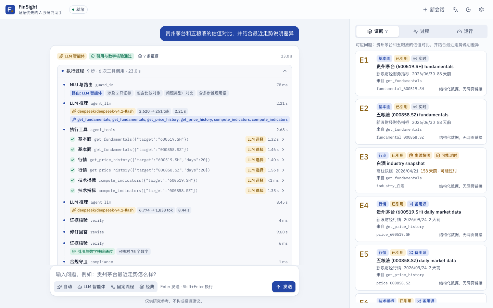
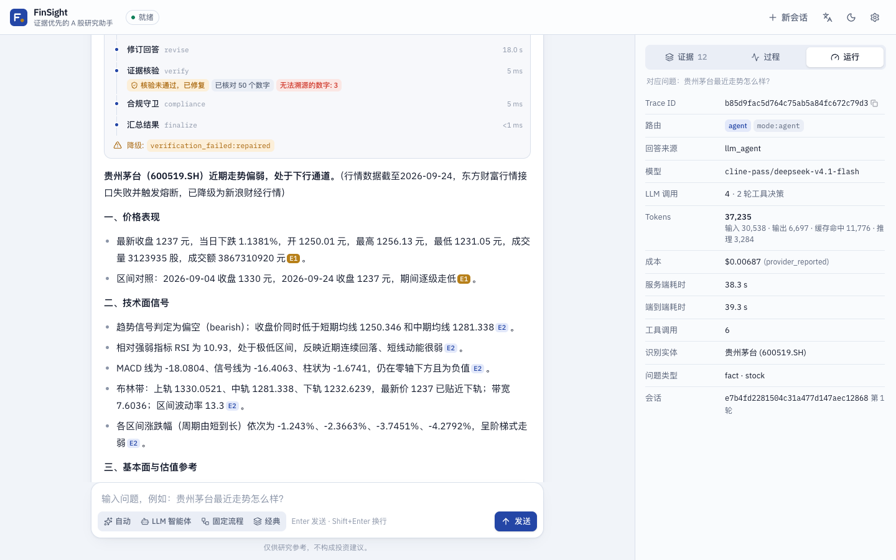
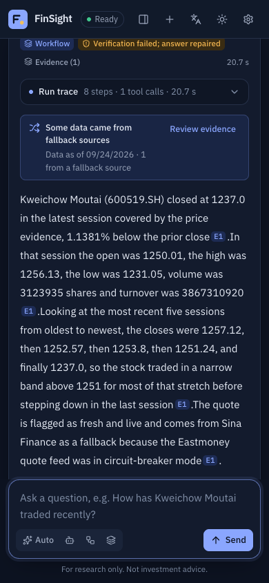

# Web UI & Local Chatbot

Languages: English | [中文](zh/frontend-chatbot.md)

The FinSight browser workspace (`frontend/src/`, built into `query_intelligence/web/dist/`) serves both the verified **LangGraph Research Agent** (`POST /agent/chat/stream`, `POST /agent/resume`, `POST /agent/claim-check`) and the paper's **Classic `/chat`** mode. Classical NLU and retrieval always stay on the backend; the UI sends user input and renders streaming traces, citation chips, KPI tiles, and verification results.

## Quick Run

```bash
pip install -r requirements.txt
export DEEPSEEK_API_KEY=...              # omit to run in deterministic mode
python scripts/launch_chatbot.py         # opens on http://127.0.0.1:8765/
```

## Workspace Capabilities



<p>
  
  &nbsp;
  
</p>

- **Pre-first-token progress & SSE streaming**: Displays the active four-step pipeline (Plan → Get data → Draft → Verify), live tool calls with target symbols, elapsed time, and a Stop control driven by `node_start`, `step`, `tool_call`, `tool_result`, and `answer_delta` events. The final verified `answer` event atomically replaces the streamed preview and flags edits when verification or compliance modified the draft.
- **Evidence ledger & freshness badges**: `[evidence_id]` references render as clickable `E1`, `E2`, … chips highlighting the corresponding evidence card with `Live`, `Fallback source`, `Cached`, `Offline snapshot`, and `May be stale` badges derived from `provenance`.
- **KPI tiles & price charts**: Lazy-loaded TradingView Lightweight Charts v5 price curves and KPI tiles (A-share red-up / green-down palette) showing explicit valuation dates (`valuation_date`), report periods, and primary-source accounting definitions (`ROE（加权）`, `归母净利润`, `营业总收入`).
- **Claim Check tab (`ClaimCheck.tsx`)**: Dedicated LLM-free fact-checking view (`POST /agent/claim-check`) displaying comparators, claimed vs actual values, relative differences, sources, and dates; hearsay messages in chat also render inline fact-check summaries.
- **Session, feedback & export**: Restores caller-scoped history via `GET /agent/sessions/{id}` (auto-resetting cleanly on `404` or API-key change), supports thumbs up/down feedback (`POST /agent/feedback`), Markdown export, zh/en i18n, light/dark/system themes, and full keyboard/screen-reader accessibility (0 `axe-core` WCAG 2.2 AA violations).
- **Security**: API keys are kept in `sessionStorage` by default (`localStorage` only when "Remember on this device" is explicitly enabled; see [SECURITY.md](../SECURITY.md)). The risk disclaimer stays visible at all times and no buy/sell buttons exist.

## Frontend Stack & Build

| Component | Choice |
|---|---|
| Core | React 19 + TypeScript 6 (strict) + Vite 8 (Rolldown code-splitting) |
| Styling & Primitives | Tailwind CSS v4 (`@theme` tokens) + Radix UI (`src/components/ui`) + Motion (`reducedMotion="user"`) |
| Charts | TradingView Lightweight Charts v5 (lazy-loaded on demand) |
| Testing | Vitest + Testing Library + Playwright E2E + `axe-core` |

```bash
cd frontend
pnpm install --frozen-lockfile
pnpm dev                                       # http://localhost:5173 proxying to :8765
pnpm typecheck && pnpm lint && pnpm test
pnpm build                                     # writes query_intelligence/web/dist/ (commit with source)
FINSIGHT_PYTHON=../.venv/bin/python pnpm run e2e
```

FastAPI serves `query_intelligence/web/dist/index.html` at `GET /` (falling back to the legacy single-file page when `QI_WEB_UI=legacy`). CI verifies that the committed bundle matches `frontend/src/`.

## Classic `/chat` Mode & LLM Configuration

In Classic mode (`POST /chat`, `mode=workflow`), FinSight executes `QueryIntelligenceService.run_pipeline` and calls an OpenAI-compatible chat-completions endpoint (`response_format={"type":"json_object"}`), falling back to a structured summary (`llm.status="fallback"`) when unreachable or keyless. Out-of-scope queries short-circuit before any LLM call, and all LLM drafts pass compliance filtering.

| Env Variable | Default | Purpose |
|---|---|---|
| `DEEPSEEK_API_KEY` | empty | API key for any OpenAI-compatible provider |
| `DEEPSEEK_BASE_URL` / `DEEPSEEK_CHAT_PATH` | `https://api.deepseek.com` / `/chat/completions` | Provider endpoint |
| `DEEPSEEK_MODEL` | `deepseek-v4-flash` | Target model ID |
| `DEEPSEEK_TIMEOUT_SECONDS` / `DEEPSEEK_MAX_TOKENS` | `60` / `8192` | Request timeout and output cap |
| `DEEPSEEK_THINKING_TYPE` / `DEEPSEEK_REASONING_EFFORT` | `enabled` / `high` | Reasoning parameters (when supported by provider) |

## Verification

```bash
python -m pytest -q tests/test_web_ui.py
cd frontend && pnpm test && FINSIGHT_PYTHON=../.venv/bin/python pnpm run e2e
```
