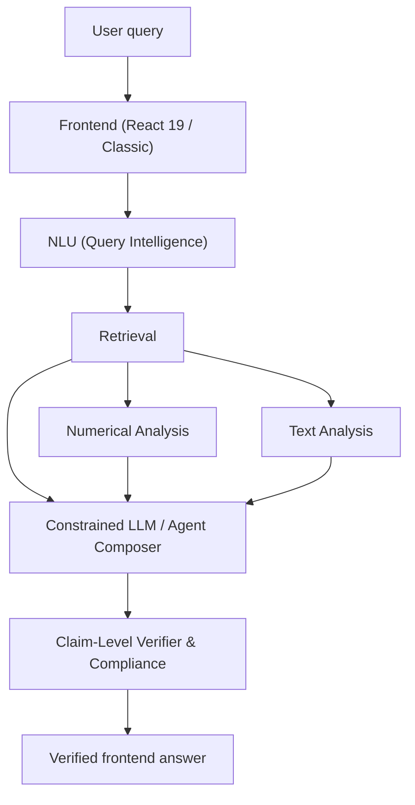

# FinSight Modules

Languages: English | [中文](zh/modules.md)

FinSight builds on the **five foundational modules** presented in our published paper (*FinSight: An Evidence-First Financial Analysis Chatbot with Explainable Query Intelligence*, FAIA Vol. 433 / DMI 2026, DOI: [`10.3233/FAIA261107`](https://ebooks.iospress.nl/doi/10.3233/FAIA261107)), plus a **sixth Agent orchestration & verification layer** built on top of them. Each stage has a strict responsibility boundary and exchanges typed artifacts with downstream consumers.

## Module Overview

| Module | Layer | Responsibility | Main outputs | Detailed docs |
|---|---|---|---|---|
| Frontend | Paper core + Agent UI | Browser interaction (`frontend/` React 19 workspace and `/chat` classic flow), live trace & evidence ledger, KPI tiles, claim-check view, and bilingual UX. | Chat/Agent UI state, rendered verified answer, citation chips, source cards. | [Local Frontend Chatbot](frontend-chatbot.md) |
| NLU and Retrieval | Paper core | Normalize the query, resolve entities, classify intent/topic/style, plan sources, retrieve documents and structured rows, rank evidence, and package traceable outputs. | `nlu_result`, `retrieval_result`, coverage, warnings, debug trace. | [Query Intelligence](query-intelligence.md) |
| Numerical Analysis | Paper core | Convert structured market, fundamental, valuation, macro, and price-history rows into compact analytical signals. | `analysis_summary.market_signal`, `fundamental_signal`, `macro_signal`, `data_readiness`. | [Numerical Analysis](numerical-analysis.md) |
| Text Analysis | Paper core | Clean retrieved documents, detect language, filter entity-relevant sentences, and classify financial sentiment. | `SentimentResult`, document-level `SentimentItem`, entity aggregates. | [Document Sentiment Analysis](sentiment.md) |
| LLM Summary and Prediction | Paper core | Generate frontend-ready answer JSON and follow-up question suggestions from compact evidence. | `answer_generation`, `next_question_prediction`, citations, disclaimer. | [LLM Response Handoff](llm-response.md) |
| Agent Layer (Orchestration & Verification) | Post-paper extension | Route each turn, invoke the modules above as 9 typed tools (deterministic plan or LLM tool loop), verify sentence-level citations and numbers, run LLM-free claim checks, apply compliance, and persist session memory. | `AgentChatResponse` with tool calls, evidence sources, verification report, trace id. | [Agent Layer](agent.md) |

## Data Flow

## Boundaries

- The frontend should not infer financial intent or source plans. It sends user input and renders returned evidence.
- NLU and Retrieval should stay explainable and evidence-producing. They do not write final investment answers.
- Numerical analysis summarizes structured evidence. It does not claim causal forecasts.
- Text analysis classifies retrieved documents. It does not retrieve new sources independently.
- LLM summary and the Agent composer use only compact evidence and cited evidence IDs. They must not invent missing facts.

## Where to Change Things

| Task | Start here |
|---|---|
| Add a new endpoint or contract field | `query_intelligence/contracts.py` and `schemas/`, then update [Query Intelligence](query-intelligence.md) and both READMEs. |
| Add a new source provider | `query_intelligence/integrations/`, retrieval source planning, and provider config. |
| Add a new numerical indicator | `query_intelligence/retrieval/market_analyzer.py`, then update [Numerical Analysis](numerical-analysis.md). |
| Change frontend display | `frontend/src/` (rebuild into `query_intelligence/web/dist/` via `pnpm build`), legacy fallback in `query_intelligence/web/static/`, and `query_intelligence/chat/`, then update [Local Frontend Chatbot](frontend-chatbot.md). |
| Change sentiment preprocessing or labels | `sentiment/` (and `query_intelligence/agent/tools/sentiment.py` if exposed to agent tools), then update [Document Sentiment Analysis](sentiment.md). |
| Add or change an agent tool | `query_intelligence/agent/tools/`, register it in `tools/defaults.py`, then update [Agent Layer](agent.md) and the eval tasks. |
| Change LLM JSON output | `scripts/llm_response.py` and `/chat` response mapping, then update [LLM Response Handoff](llm-response.md). |
