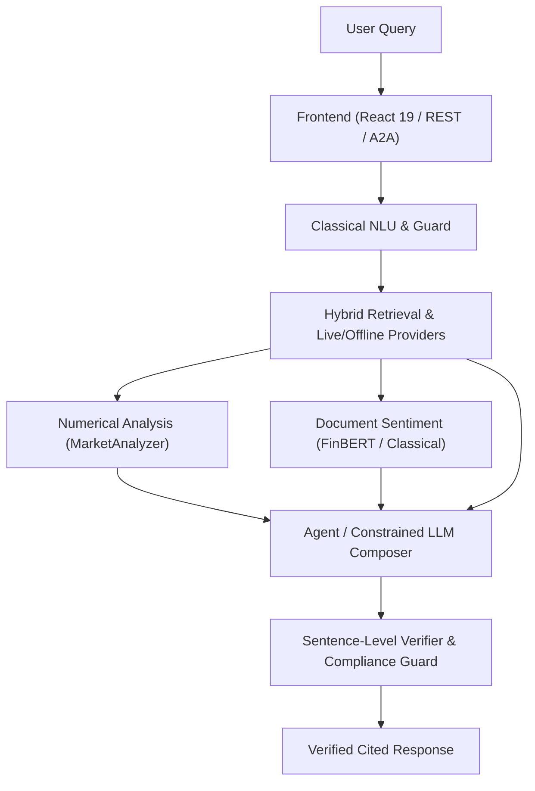

# System Modules

Languages: English | [中文](zh/modules.md)

FinSight is organized into **five foundational modules** from the published paper ([DOI: `10.3233/FAIA261107`](https://ebooks.iospress.nl/doi/10.3233/FAIA261107)) plus a **sixth Agent orchestration layer**. Each stage owns a narrow contract and passes typed artifacts downstream.

## Module Map

| Module | Layer | Primary Responsibility | Key Artifacts | Guide |
|---|---|---|---|---|
| **Web UI / Frontend** | Paper + Agent | React 19 workspace (`frontend/src/` → `query_intelligence/web/dist/`) and classic `/chat` client; renders streaming traces, citation chips, KPI tiles, and claim checks. | UI state, cited answer view, evidence cards | [frontend-chatbot.md](frontend-chatbot.md) |
| **Query Intelligence** | Paper core | Classical NLU (`query_intelligence/nlu/`) and hybrid retrieval (`query_intelligence/retrieval/`): normalization, entity/alias/CRF resolution, classifiers, OOS/clarification gates, source planning, LTR ranking. | `NLUResult`, `RetrievalResult`, coverage, warnings | [query-intelligence.md](query-intelligence.md) |
| **Numerical Analysis** | Paper core | Computes technical indicators, valuation context, macro direction, and data-readiness flags from structured rows (`market_analyzer.py`). | `analysis_summary` (`market_signal`, `fundamental_signal`, `macro_signal`, `data_readiness`) | [numerical-analysis.md](numerical-analysis.md) |
| **Document Sentiment** | Paper core | Cleans retrieved documents, detects language, filters entity-relevant sentences, and runs per-sentence FinBERT or classical fallback (`sentiment/`). | `SentimentResult`, `SentimentItem`, `FilterMeta` | [sentiment.md](sentiment.md) |
| **Constrained LLM Handoff** | Paper core | Produces validated `answer_generation` and `next_question_prediction` JSON from compact evidence (`scripts/llm_response.py`, `query_intelligence/chat/`). | Structured JSON answer, 3 follow-ups, disclaimer | [llm-response.md](llm-response.md) |
| **Agent Orchestration** | Extension | Routes simple vs complex turns, executes 9 typed read-only tools (deterministic planner or LangGraph LLM loop), verifies every numeric claim per sentence, runs LLM-free claim checks, and persists checkpoints (`query_intelligence/agent/`). | `AgentChatResponse`, verification report, trace ID, MCP/A2A responses | [agent.md](agent.md) |

## End-to-End Data Flow

## Architectural Boundaries

- **Frontend** sends user messages and renders typed responses; it never re-infers financial intent or source plans.
- **Query Intelligence** stays classical, deterministic/explainable, and evidence-producing; it never outputs buy/sell recommendations.
- **Numerical & Text Analysis** operate strictly on upstream retrieved evidence without introducing hidden retrieval paths.
- **Agent & LLM Composers** treat all retrieved text as untrusted data, cite only `evidence_id`s returned in the run, and fall back to deterministic templates when no LLM is available.

## Where to Edit

| Change | Starting Path |
|---|---|
| Public API schemas / contracts | `query_intelligence/contracts.py` and `schemas/*.schema.json` |
| NLU rules, lexicons, or models | `query_intelligence/nlu/`, `data/runtime/`, `training/` |
| Data providers & circuit breakers | `query_intelligence/integrations/` |
| Technical / fundamental indicators | `query_intelligence/retrieval/market_analyzer.py` |
| Sentiment models or preprocessing | `sentiment/`, `query_intelligence/agent/tools/sentiment.py` |
| Agent graph, tools, or verifier | `query_intelligence/agent/` (`tools/defaults.py`, `verifier.py`, `output_safety.py`) |
| Web interface | `frontend/src/` (run `pnpm build` to update `query_intelligence/web/dist/`) |
