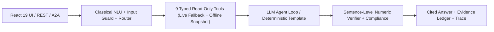

# FinSight Slide Outline

Concise deck outline for conference talks and technical demos of **FinSight** (*FAIA* Vol. 433 / DMI 2026, IOS Press; DOI: [`10.3233/FAIA261107`](https://ebooks.iospress.nl/doi/10.3233/FAIA261107)).

## 1. Motivation
- General chatbots hallucinate prices, confuse company entities, omit sources, and emit unlicensed buy/sell calls.
- Financial QA demands **strict separation between explainable evidence production and downstream narration**.

## 2. Two-Layer Architecture
- **Layer 1 — Explainable Query Intelligence (FAIA 2026 Paper)**: Classical NLU (`query_intelligence/nlu/`: normalization, alias/CRF/typo resolution, TF-IDF + linear/tree classifiers, OOS & clarification gates, source planner), hybrid retrieval & `MarketAnalyzer` (`query_intelligence/retrieval/`), FinBERT document sentiment (`sentiment/`), and constrained JSON handoff (`scripts/llm_response.py`).
- **Layer 2 — Verified Research Agent (Post-Paper Extension)**: LangGraph tool loop + deterministic fallback (`query_intelligence/agent/`), 9 typed read-only tools with live multi-source circuit breakers, sentence-level numeric claim verifier (`verifier.py`), LLM-free Claim Check (`claim_check.py`), MCP + A2A 1.0, and React 19 UI (`frontend/`).



## 3. Core Technical Highlights
- **Classical, inspectable routing**: Rules, lexicons, CRF, and LTR explain every entity match, rank score, and route decision.
- **Sentence-level numeric verification**: Every number must appear in the `evidence_id` cited *in that same sentence* (unit-, precision-, and sign-aware).
- **Defense in depth**: Read-only tools, untrusted-data envelopes, output safety attribution, forecast/foreign-listing/lookalike guards, and hard removal of trading instructions.
- **Zero-key resilience**: Runs fully offline without an LLM API key; degrades gracefully on upstream 429/503 or provider blocks.

## 4. Headline Benchmarks
- **Paper NLU & Retrieval (10,000 bilingual queries)**: `0.975` finance recall · `0.9729` OOS accuracy · `0.9407` intent F1 · `0.9208` topic F1 · `0.9664` Recall@10 · `32/32` contract fuzz checks.
- **Independent Test v3 (130 tasks, untouched first run, DeepSeek)**: Agent **`0.869`** vs. LLM composition `0.831`, deterministic workflow `0.769`, no-tool LLM `0/130`.
- **Verifier Stress (333 gold, 5,631 corrupted)**: **`0.92%`** strict false-accept (`0.0%` cross-company swaps), `100%` true-accept.
- **Prompt-Injection Red Team**: Template path `0 / 3,796` across 16 sets; latest targeted LLM slice `0/16` agent, `0/13` composition.
- **Latency & Scale**: DeepSeek P95 `15.4 s` (~3 s TTFT); `0` errors across `400` chaos-load requests; linear k3s scaling (`1 → 3` replicas) with Postgres-shared sessions.

## 5. Live Demo Flow
```bash
uvicorn query_intelligence.api.app:create_app --factory --port 8765
```
1. Factual + valuation query: `"贵州茅台和五粮液的市盈率和ROE哪个更低？"` → streaming trace, citation chips, KPI tiles.
2. Multi-turn follow-up: `"前者最近走势怎么样？"` → coreference resolution + price chart.
3. Hearsay / Claim Check tab: `"听说茅台市盈率只有15倍"` → deterministic contradicted verdict with primary-source date.
4. Safety / compliance probes: `"写一段Python代码"` (refuse), `"现在能满仓买入吗"` (hedged, no advice), `"腾讯港股现价"` (`out_of_coverage`).
