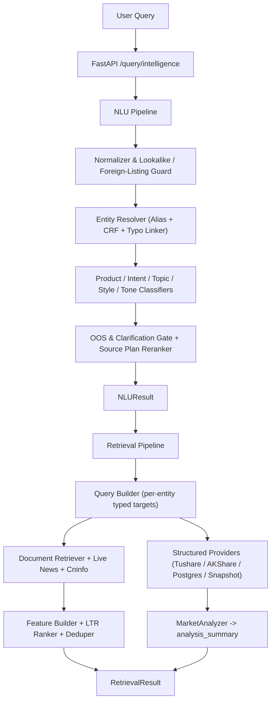

# Query Intelligence

Languages: English | [中文](zh/query-intelligence.md)

**Query Intelligence** is the classical, explainable ML core of FinSight published in *FinSight: An Evidence-First Financial Analysis Chatbot with Explainable Query Intelligence* (*Frontiers in Artificial Intelligence and Applications*, Vol. 433 / DMI 2026, IOS Press; DOI: [`10.3233/FAIA261107`](https://ebooks.iospress.nl/doi/10.3233/FAIA261107)).

It converts a raw financial question into two typed, inspectable JSON artifacts:

- **`NLUResult`**: normalized text, resolved entities, product type, multi-label intents/topics, question style, time scope, missing slots, risk flags, source plan, and matched-rule/feature explanations.
- **`RetrievalResult`**: executed sources, ranked document and structured evidence rows with stable `evidence_id`s, coverage flags, warnings, debug traces, and `analysis_summary`.

> [!NOTE]
> **Paper Benchmark (`10.3233/FAIA261107`):** Evaluated on 10,000 bilingual queries (6,236 finance-domain, 3,764 out-of-scope), Query Intelligence achieves **0.975** finance recall, **0.9729** OOS rejection accuracy, **0.9407** intent micro-F1, **0.9208** topic micro-F1, **0.9664** retrieval Recall@10, and **32/32** end-to-end fuzz contract checks.

## Scope & Architecture

Default coverage targets Chinese financial markets: A-share equities, ETFs/open funds, major indices, industry sectors, and macro/policy indicators. Non-financial or out-of-coverage queries are marked `out_of_scope` before retrieval or any LLM call.

The NLU and retrieval backbone uses **classical, explainable ML only** (rules, lexicons, TF-IDF, linear/tree classifiers, CRF, LTR, and PostgreSQL full-text search). Downstream modules ([Numerical Analysis](numerical-analysis.md), [Document Sentiment](sentiment.md), [LLM Response Handoff](llm-response.md), and the [Agent Layer](agent.md)) consume its typed outputs without re-inferring intent or entities.



## Module Paths

| Path | Responsibility |
|---|---|
| `query_intelligence/service.py` | End-to-end NLU + Retrieval orchestration |
| `query_intelligence/contracts.py` | Pydantic models mirrored to `schemas/*.schema.json` |
| `query_intelligence/config.py` | Environment-driven runtime settings |
| `query_intelligence/data_loader.py` | Runtime entity/alias/corpus/snapshot loaders |
| `query_intelligence/nlu/` | Normalization, entity/alias/CRF/lookalike resolution, classifiers, source planning |
| `query_intelligence/retrieval/` | Query builder, document & structured retrievers, LTR ranker, `MarketAnalyzer` |
| `query_intelligence/integrations/` | Tushare, AKShare, Cninfo, and efinance adapters |

## API Endpoints

| Endpoint | Input | Output |
|---|---|---|
| `POST /nlu/analyze` | `AnalyzeRequest` | `NLUResult` |
| `POST /retrieval/search` | `RetrievalRequest` | `RetrievalResult` |
| `POST /query/intelligence` | `PipelineRequest` | `PipelineResponse` (`nlu_result` + `retrieval_result`) |
| `POST /query/intelligence/artifacts` | `ArtifactRequest` | Artifact file paths (`query.txt`, `nlu_result.json`, `retrieval_result.json`, `manifest.json`) |

### `PipelineRequest` Example

```json
{
  "query": "What do you think about Ping An Insurance (601318.SH)?",
  "user_profile": {"risk_preference": "balanced", "holding_symbols": ["601318.SH"]},
  "dialog_context": [{"role": "user", "content": "I hold Ping An Insurance."}],
  "top_k": 10,
  "debug": false
}
```

`query` accepts 1–2,000 characters; `top_k` accepts 1–100 (default `20`); keep `debug: false` in production.

## Contracts

### `NLUResult`

| Field | Description |
|---|---|
| `query_id`, `raw_query`, `normalized_query` | Shared UUID and raw/normalized query text |
| `product_type` | Single-label prediction: `stock`, `etf`, `fund`, `index`, `macro`, `generic_market`, `unknown`, `out_of_scope` |
| `intent_labels[]` | Multi-label: `price_query`, `market_explanation`, `hold_judgment`, `buy_sell_timing`, `product_info`, `risk_analysis`, `peer_compare`, `fundamental_analysis`, `valuation_analysis`, `macro_policy_impact`, `event_news_query`, `trading_rule_fee` |
| `topic_labels[]` | Multi-label: `price`, `news`, `industry`, `macro`, `policy`, `fundamentals`, `valuation`, `risk`, `comparison`, `product_mechanism` |
| `question_style` | `fact`, `why`, `compare`, `advice`, `forecast` |
| `entities[]` | `mention`, `entity_type`, `canonical_name`, `symbol` (`^[A-Za-z0-9._-]+$`, ≤64 chars), `exchange`, `match_type`, `confidence` |
| `comparison_targets[]`, `keywords[]` | Paired comparison subjects and retrieval keywords |
| `time_scope`, `forecast_horizon`, `sentiment_of_user`, `operation_preference` | Temporal window, horizon, user tone, and trading-action preference |
| `required_evidence_types[]`, `source_plan[]` | Needed evidence categories and ordered retrieval sources |
| `risk_flags[]`, `missing_slots[]` | Safety/clarification triggers (`investment_advice_like`, `out_of_scope_query`, `entity_not_found`, `clarification_required`, `missing_entity`, `comparison_target`) |
| `confidence`, `explainability` | Confidence score, matched rules, and top linear/tree features |

### `RetrievalResult`

| Field | Description |
|---|---|
| `query_id`, `nlu_snapshot`, `executed_sources[]` | Run correlation and sources actually executed |
| `documents[]` | Ranked `news`, `announcement`, `research_note`, `faq`, `product_doc` items with `evidence_id`, `source_url`, `publish_time`, `rank_score`, and `reason[]` |
| `structured_data[]` | `market_api`, `fundamental_sql`, `industry_sql`, `macro_sql`, `fund_*`, `index_*`, `macro_indicator`, `policy_event` rows with `provider_endpoint`, `source_reference`, `as_of`, `quality_flags`, and `payload` |
| `evidence_groups[]` | Deduplication/clustering groups |
| `coverage`, `coverage_detail` | High-level and fine-grained evidence completeness flags |
| `warnings[]` | E.g. `out_of_scope_query`, `clarification_required_missing_entity`, `announcement_not_found_recent_window` |
| `analysis_summary` | Pre-computed technical, fundamental, macro, and data-readiness signals ([numerical-analysis.md](numerical-analysis.md)) |
| `retrieval_confidence`, `debug_trace` | Confidence score and candidate/ranking debug trace |

## Runtime Configuration

| Variable | Default | Purpose |
|---|---|---|
| `TUSHARE_TOKEN` | empty | Enables Tushare daily/financial/news providers |
| `QI_POSTGRES_DSN` | empty | PostgreSQL connection string for structured/FTS stores |
| `QI_USE_LIVE_MARKET` / `_NEWS` / `_ANNOUNCEMENT` / `_MACRO` | `false` (core CLI) / `true` (app default) | Toggle live external providers vs offline snapshot |
| `QI_USE_POSTGRES_RETRIEVAL` | `false` | Route document/structured retrieval to PostgreSQL |
| `QI_HTTP_TIMEOUT_SECONDS` | `15` | Upstream HTTP timeout |
| `QI_MODELS_DIR` | `models` | Directory containing shipped `.joblib` artifacts and `manifest.json` |
| `QI_ENTITY_MASTER_PATH`, `QI_ALIAS_TABLE_PATH`, `QI_DOCUMENTS_PATH` | auto | Override shipped runtime files in `data/runtime/` |

**Asset load precedence**: explicit env override → `data/runtime/*` → `data/*`.

## Troubleshooting

| Symptom | Resolution |
|---|---|
| Stock resolves during training but not runtime | Run `python -m scripts.materialize_runtime_entity_assets` to refresh `data/runtime/`. |
| `source_url` is null on structured rows | Expected for API-only feeds; use `provider_endpoint`, `query_params`, and `source_reference`. |
| `executed_sources` is smaller than `source_plan` | Check live toggles, provider tokens, missing symbols, or OOS/clarification short-circuits. |
| Only seed rows returned | Enable live providers or configure `QI_POSTGRES_DSN`. |
