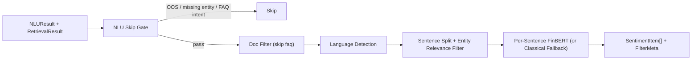

# Document Sentiment Analysis

Languages: English | [中文](zh/sentiment.md)

`sentiment/` is a downstream module from the FinSight architecture ([DOI: `10.3233/FAIA261107`](https://ebooks.iospress.nl/doi/10.3233/FAIA261107)) that consumes `NLUResult` and `RetrievalResult` and assigns document-level financial tone (`positive`, `negative`, or `neutral`). It is also exposed to the Agent and MCP servers via the `analyze_sentiment` tool (`query_intelligence/agent/tools/sentiment.py`), which automatically falls back to `ClassicalSentimentBackend` when FinBERT weights or `torch` are unavailable offline.

## Pipeline



## Filtering & Preprocessing Rules

- **Query-level skip**: Skipped when `product_type == "out_of_scope"`, `risk_flags` contains `out_of_scope_query`, `missing_slots` contains `missing_entity`, or intents are purely `product_info` / `trading_rule_fee`.
- **Document types**: Analyzes `news`, `announcement`, `research_note`, and `product_doc`; skips `faq`. Falls back to `title + summary` (`text_level: "short"`) when full body text is absent.
- **Language & sentence routing**: Detects Chinese, English, or mixed text (`lingua-language-detector` with character-ratio fallback), segments sentences, retains entity-relevant sentences (falling back to title + leading sentences if none match), runs per-sentence inference (`ProsusAI/finbert` for English, Chinese FinBERT family for Chinese), and aggregates per document.

## Usage

```bash
# Integrated into manual Query Intelligence CLI
python manual_test/run_manual_query.py --query "贵州茅台近期有什么新闻？" --sentiment
python manual_test/run_manual_query.py --query "贵州茅台近期有什么新闻？" --sentiment --real-models

# Standalone runner
python manual_test/run_sentiment_test.py --input manual_test/output/<run-dir>
```

```python
from sentiment import Preprocessor, SentimentClassifier

skip_reason, docs, filter_meta = Preprocessor().process_query(nlu_result, retrieval_result)
if not skip_reason:
    items = SentimentClassifier().analyze_documents(docs)
```

## Output Contract

- **`SentimentItem`**: `evidence_id`, `source_type`, `title`, `publish_time`, `source_name`, `entity_symbols[]`, `sentiment_label` (`positive|negative|neutral`), `sentiment_score` (`0.0–1.0`), `confidence`, `text_level` (`full|short`), `relevant_excerpt`, `rank_score`.
- **`FilterMeta`**: `skipped_by_product_type`, `skipped_by_intent`, `skipped_docs_count`, `short_text_fallback_count`, `analyzed_docs_count`.

## Tests

```bash
python -m pytest -q tests/test_sentiment_preprocessor.py tests/test_sentiment_classifier.py tests/test_sentiment_pipeline.py
```
