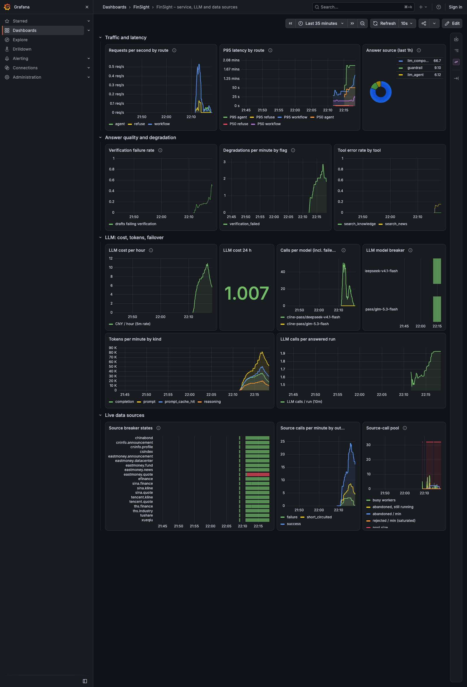

# A2A 协议、模型容灾与可观测性

语言：[English](../a2a-and-observability.md) | 中文

本文涵盖 FinSight 的 Agent 互操作协议（A2A 1.0）、PostgreSQL 多副本共享存储、LLM 容灾与计费、运行追踪（Trace）、Prometheus/Grafana/Jaeger 监控、故障演练与审计日志。

## A2A（Agent2Agent 1.0）

MCP 暴露单个工具，**A2A**（`query_intelligence/agent/a2a_server.py`，基于 `a2a-sdk` 1.x）则将整个研究 Agent 暴露给其他 Agent，接收自然语言问题并返回带引用的验证结果。

| 接口 | 用途 |
|---|---|
| `GET /.well-known/agent-card.json` | 公开服务发现卡片，声明技能（`equity_research`、`comparison`、`macro_linkage`）、JSON-RPC 与流式能力 |
| `POST /a2a` | A2A 1.0 JSON-RPC 2.0 入口（`SendMessage`、`SendStreamingMessage`、`GetTask`、`SubscribeToTask`、`CancelTask`），需携带 `A2A-Version: 1.0` |

**核心行为与隔离**：
- **租户隔离与防探测**：任务与会话归属调用方主身份（`key:<sha256[:12]>` 或签名 Cookie）。客户端传入的 `contextId` 必须属于自身已有会话（不存在或跨租户均返回一致的 `"Context not found."`），并强制执行 `MAX_QUERY_LENGTH=2000`。
- **澄清与产物**：缺少标的时返回 `TASK_STATE_INPUT_REQUIRED`，同任务/上下文后续消息自动恢复执行；完成任务输出 `answer`（带引用回答与免责声明）与 `evidence`（结构化证据、校验报告、Trace ID 与推荐追问）两份产物。
- **跨框架互操作**：已通过官方 JavaScript SDK（`@a2a-js/sdk` 1.2.1，`tools/a2a-js-client/interop.mjs`）全部 **16/16** 项互操作校验（含对已结束任务调用 `SubscribeToTask` 返回 `-32004 UnsupportedOperationError`），详见 [`a2a-js-interop.txt`](../results/protocols/a2a-js-interop.txt)。
- **开关**：`QI_A2A_ENABLED=0` 关闭路由，`QI_A2A_MODE`（默认 `auto`）指定模式，`QI_PUBLIC_BASE_URL` 配置卡片广播地址。

```bash
python scripts/a2a_client_demo.py --url http://127.0.0.1:8000
python -m pytest -q tests/test_agent_observability_a2a.py tests/test_a2a_client_demo.py tests/test_a2a_js_interop.py
```

## 多副本共享存储（PostgreSQL）

配置 `QI_AGENT_CHECKPOINT_DB=postgresql://...` 即可将四类有状态数据统一迁移至 PostgreSQL，支持无状态多副本水平扩展：

| 状态数据 | 默认内存实现 | PostgreSQL 存储 | 单独覆盖 |
|---|---|---|---|
| 会话检查点 | `InMemorySaver` | LangGraph `PostgresSaver` 表 | — |
| A2A 任务 | `BoundedInMemoryTaskStore`（上限 2,000） | `finsight_a2a_tasks`（默认保留 7 天） | `QI_A2A_TASK_DB=memory` |
| 运行 Trace（`/agent/traces*`） | `RecentTraceStore`（最近 200 条） | `finsight_agent_traces`（上限 50,000 / 14 天） | `QI_AGENT_TRACE_DB=memory` |
| 限流令牌桶 | 进程内令牌桶 | `finsight_rate_buckets` | `QI_RATE_LIMIT_DB=memory` |

所有表按 `owner` 严格隔离；数据库不可达时（`QI_STORE_CONNECT_TIMEOUT_S=5`）自动打印脱敏告警并安全回退至本地内存。双副本验证见 [docs/results/protocols/README.md](../results/protocols/README.md)。

## LLM 网关、模型容灾与计费

`query_intelligence/agent/llm.py` 同时兼容标准 OpenAI Chat Completions 与信封格式网关（`{"success": true, "data": {...}}`）。

- **模型容灾（`QI_LLM_FALLBACK_MODELS`）**：`FallbackLLM` 为每个模型维护独立熔断器（连续失败 3 次熔断 60 秒后半开探测），流式失败不会将备选模型分片拼接到残缺输出上；全部模型不可用时无缝降级至确定性模板回答（`degraded: llm_error`）。
- **成本核算**：优先使用自定义价表（`QI_LLM_PRICE_*`），否则读取网关返回的 `usage.cost` 并按 `QI_LLM_USD_CNY` 换算，分模型统计输入/输出/缓存命中/推理 Token。

## 运行检查器与 Prometheus / Grafana / Jaeger

- **运行检查器**：`GET /agent/traces[/{trace_id}]` 查看节点、工具与 LLM 详情（匿名访问返回 `403`）；`POST /agent/feedback` 记录赞/踩至 `QI_FEEDBACK_PATH`；设置 `QI_AGENT_OTEL=1` 或 `OTEL_EXPORTER_OTLP_ENDPOINT` 导出 OTLP Span 至 Jaeger/Tempo/Langfuse。
- **Prometheus 指标（`GET /metrics`）**：覆盖流量与延迟（`finsight_agent_runs_total`、`finsight_agent_run_seconds`）、工具与校验结果（`finsight_tool_calls_total`、`finsight_answer_verification_total`）、LLM 成本与熔断（`finsight_llm_cost_total`、`finsight_llm_circuit_state`）、数据源熔断与线程池（`finsight_source_circuit_state`、`finsight_source_pool_*`）以及安全审计指标（`finsight_audit_events_total`、`finsight_output_safety_edits_total`）。
- **监控栈**：`docker compose -f docker/docker-compose.yml --profile monitoring up -d`（端口默认仅监听 `127.0.0.1`），内置 26 面板 Grafana 看板（`monitoring/grafana/finsight-dashboard.json`）与 14 条 Prometheus 告警规则（`monitoring/prometheus/alerts.yml`，经 `promtool test rules` 与 `pytest -q tests/test_monitoring_config.py` 验证）。



## 故障演练（Chaos Drill）与审计日志

- **实网故障演练**（`scripts/chaos_drill.py`）：`--scenario llm` 注入主模型 404 验证自动切流、截止时间兜底（零 504）与熔断恢复；`--scenario sources` 阻断东财/新浪/腾讯（403）验证实时 → TTL 缓存 → 最近可用 → 显式缺失提示 → 自动恢复全链路 100% HTTP 200。
- **脱敏审计日志**（`query_intelligence/agent/audit.py`）：每次拒答、合规编辑与注入脱敏均写入 `finsight.audit`、按天轮转的 `QI_AUDIT_LOG_PATH` 及 Prometheus 计数器；仅记录主身份哈希与 HMAC-SHA256 `query_hash`（`QI_AUDIT_HASH_KEY`），绝不落盘原始提问或密钥（`pytest -q tests/test_agent_audit_metrics.py`）。
