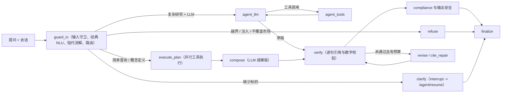

# Agent 层架构

语言：[English](../agent.md) | 中文

Agent 层（`query_intelligence/agent/`）在论文核心的 Query Intelligence 流水线（[DOI: `10.3233/FAIA261107`](https://ebooks.iospress.nl/doi/10.3233/FAIA261107)）之上构建有状态的 LangGraph 研究编排器、9 个类型化只读工具、逐句数值校验器与离线确定性兜底。经典 NLU 与混合检索始终作为可解释的路由器和证据底座。

两条执行路径共享同一张 LangGraph 状态图：

- **`workflow`**：确定性规划器根据 `NLUResult` 直接推导并并行执行工具调用；LLM 仅负责组织文字（无 API Key 时自动回退为带引用模板）。
- **`agent`**：由确定性规划预取（`planner_prefetch`）启动的 LangGraph 工具循环（`agent_llm` ⇄ `agent_tools`），在严格的步数、Token 与截止时间预算内补全所需证据。

`mode=auto` 按每轮复杂度自动分流；`mode=workflow` 与 `mode=agent` 仅覆盖执行路径，永不绕过输入与合规守卫。未配置 Key 或遇到故障/超时时，`agent` 自动降级为 `workflow` 并在 `degraded` 中显式标记。

## 状态图



| 节点 | 核心职责 |
|---|---|
| `guard_in` | 剥离用户消息中的指令注入片段、识别回答语种、带会话上下文运行经典 NLU、消解代词/复数/省略追问、检查市场覆盖范围（A 股/基金/指数/中国宏观）并记录 `route_reasons`。 |
| `refuse` | 以用户语种拒答，并返回机器码（`out_of_scope_query`、`prompt_injection_request` 或 `out_of_coverage`）。 |
| `clarify` | 缺少标的时通过 LangGraph `interrupt()` 暂停，等待 `POST /agent/resume` 或下一轮仅含标的的回复继续。 |
| `execute_plan` | 并行执行规划好的工具调用（`max_parallel_tools=4`）。 |
| `agent_llm` / `agent_tools` | 规划预取驱动的工具循环，受 `max_llm_steps`、`max_tool_calls`、`token_budget` 与 `run_deadline_s` 约束，自动拦截同参数重复调用。 |
| `compose` | 基于已收集证据由 LLM 或 `compose_template` 生成回答，显式披露缺失的报告期、指标或标的。 |
| `verify` / `revise` | 强制执行逐句数字与 `evidence_id` 绑定；纯引用遗漏先尝试 `cite_repair`，否则触发一次定向修订，仍不通过则删除不支持子句。 |
| `compliance` / `finalize` | 执行输出安全（`output_safety.py`）、判断/预测限定语、数据新鲜度提示、语种守卫、免责声明、Trace 落盘与成本核算。 |

### 路由策略（`agent/router.py`）

守卫优先触发，其余金融问题按复杂度分流：

| 路由 | 触发条件 | 示例 |
|---|---|---|
| `refuse` | 非金融、非研究任务（写代码/翻译）、纯注入指令，或未覆盖资产（加密货币、美股/港股、GDR/ADR） | 「写个Python爬虫」「比特币还能涨吗」「腾讯港股股价」 |
| `clarify` | 无上下文的悬空指代，或缺少标的的指标/投资建议提问 | 「这只股票能买吗」「市盈率多少」 |
| `workflow` | 单一标的事实查询与金融术语定义 | 「茅台的PE和PB分别多少」「什么是LPR」 |
| `agent` | 多标的对比、归因（为什么）、宏观到市场传导、估值/判断与多跳综合研究 | 「茅台和五粮液哪个估值更低」「降息对银行股有什么影响」 |

独立测试集 v3 消融（[docs/agent-eval.md](../agent-eval.md)）验证了混合设计：DeepSeek 规划预取 `agent` 通过率 **0.869**，高于 `workflow`+LLM（**0.831**）与纯模板（**0.769**），同时预取减少约 35% LLM 调用次数并降低 P50 延迟约 3 秒。对较慢的推理模型（配置 `prefer_composition`，如 GLM），`QI_AGENT_SLOW_MODEL_POLICY=on` 在 `auto` 模式下自动选择 `workflow` + LLM 组织答案。

## 工具集

9 个只读工具统一继承自 `tools/base.py`（Pydantic Schema 同步导出至 OpenAI 工具协议与 MCP，自带超时、重试、TTL 缓存、统一错误码与稳定 `evidence_id`）：

| 工具 | 底层支撑 |
|---|---|
| `resolve_entity` | 经典 NLU 实体/别名/CRF/简称/错别字消歧（`data/runtime/`） |
| `get_price_history` | 实时降级链（Tushare 或 东财 → 新浪 → 腾讯 → efinance）+ 交易时段盘中实时价；离线快照与更正层 |
| `compute_indicators` | `MarketAnalyzer`（涨跌幅、MA5/MA20、RSI-14、MACD、布林带、20 日波动率） |
| `get_fundamentals` | 实时新浪 + 同花顺交叉核验财务指标、东财/腾讯估值；离线快照与一手会计口径标注 |
| `get_macro_indicators` | 实时东财数据中心（CPI、PMI、M2、LPR）+ 中债 10 年期国债收益率；离线快照 |
| `search_news`、`search_announcements`、`search_knowledge` | 混合检索（实时新闻 / 巨潮与东财公告 / PostgreSQL FTS / TF-IDF + LTR） |
| `analyze_sentiment` | 默认离线经典情感分类器；设置 `QI_AGENT_SENTIMENT_BACKEND=finbert` 启用 FinBERT |
| `explain_concept` | 精编中英 A 股概念与指标口径词典（`evidence_id: glossary_<term>`） |

数据工具均返回不含数字的 `provenance` 溯源元数据（详见 [data-sources.md](data-sources.md) 与 [mcp.md](mcp.md)）。

## 记忆与会话

- **服务端签发与租户隔离**：开启新会话时不传 `session_id`，后续轮次沿用服务端返回的 ID；提交不存在或属于其他调用方的 `session_id` 时，所有会话接口均返回一致的 `404`（`session <id> not found`），杜绝跨租户探测。
- **持久化与并发**：默认内存存储；配置 `QI_AGENT_CHECKPOINT_DB` 为 SQLite 路径或 `postgresql://` DSN 即可跨重启与多副本共享（`QI_AGENT_DURABILITY=exit` 每轮写入一次检查点），单会话锁串行化同会话并发请求。
- **追问与指代消解（`agent/memory.py`）**：支持代词（`它`、`这两家`、`前者/后者`）、群组对比（`三家里哪家`）、省略切换（`ROE呢`、`换成五粮液呢`）、悬空「为什么」、对比锚点继承、所属行业追问与对话内直接回复澄清，每条改写均记录 `route_reasons`。
- **会话记忆卡**：有界抽取式卡片保存最近最多 6 个 `recent_targets`、用户风险/期限/范围约束、最多 5 条 `stated_holdings` 与当前 `comparison_frame`。可选历史摘要（`QI_AGENT_MEMORY_SUMMARY=1`）默认关闭。

## 安全、合规与护栏

除 [SECURITY.md](../../SECURITY.md) 中的部署与接口安全边界外，Agent 在输入与输出链路实施多层防御：

1. **输入守卫与不可信数据信封（`agent/injection.py`、`text_safety.py`）**：在 NLU 前剥离用户消息中的提示注入指令与伪造系统标签；所有工具文档输出经不可信信封封装并脱敏注入文本。
2. **证据列表与标题卫生（`text_safety.py`）**：确定性模板永不直接引用长正文，屏蔽含链接、联系方式、荐股话术、投毒数字、未证实传闻、拼音/形近字绕过或非官方监管声称的标题。
3. **逐句数值与引用校验（`agent/verifier.py`）**：每个数字必须匹配**本句**引用的 `evidence_id`（感知单位、精度与正负号），拦截跨公司数字替换及与结构化基本面矛盾的文档数字。
4. **输出安全与合规（`agent/output_safety.py`、`agent/compliance.py`）**：将文档中转述的推广/联系方式/喊单替换为中性提示；为单源或冲突文档数字强制加注「据一篇文档称…（未经其他来源证实）」；剔除买卖、目标价与仓位建议；附加数据过期提醒与风险提示。
5. **预测、境外上市与仿冒名守卫（`stated_dates.py`、`coverage.py`、`nlu/lookalike.py`）**：
   - **未来预测**：涉及未来日期/季度/期限的股价、业绩、分红或市值问题自动触发非预测对冲（`price_forecast_hedge`、`earnings_forecast_hedge`、`market_value_forecast_hedge`），同时保留历史查询。
   - **境外上市标的**：港股/H 股、港交所代码（`data/runtime/dual_listings.csv`，100 家 A+H 对照）、港币报价、GDR、ADR 及 AH 溢价统一返回 `out_of_coverage`，绝不静默返回 A 股价格。
   - **未覆盖仿冒名**：默认拒绝策略（`lookalike.py` + `data/runtime/hk_only_names.csv`，2,239 只纯港股名单）防止「美的置业」「紫金黄金」等误配到已覆盖 A 股母公司。
6. **语种守卫**：若外部投毒文档劫持了回答语言，自动替换为与用户提问语种一致的确定性兜底回答。

## API

| 方法与路径 | 说明 |
|---|---|
| `POST /agent/chat` | 单轮 Agent 调用（`AgentChatRequest` → `AgentChatResponse`） |
| `POST /agent/chat/stream` | SSE 事件流：`session`、`node_start`、`step`、`tool_call`、`tool_result`、`answer_delta`、`answer`/`clarification`、`done`/`error` |
| `POST /agent/resume` | 幂等恢复澄清轮次（重复提交返回 `replayed: true`，无待澄清返回 `409`） |
| `POST /agent/claim-check` | 零 LLM 金融声明核查（见 [claim-check.md](claim-check.md)） |
| `POST /agent/feedback` | 按调用方隔离记录绑定 `trace_id` 的赞/踩反馈 |
| `GET /agent/sessions/{id}`、`GET /agent/traces[/{id}]` | 按调用方隔离查询会话记忆与运行轨迹 |
| `POST /chat` | 经典接口（默认 `mode=workflow`；`mode=auto|agent` 委托给 Agent） |

JSON Schema 位于 `schemas/agent_*.schema.json`（通过 `python -m scripts.export_agent_schemas` 重新导出）。

## 常用配置

| 环境变量 | 默认值 | 说明 |
|---|---|---|
| `DEEPSEEK_API_KEY` / `_BASE_URL` / `_MODEL` | 未设置 / `config/app_config.json` | OpenAI 兼容 LLM 配置；不设 Key 自动走确定性模式 |
| `DEEPSEEK_REASONING_STYLE` / `_REASONING_EFFORT` | `auto` / 配置文件 | 节点级推理参数格式（`deepseek`、`openrouter`、`none`） |
| `QI_LLM_FALLBACK_MODELS` | 未设置 | 逗号分隔的容灾模型列表，各自维护独立熔断器 |
| `QI_PROMPT_VERSION` | `v4` | 当前生效的 Prompt 版本（`v1`–`v4`） |
| `QI_AGENT_SLOW_MODEL_POLICY` | `on` | `auto` 模式下将慢速模型路由至 `workflow` + LLM 组织答案 |
| `QI_AGENT_CHECKPOINT_DB` / `QI_AGENT_DURABILITY` | 内存 / `exit` | SQLite 或 PostgreSQL 会话检查点及写入频率 |
| `QI_AGENT_REQUEST_TIMEOUT_S` | `120` | 单次请求端到端超时秒数（超时返回 `504`） |
| `QI_AGENT_PREFETCH` | `1` | 首次 LLM 调用前先执行确定性规划预取 |
| `QI_AGENT_REVISE_POLICY` | `cite_repair` | 纯引用缺失优先自动补全引用再决定是否调用 LLM 修订 |
| `QI_AGENT_LLM_STALL_TIMEOUT_S` | `20` | 流式首包/分块停滞超时秒数（`0` 关闭） |
| `QI_AGENT_VERIFY_DERIVED` | `1` | 允许同句内由已支持数字推导的和/差/比/变化率 |
| `QI_AGENT_SENTIMENT_BACKEND` | `classical` | 设为 `finbert` 加载 FinBERT 权重 |
| `QI_AGENT_TRACE_DIR` / `QI_AGENT_OTEL` | `outputs/traces` / 未设置 | 本地 JSON Trace 落盘（`off` 关闭）与 OTLP 导出 |
| `QI_API_KEYS` / `QI_RATE_LIMIT_PER_MINUTE` / `QI_MAX_REQUEST_BYTES` | 未设置 / `0` / `1048576` | 接口鉴权、限流与请求体上限 |
| `QI_TFIDF_CACHE_DIR` | 未设置 | TF-IDF 索引磁盘缓存目录（冷启动由 ~24 秒降至 ~6.8 秒） |

默认预算（`agent/state.py` `AgentConfig`）：`max_llm_steps=6`、`max_tool_calls=16`、`max_parallel_tools=4`、`token_budget=80000`、`max_revisions=1`、`run_deadline_s=90`、`answer_grace_s=20`。每次 LLM HTTP 调用、重试与容灾均受剩余截止时间约束。

## 评测与测试

```bash
python -m pytest -q tests/test_agent*.py tests/test_audit_issue7_fixes.py
python -m evaluation.agent_eval.gate
python -m evaluation.agent_eval.verifier_stress
python -m evaluation.agent_eval.fault_injection
```

完整指标与局限见 [evaluation.md](evaluation.md)、[evaluation-history.md](evaluation-history.md) 与 [known-issues.md](known-issues.md)。
