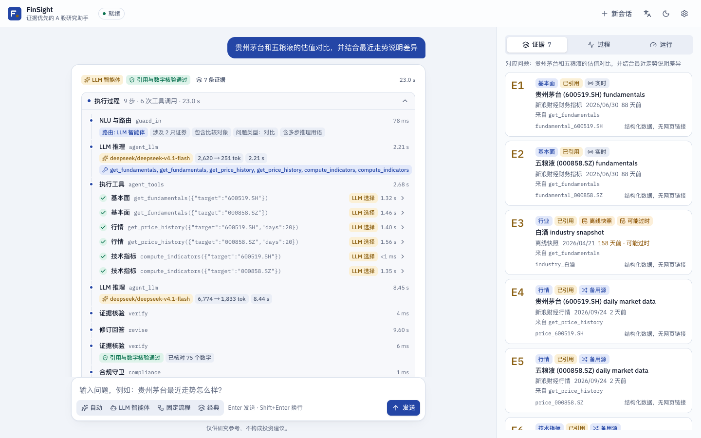
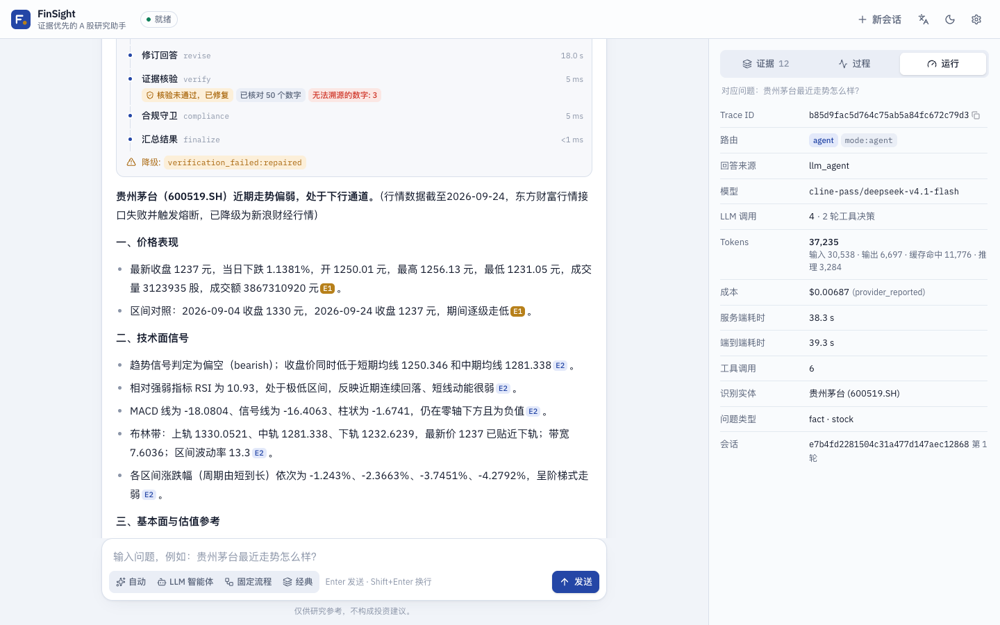
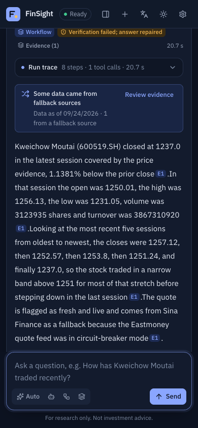

# 网页前端与本地聊天界面

语言：[English](../frontend-chatbot.md) | 中文

FinSight 浏览器工作台（源码位于 `frontend/src/`，构建产物提交于 `query_intelligence/web/dist/`）同时支持可验证的 **LangGraph 研究 Agent**（`POST /agent/chat/stream`、`POST /agent/resume`、`POST /agent/claim-check`）与论文的 **Classic `/chat`** 模式。经典 NLU 与检索始终由后端执行，前端仅负责交互与证据可视化。

## 快速运行

```bash
pip install -r requirements.txt
export DEEPSEEK_API_KEY=...              # 不设置则运行确定性模式
python scripts/launch_chatbot.py         # 访问 http://127.0.0.1:8765/
```

## 工作台功能



<p>
  
  &nbsp;
  
</p>

- **首字前进度与 SSE 流式回答**：基于 `node_start`、`step`、`tool_call`、`tool_result` 与 `answer_delta` 事件展示四阶段进度（规划 → 取数 → 撰写 → 校验）、实时工具调用、耗时与中止按钮；最终 `answer` 事件原子替换流式草稿，并在校验或合规修改后标注提示。
- **证据台账与新鲜度标签**：正文 `[evidence_id]` 渲染为可点击的 `E1`、`E2` 徽标，联动高亮对应证据卡片并依据 `provenance` 标明「实时」「备用源」「缓存」「离线快照」与「可能过时」。
- **KPI 指标卡与行情图**：按需懒加载 TradingView Lightweight Charts v5 价格曲线与 A 股红涨绿跌指标卡，明确标注估值日（`valuation_date`）、报告期与一手会计口径（`ROE（加权）`、`归母净利润`、`营业总收入`）。
- **声明核查标签页（`ClaimCheck.tsx`）**：零 LLM 事实核查视图（`POST /agent/claim-check`），清晰展示比较词、声称值与实测值、相对差、来源与日期；聊天中的传闻核实句式同步内联展示核查摘要。
- **会话恢复、反馈与导出**：通过 `GET /agent/sessions/{id}` 恢复调用方会话（`404` 或切换 API Key 时自动重置），支持赞/踩反馈（`POST /agent/feedback`）、Markdown 导出、中英双语、浅色/深色主题及无障碍支持（`axe-core` WCAG 2.2 AA 零违例）。
- **前端安全**：API Key 默认仅存于 `sessionStorage`（仅在用户主动勾选「在此设备上记住」时写入 `localStorage`，见 [SECURITY.md](../../SECURITY.md)）；风险提示常驻显示，界面不提供任何买卖操作按钮。

## 技术栈与开发构建

| 模块 | 选型 |
|---|---|
| 核心框架 | React 19 + TypeScript 6（strict）+ Vite 8（Rolldown 分包） |
| 样式与交互原语 | Tailwind CSS v4（`@theme` 令牌）+ Radix UI（`src/components/ui`）+ Motion（`reducedMotion="user"`） |
| 图表 | TradingView Lightweight Charts v5（按需懒加载） |
| 测试 | Vitest + Testing Library + Playwright E2E + `axe-core` |

```bash
cd frontend
pnpm install --frozen-lockfile
pnpm dev                                       # http://localhost:5173 代理至 :8765
pnpm typecheck && pnpm lint && pnpm test
pnpm build                                     # 输出至 query_intelligence/web/dist/（随源码提交）
FINSIGHT_PYTHON=../.venv/bin/python pnpm run e2e
```

FastAPI 在 `GET /` 托管 `query_intelligence/web/dist/index.html`（设置 `QI_WEB_UI=legacy` 可切回旧版单页）；CI 自动检查已提交产物与 `frontend/src/` 一致。

## Classic `/chat` 模式与 LLM 配置

在经典模式（`POST /chat`，`mode=workflow`）下，后端运行 `QueryIntelligenceService.run_pipeline` 并调用 OpenAI 兼容聊天补全接口（`response_format={"type":"json_object"}`），无 Key 或故障时降级为结构化摘要（`llm.status="fallback"`）；越界查询在调用 LLM 前短路拒答，所有输出均过合规守卫。

| 环境变量 | 默认值 | 说明 |
|---|---|---|
| `DEEPSEEK_API_KEY` | 空 | OpenAI 兼容模型接口密钥 |
| `DEEPSEEK_BASE_URL` / `DEEPSEEK_CHAT_PATH` | `https://api.deepseek.com` / `/chat/completions` | 接口地址与路径 |
| `DEEPSEEK_MODEL` | `deepseek-v4-flash` | 目标模型名 |
| `DEEPSEEK_TIMEOUT_SECONDS` / `DEEPSEEK_MAX_TOKENS` | `60` / `8192` | 超时秒数与最大输出 Token |
| `DEEPSEEK_THINKING_TYPE` / `DEEPSEEK_REASONING_EFFORT` | `enabled` / `high` | 推理档位（上游支持时生效） |

## 回归测试

```bash
python -m pytest -q tests/test_web_ui.py
cd frontend && pnpm test && FINSIGHT_PYTHON=../.venv/bin/python pnpm run e2e
```
