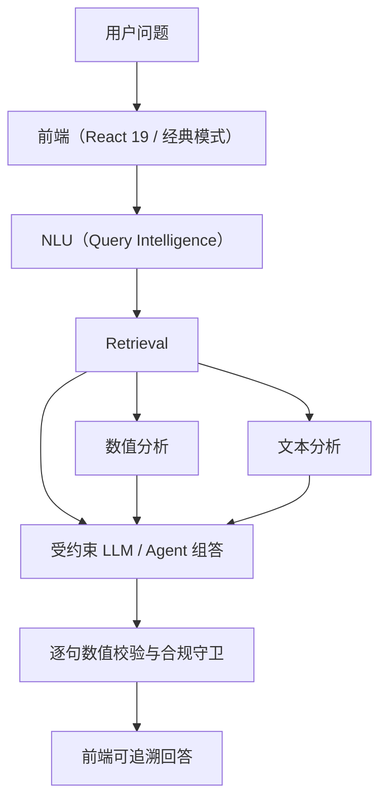

# FinSight 模块

语言：[English](../modules.md) | 中文

FinSight 由发表论文（*FinSight: An Evidence-First Financial Analysis Chatbot with Explainable Query Intelligence*，FAIA 第 433 卷 / DMI 2026，DOI：[`10.3233/FAIA261107`](https://ebooks.iospress.nl/doi/10.3233/FAIA261107)）提出的**五大基础模块**，以及在此之上扩展的**第六层 Agent 编排与校验层**组成。各模块职责边界清晰，通过显式类型化产物向下一阶段传递信息。

## 模块总览

| 模块 | 所属层次 | 职责 | 主要输出 | 详细文档 |
|---|---|---|---|---|
| 前端 | 论文核心 + Agent 工作台 | 浏览器交互（`frontend/` React 19 研究工作台及 `/chat` 经典流程）、实时执行轨迹与证据面板、指标卡片、声明核查界面与中英双语体验。 | Chat/Agent UI 状态、经校验的回答、引用标签、source cards。 | [本地网页 Chatbot](frontend-chatbot.md) |
| NLU 和 Retrieval | 论文核心 | 问题归一化、实体解析、意图/主题/问法分类、source plan、文档与结构化检索、证据排序和打包。 | `nlu_result`、`retrieval_result`、coverage、warnings、debug trace。 | [Query Intelligence](query-intelligence.md) |
| 数值分析 | 论文核心 | 将行情、基本面、估值、宏观和价格历史行转换为紧凑分析信号。 | `analysis_summary.market_signal`、`fundamental_signal`、`macro_signal`、`data_readiness`。 | [数值分析](numerical-analysis.md) |
| 文本分析 | 论文核心 | 清洗检索文档、检测语言、过滤实体相关句子并分类金融情感。 | `SentimentResult`、文档级 `SentimentItem`、实体聚合结果。 | [文档情感分析](sentiment.md) |
| LLM 总结和预测 | 论文核心 | 基于紧凑证据生成前端回答 JSON 和后续问题建议。 | `answer_generation`、`next_question_prediction`、引用和风险提示。 | [LLM 回答生成交接](llm-response.md) |
| Agent 层（编排与校验） | 论文后扩展 | 逐轮路由，把上述模块封装为 9 个类型化工具调用（确定性计划或 LLM 工具循环），逐句校验引用与数字，支持零 LLM 市场声明核查，执行合规守卫并维护会话记忆。 | 带工具调用、证据来源、校验报告与 trace id 的 `AgentChatResponse`。 | [Agent 层](agent.md) |

## 数据流

## 边界

- 前端不推断金融意图或 source plan，只发送用户输入并渲染返回证据。
- NLU 和 Retrieval 保持可解释，负责生产证据，不写最终投资回答。
- 数值分析只总结结构化证据，不声称因果预测。
- 文本分析只分类已检索文档，不独立检索新来源。
- LLM 总结与 Agent 组答只使用紧凑证据和 evidence ID，不编造缺失事实。

## 修改入口

| 任务 | 从这里开始 |
|---|---|
| 新增 endpoint 或契约字段 | `query_intelligence/contracts.py` 与 `schemas/`，然后同步更新 [Query Intelligence](query-intelligence.md) 和中英文根 README。 |
| 新增 source provider | `query_intelligence/integrations/`、retrieval source planning 和 provider 配置。 |
| 新增数值指标 | `query_intelligence/retrieval/market_analyzer.py`，然后更新 [数值分析](numerical-analysis.md)。 |
| 修改前端展示 | `frontend/src/`（执行 `pnpm build` 生成至 `query_intelligence/web/dist/`）、静态兜底页 `query_intelligence/web/static/` 与 `query_intelligence/chat/`，然后更新 [本地网页 Chatbot](frontend-chatbot.md)。 |
| 修改情感预处理或标签 | `sentiment/`（若涉及 Agent 工具同步检查 `query_intelligence/agent/tools/sentiment.py`），然后更新 [文档情感分析](sentiment.md)。 |
| 新增或修改 Agent 工具 | `query_intelligence/agent/tools/`，在 `tools/defaults.py` 注册，然后更新 [Agent 层](agent.md) 与评测任务。 |
| 修改 LLM JSON 输出 | `scripts/llm_response.py` 和 `/chat` 响应映射，然后更新 [LLM 回答生成交接](llm-response.md)。 |
