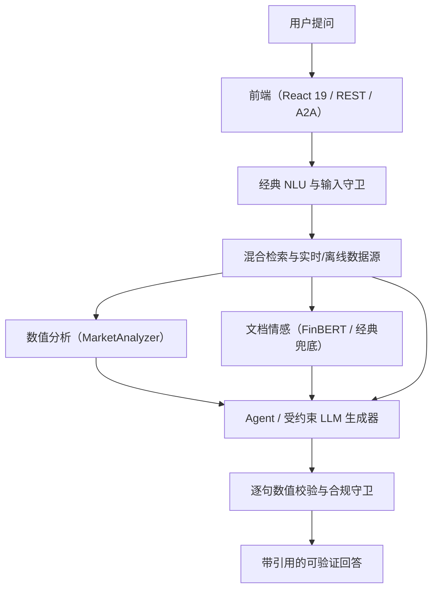

# 系统模块

语言：[English](../modules.md) | 中文

FinSight 由已发表论文中的**五个核心模块**（[DOI: `10.3233/FAIA261107`](https://ebooks.iospress.nl/doi/10.3233/FAIA261107)）以及其上的**第六层 Agent 编排与校验模块**组成。每个模块拥有清晰契约，仅消费上游类型化产物。

## 模块总览

| 模块 | 层次 | 核心职责 | 主要产出 | 详细文档 |
|---|---|---|---|---|
| **网页前端** | 论文 + Agent | React 19 工作台（`frontend/src/` → `query_intelligence/web/dist/`）与经典 `/chat` 界面；展示流式轨迹、引用证据、KPI 卡片与声明核查。 | 界面状态、可溯源回答视图、来源卡片 | [frontend-chatbot.md](frontend-chatbot.md) |
| **查询智能（Query Intelligence）** | 论文核心 | 经典 NLU（`query_intelligence/nlu/`）与混合检索（`query_intelligence/retrieval/`）：规范化、别名/CRF/纠错实体消歧、分类器、越界/澄清门控、Source Planner 与 LTR 排序。 | `NLUResult`、`RetrievalResult`、覆盖度、告警 | [query-intelligence.md](query-intelligence.md) |
| **数值分析** | 论文核心 | 基于已检索结构化行情、基本面与宏观数据计算技术指标与就绪度信号（`market_analyzer.py`）。 | `analysis_summary`（行情、基本面、宏观、数据就绪度） | [numerical-analysis.md](numerical-analysis.md) |
| **文档情感分析** | 论文核心 | 清洗检索文档、语种识别、按实体过滤相关句子，并执行逐句 FinBERT 或经典词典兜底推理（`sentiment/`）。 | `SentimentResult`、`SentimentItem`、`FilterMeta` | [sentiment.md](sentiment.md) |
| **受约束 LLM 交接** | 论文核心 | 基于压缩证据生成经校验的 `answer_generation` 与 `next_question_prediction` JSON（`scripts/llm_response.py`、`query_intelligence/chat/`）。 | 结构化回答 JSON、3 个推荐追问、风险提示 | [llm-response.md](llm-response.md) |
| **Agent 编排层** | 论文后扩展 | 路由简单/复杂问题、通过确定性规划器或 LangGraph 循环调用 9 个只读工具、逐句核对数字与引用、提供零 LLM 声明核查并持久化会话（`query_intelligence/agent/`）。 | `AgentChatResponse`、校验报告、Trace ID、MCP/A2A 响应 | [agent.md](agent.md) |

## 端到端数据流

## 边界约定

- **前端**仅发送问题并渲染返回证据，不重新推断意图或数据源计划。
- **Query Intelligence** 保持经典、可解释、仅产出证据，不直接生成买卖建议。
- **数值分析与文档情感**仅处理上游已检索证据，不隐式引入新的检索源。
- **Agent 与 LLM 生成层**将一切外部文档视为不可信数据，仅引用本次运行实际产出的 `evidence_id`，无 Key 或异常时自动回退至确定性模板。

## 修改入口速查

| 变更目标 | 起始路径 |
|---|---|
| 公共 API 契约与 Schema | `query_intelligence/contracts.py` 与 `schemas/*.schema.json` |
| NLU 规则、词表或模型 | `query_intelligence/nlu/`、`data/runtime/`、`training/` |
| 实时数据源与熔断器 | `query_intelligence/integrations/` |
| 技术/基本面指标 | `query_intelligence/retrieval/market_analyzer.py` |
| 情感预处理或分类器 | `sentiment/`、`query_intelligence/agent/tools/sentiment.py` |
| Agent 图、工具或校验器 | `query_intelligence/agent/`（`tools/defaults.py`、`verifier.py`、`output_safety.py`） |
| 前端界面 | `frontend/src/`（执行 `pnpm build` 更新 `query_intelligence/web/dist/`） |
