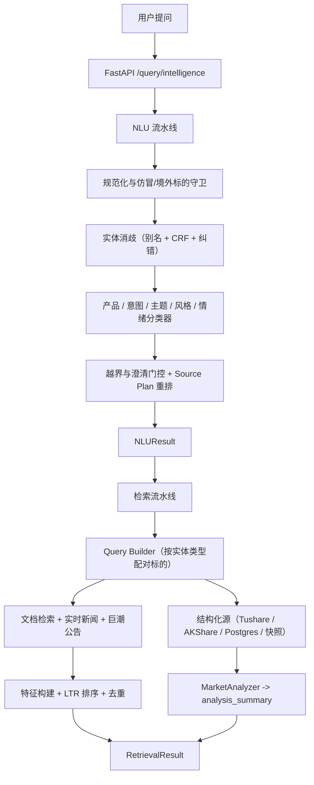

# Query Intelligence（查询智能核心）

语言：[English](../query-intelligence.md) | 中文

**Query Intelligence** 是 FinSight 论文核心的经典可解释机器学习后端（发表于 *Frontiers in Artificial Intelligence and Applications* 第 433 卷 / DMI 2026，IOS Press；DOI：[`10.3233/FAIA261107`](https://ebooks.iospress.nl/doi/10.3233/FAIA261107)）。

它将自然语言金融问题转化为两份显式、可审查的类型化 JSON 证据产物：

- **`NLUResult`**：规范化文本、实体消歧结果、产品类型、多标签意图与主题、提问风格、时间范围、缺失槽位、风险标记、数据源计划以及命中的规则与特征解释。
- **`RetrievalResult`**：实际执行的数据源、带稳定 `evidence_id` 的文档与结构化证据、覆盖度标记、告警、排序调试轨迹以及 `analysis_summary`。

> [!NOTE]
> **论文基准结果（`10.3233/FAIA261107`）**：在 10,000 条中英双语查询（6,236 条金融域 + 3,764 条越界）上，Query Intelligence 取得金融召回率 **0.975**、越界拒答准确率 **0.9729**、意图 micro-F1 **0.9407**、主题 micro-F1 **0.9208**、检索 Recall@10 **0.9664**，并通过 **32/32** 端到端契约模糊测试。

## 范围与架构

默认覆盖中国金融市场：A 股股票、ETF/公募基金、主要指数、行业板块与宏观政策指标。非金融或超出覆盖范围的查询在检索与 LLM 调用前即标记 `out_of_scope`。

NLU 与检索主链路坚持**经典可解释方法**（规则、词表、TF-IDF、线性/树模型、CRF、LTR 与 PostgreSQL 全文检索）。下游模块（[数值分析](numerical-analysis.md)、[文档情感](sentiment.md)、[受约束 LLM 交接](llm-response.md) 与 [Agent 层](agent.md)）直接消费上游契约，不重复推断意图或标的。

## 核心代码路径

| 路径 | 职责 |
|---|---|
| `query_intelligence/service.py` | 端到端 NLU + 检索编排 |
| `query_intelligence/contracts.py` | Pydantic 契约（同步导出至 `schemas/*.schema.json`） |
| `query_intelligence/config.py` | 环境变量驱动配置 |
| `query_intelligence/data_loader.py` | 运行时实体、别名、语料与快照加载器 |
| `query_intelligence/nlu/` | 规范化、实体/别名/CRF/仿冒名消歧、分类器、Source Planner |
| `query_intelligence/retrieval/` | 查询构建、文档/结构化检索、LTR 排序、`MarketAnalyzer` |
| `query_intelligence/integrations/` | Tushare、AKShare、巨潮资讯与 efinance 适配层 |

## API 入口

| 接口 | 输入 | 输出 |
|---|---|---|
| `POST /nlu/analyze` | `AnalyzeRequest` | `NLUResult` |
| `POST /retrieval/search` | `RetrievalRequest` | `RetrievalResult` |
| `POST /query/intelligence` | `PipelineRequest` | `PipelineResponse`（`nlu_result` + `retrieval_result`） |
| `POST /query/intelligence/artifacts` | `ArtifactRequest` | 产物文件路径（`query.txt`、`nlu_result.json`、`retrieval_result.json`、`manifest.json`） |

`query` 长度限制为 1–2,000 字符，`top_k` 为 1–100（默认 `20`），生产环境保持 `debug: false`。

## 核心契约

### `NLUResult`

| 字段 | 说明 |
|---|---|
| `query_id`、`raw_query`、`normalized_query` | 贯穿全链路的 UUID 及原始/规范化文本 |
| `product_type` | 单标签：`stock`、`etf`、`fund`、`index`、`macro`、`generic_market`、`unknown`、`out_of_scope` |
| `intent_labels[]` | 多标签：`price_query`、`market_explanation`、`hold_judgment`、`buy_sell_timing`、`product_info`、`risk_analysis`、`peer_compare`、`fundamental_analysis`、`valuation_analysis`、`macro_policy_impact`、`event_news_query`、`trading_rule_fee` |
| `topic_labels[]` | 多标签：`price`、`news`、`industry`、`macro`、`policy`、`fundamentals`、`valuation`、`risk`、`comparison`、`product_mechanism` |
| `question_style` | `fact`、`why`、`compare`、`advice`、`forecast` |
| `entities[]` | `mention`、`entity_type`、`canonical_name`、`symbol`（`^[A-Za-z0-9._-]+$`，≤64 字符）、`exchange`、`match_type`、`confidence` |
| `comparison_targets[]`、`keywords[]` | 对比对象与检索关键词 |
| `time_scope`、`forecast_horizon`、`sentiment_of_user`、`operation_preference` | 时间窗口、期限、用户情绪与操作倾向 |
| `required_evidence_types[]`、`source_plan[]` | 所需证据类型与有序数据源计划 |
| `risk_flags[]`、`missing_slots[]` | 风险与澄清信号（`investment_advice_like`、`out_of_scope_query`、`entity_not_found`、`clarification_required`、`missing_entity`、`comparison_target`） |
| `confidence`、`explainability` | 综合置信度、命中规则与模型 Top 特征 |

### `RetrievalResult`

| 字段 | 说明 |
|---|---|
| `query_id`、`nlu_snapshot`、`executed_sources[]` | 关联标识与实际执行源列表 |
| `documents[]` | 排序后的 `news`、`announcement`、`research_note`、`faq`、`product_doc`，含 `evidence_id`、`source_url`、`publish_time`、`rank_score`、`reason[]` |
| `structured_data[]` | `market_api`、`fundamental_sql`、`industry_sql`、`macro_sql`、`fund_*`、`index_*`、`macro_indicator`、`policy_event`，含 `provider_endpoint`、`source_reference`、`as_of`、`quality_flags`、`payload` |
| `evidence_groups[]`、`coverage`、`coverage_detail` | 去重分组与粗/细粒度覆盖度标记 |
| `warnings[]` | 如 `out_of_scope_query`、`clarification_required_missing_entity`、`announcement_not_found_recent_window` |
| `analysis_summary` | 预计算的技术面、基本面、宏观与数据就绪度摘要（见 [numerical-analysis.md](numerical-analysis.md)） |
| `retrieval_confidence`、`debug_trace` | 检索置信度与候选排序调试信息 |

## 常用环境变量

| 变量 | 默认值 | 说明 |
|---|---|---|
| `TUSHARE_TOKEN` | 空 | 启用 Tushare 日线、财务与新闻接口 |
| `QI_POSTGRES_DSN` | 空 | PostgreSQL 结构化与全文检索连接串 |
| `QI_USE_LIVE_MARKET` / `_NEWS` / `_ANNOUNCEMENT` / `_MACRO` | 核心 CLI `false` / 服务默认 `true` | 控制实时源开关 |
| `QI_USE_POSTGRES_RETRIEVAL` | `false` | 启用 PostgreSQL 检索 |
| `QI_HTTP_TIMEOUT_SECONDS` | `15` | 外部数据源 HTTP 超时秒数 |
| `QI_MODELS_DIR` | `models` | 随仓 `.joblib` 模型与 `manifest.json` 路径 |
| `QI_ENTITY_MASTER_PATH`、`QI_ALIAS_TABLE_PATH`、`QI_DOCUMENTS_PATH` | 自动 | 覆盖 `data/runtime/` 运行时资产 |

**运行时加载优先级**：显式环境变量 → `data/runtime/*` → `data/*`。

## 常见问题排查

| 现象 | 处理建议 |
|---|---|
| 训练过的股票在运行时无法识别 | 执行 `python -m scripts.materialize_runtime_entity_assets` 刷新 `data/runtime/` |
| 结构化记录的 `source_url` 为空 | 纯 API 数据属正常现象，改用 `provider_endpoint`、`query_params` 与 `source_reference` 溯源 |
| `executed_sources` 少于 `source_plan` | 检查实时源开关、Token、标的映射或越界/澄清短路 |
| 生产环境仅返回种子数据 | 开启实时源或配置 `QI_POSTGRES_DSN` 并校验凭据 |
