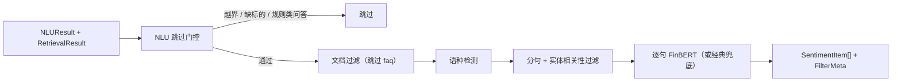

# 文档情感分析

语言：[English](../sentiment.md) | 中文

`sentiment/` 是 FinSight 论文架构的下游文本情感模块（[DOI: `10.3233/FAIA261107`](https://ebooks.iospress.nl/doi/10.3233/FAIA261107)），直接消费 `NLUResult` 与 `RetrievalResult`，对检索文档输出 `positive`、`negative` 或 `neutral` 金融倾向判断。同时通过 `analyze_sentiment` 工具（`query_intelligence/agent/tools/sentiment.py`）暴露给 Agent 与 MCP 客户端，并在缺少 FinBERT 权重或离线环境下自动回退至 `ClassicalSentimentBackend`。

## 处理流程



## 过滤与预处理规则

- **查询级跳过**：当 `product_type == "out_of_scope"`、`risk_flags` 含 `out_of_scope_query`、`missing_slots` 含 `missing_entity`，或意图仅为 `product_info` / `trading_rule_fee` 时直接跳过。
- **支持文档类型**：分析 `news`、`announcement`、`research_note`、`product_doc`，跳过 `faq`；无正文时自动使用标题+摘要短文本（`text_level: "short"`）。
- **语种与分句路由**：识别中、英或混合文档（优先 `lingua-language-detector`，缺省按字符比例回退），按实体名称/代码筛选相关句子（未命中时回退至标题+首句），分别路由至中文金融 FinBERT 或 `ProsusAI/finbert` 逐句推理并聚合至文档级别。

## 使用示例

```bash
# 通过手工查询脚本启用情感分析
python manual_test/run_manual_query.py --query "贵州茅台近期有什么新闻？" --sentiment
python manual_test/run_manual_query.py --query "贵州茅台近期有什么新闻？" --sentiment --real-models

# 独立运行情感测试脚本
python manual_test/run_sentiment_test.py --input manual_test/output/<run-dir>
```

```python
from sentiment import Preprocessor, SentimentClassifier

skip_reason, docs, filter_meta = Preprocessor().process_query(nlu_result, retrieval_result)
if not skip_reason:
    items = SentimentClassifier().analyze_documents(docs)
```

## 输出字段

- **`SentimentItem`**：`evidence_id`、`source_type`、`title`、`publish_time`、`source_name`、`entity_symbols[]`、`sentiment_label`（`positive|negative|neutral`）、`sentiment_score`（`0.0–1.0`）、`confidence`、`text_level`（`full|short`）、`relevant_excerpt`、`rank_score`。
- **`FilterMeta`**：`skipped_by_product_type`、`skipped_by_intent`、`skipped_docs_count`、`short_text_fallback_count`、`analyzed_docs_count`。

## 测试命令

```bash
python -m pytest -q tests/test_sentiment_preprocessor.py tests/test_sentiment_classifier.py tests/test_sentiment_pipeline.py
```
